# Phases 1–4 — results

**Date:** 2026-10-11, 00:xx  
**Code:** `honor_well.py` (core), `run_phases_1_4.py` (experiments, 111 s on this machine). Numbers in `results_1_4.json`; events appended to `session.jsonl`.  
**Reading guide:** each item states the prediction from the game plan, what the run did, and a verdict: **holds**, **holds with a change**, **does not hold**, or **artifact** (the model did something the rules caused rather than the world). Artifacts are the most useful rows; they are where the rules need the user.

---

## Phase 1 — the field is honest

**1.1 Point load against \(K_0\).** Relaxed wave equation with a Dirichlet rim on a 48-wide field, \(w=1\), \(r=0.25\), \(\lambda=\sqrt3\). Between \(2\lambda\) and \(6\lambda\) the simulated depth is within **1.9% max, 0.5% mean** of \(\frac{w}{2\pi T}K_0(\rho/\lambda)\). **Holds** (target was <2%). 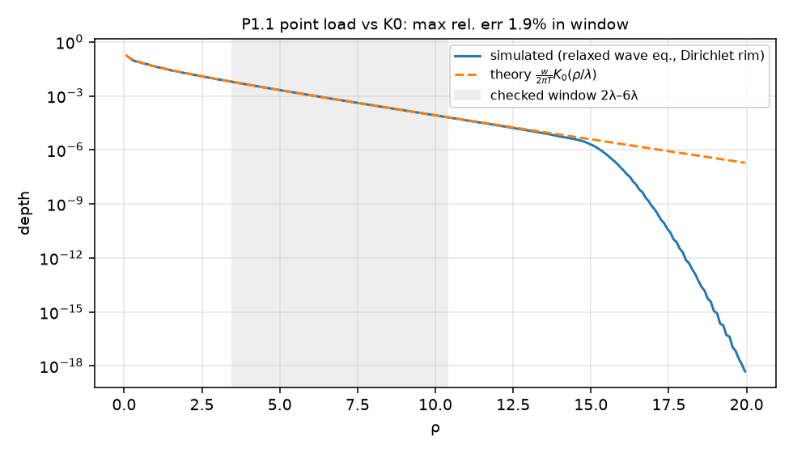

**1.2 A real edge.** The rim is pinned at \(z=0\). A well of the same ball at the centre, 3 units from the edge, and 1.4 from the edge: peak depth 0.46 → 0.45 → 0.40; captured area (depth > 0.25) 3.51 → 3.28 → 2.03. **Holds**: a code pressed against the edge of the field is shallower on the edge side and holds 40% fewer. The edge is where the membrane cannot give. 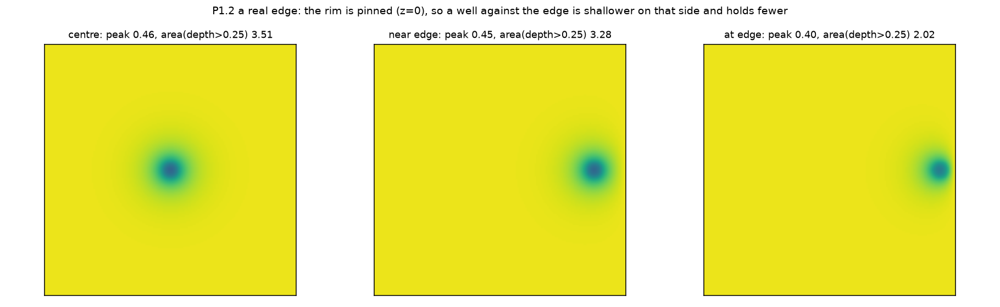

**1.3 Cohesion sweep \(T \in \{0.5 … 12\}\), fixed \(w=6\).** Prediction was "outcast fraction falls as \(T\) rises." **Does not hold, and the reason matters.** Peak depth falls as \(T\) rises (1.41 → 0.17) because the same weight is spread over a wider \(\lambda\); captured area falls monotonically (6.3 → 0); outcast fraction stays ≈0.79 up to \(T=5\) and goes to 1.0 at \(T \ge 8\) when the floor (0.23) drops under the demand (0.25). Raising cohesion at fixed weight makes a code *felt farther and held shallower*. For a code to capture at high cohesion it must get heavier in proportion. The reflection's line that "the internet raised \(T\)" stands for displacement and for splash travel; for capture it needs the second clause: the balls that survive at high \(T\) are the heavy ones. 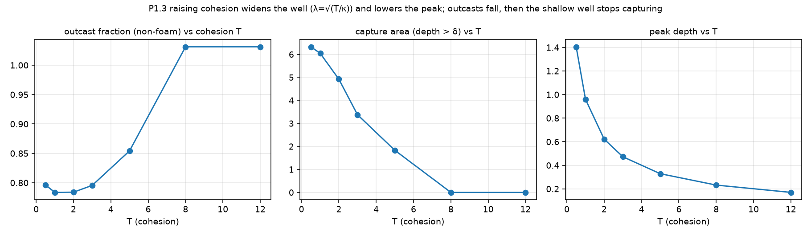

**1.4 Regional cohesion.** Two high-\(T\) clans (6.0) joined by a corridor in a low-\(T\) (0.6) background; ball in the left clan. At equal distance 5 from the ball, depth on the corridor is **2.5×** depth off it (0.023 vs 0.009); at the far clan's centre, 10 away, 0.001. **Holds**: wells follow cohesion corridors and stop at low-cohesion gaps. The absolute values are small because the background is soft; the ratio is the result. 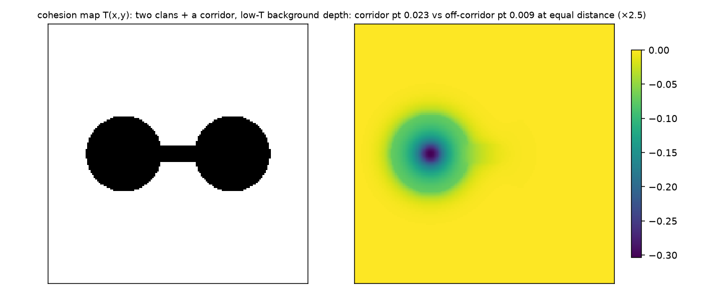

**1.5 Convergence.** Grid 96→192 and timestep 0.02→0.01: mean |Δ| in outcast fraction 0.0007, in surface depth 0.0005. **Holds.** 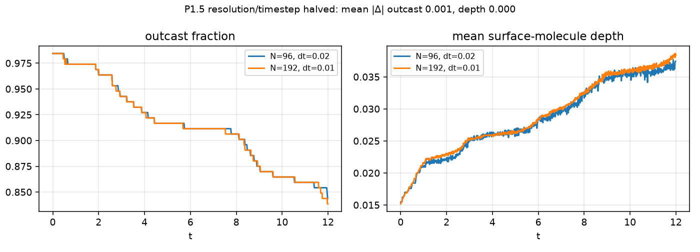

## Phase 2 — the ball has physics

**2.1 The crowd pushes the ball.** Crowd piled at (4, 2); ball at origin with inertia ∝ \(w\), drag ∝ \(r\). Ball rolled **4.94** units to (4.49, 2.05). **Holds**: the code follows the mass. 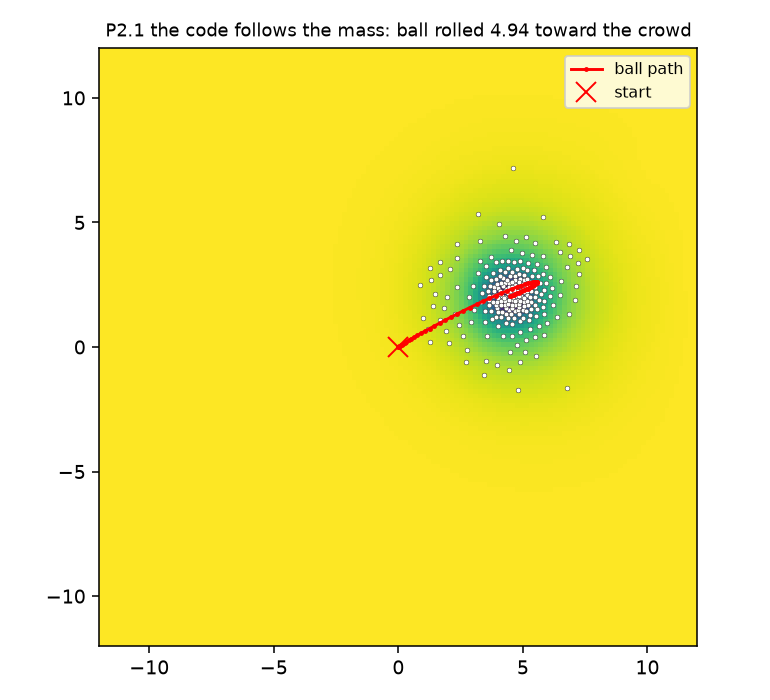

**2.2 Radius as a process.** Government ball (rate 0.05, target 1.6) went 0.80 → 1.36 over 24 time units; influencer ball (rate 0.6, random retargets) wandered 0.81–1.21. **Holds** as specified. **2.3a Rivals** (different camps) repelled from 8.0 apart to 13.1. **2.3b Aligned** balls (same camp, \(w\) 6 and 4) merged at step 167 into one of \(w=10\), \(r=1.13\) (footprint areas add). **Holds.** 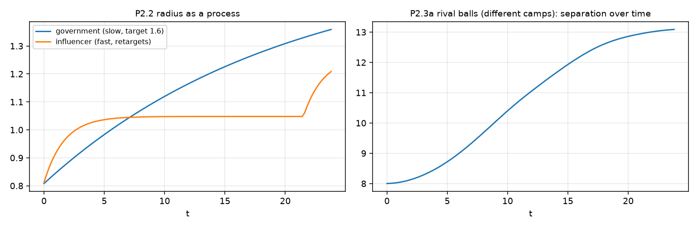

**2.4 Bowling balls become more static.** Same crowd push: at \(r=0.5\), displacement 5.7 / 3.3 / 1.7 for \(w\) = 2 / 6 / 12 — **holds in weight**. At \(r=2.0\): 4.4 / 4.2 / 4.3, flat — **does not hold in radius as implemented**, because the crowd force collects molecules within ~2.5\(r\), so a wider ball is pushed by more people and the extra drag is cancelled. Whether a broad code is pushed by more people or the same people is a modelling decision (report §10 should gain a sixth item). 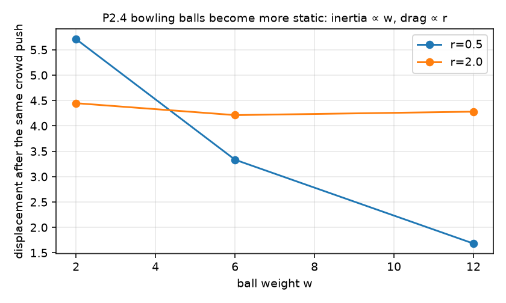

## Phase 3 — the trap closes

**3.1 Demand ratchet \(\delta = \delta_0 + \chi\,\overline{d}_{\text{in}}\).** Ball narrowing slowly (1.6 → 0.5) to offer more depth; \(\chi \in \{0, 0.5, 1\}\). Mean depth rose roughly linearly (early slope 0.0029, late 0.0035; no exponential phase). With \(\chi = 0.5\) the demand climbed to 0.52 and the inside fraction fell to **3%**; with \(\chi = 1.0\) to 0.77 and **0%**. Reward never went below −0.001 because depth only ever increased. Two findings: (a) **the ratchet empties the inside** — a code whose demand tracks its insiders' depth outruns the depth it can supply and ejects its own members; (b) **artifact**: once the inside is empty, \(\delta\) freezes at its last value (nobody inside to update it) and the lock-out is permanent. A real code softens when it has no members. Rule change for the next pass: \(\dot\delta = \chi(\overline{d}_{\text{in}} - \delta) - \mu(\delta - \delta_0)\), with relaxation \(\mu\). (c) The linear-then-exponential dose did **not** appear and cannot in this version: molecules can only descend a well that exists; they cannot *dig*. Escalation needs a molecule to add load (conformity that deepens the well under itself, the performative term), and that is the one mechanism the derivation describes that the model does not yet contain. 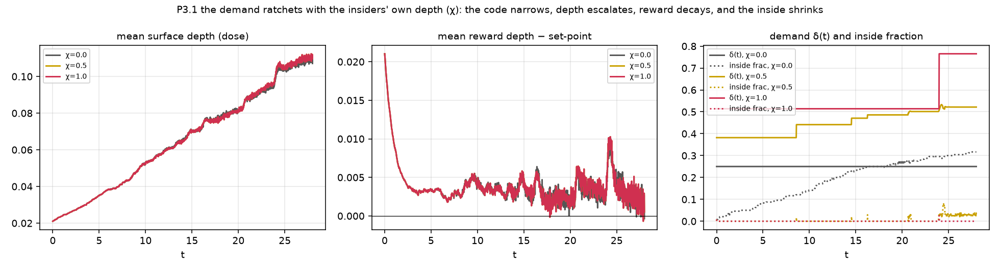

**3.2 Tolerance rates.** \(\eta_i\) lognormal (σ = 0.8). Only 7 molecules were trapped in this scenario (no ball jump, see 3.1c), correlation of \(\log\eta\) with time of first trap −0.29. **Holds weakly, right sign**: faster tolerance, earlier trap; needs the jumping scenario for power. 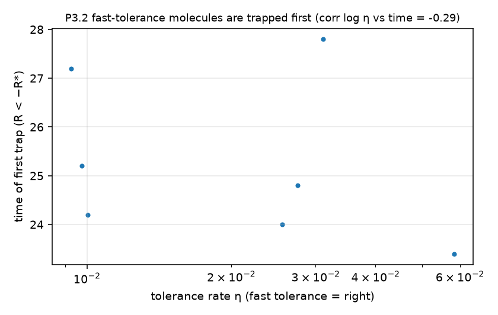

**3.3 Relapse.** Influencer ball with 7 jumps over 48 time units. Relapses (trapped, then back inside within 150 steps): surface 72 (of ~110), planner 89 (of 48 → 19), deep 77 (of 36 → 52). Per head, **planners relapse most**, consistent with Phase 0 (highest set-points, deepest fall, fastest return). **Holds.**

**3.4 Belief loss on the floor.** 279 anchors dropped over the run; **19 of 48 planners** reached zero anchors and became deep swimmers. **Holds**: long conformity converts the planner into the swimmer, and the swimmers are then the fastest to relocate at the next jump (final kinds: 124 surface, 19 planner, 52 deep, 45 foam). 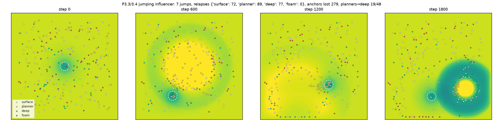

## Phase 4 — foam

**4.1 Dissolution vs splash.** Foam-heavy population (50%). Splash amplitude 0 / 0.6 / 1.2 / 2.4 → foam dissolved **0 / 5 / 10 / 26**. Zero without a wave; monotone with wave size. **Holds.** 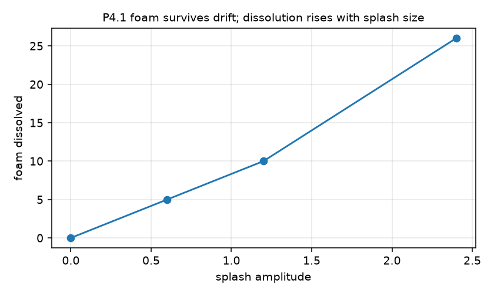

**4.2 Foam mass (user decision pending).** Weightless foam: outer depression beyond radius 6 is 0.006. Foam of mass 0.08 each: 0.023 (×4), peak depth unchanged (0.47 → 0.48), outcast fraction unchanged (0.82 → 0.82). So slight foam mass presses the edges down and shallows the gradient leaving the well, without changing who is inside. The choice is between a field that convictions leave alone and a field whose rim is lowered by the people who sit on it. 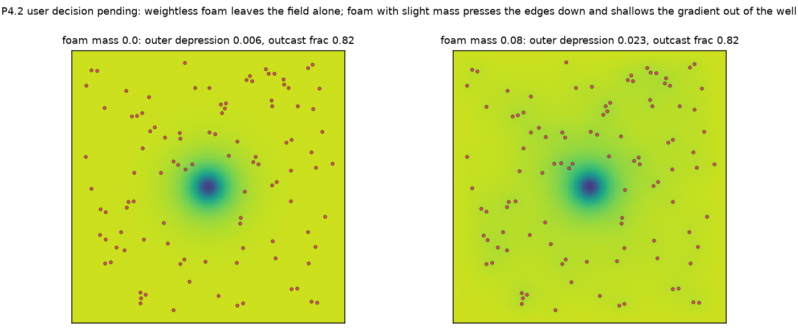

**4.3 Rafts.** Before any jump: centre rafts larger (2.8) than edge rafts (1.6). After 4 jumps: edge rafts **3.5** (138 foam at the edge), centre rafts 1.9 (17 foam left in the centre). **Holds**: splashes break central rafts and the survivors accumulate at the edge in larger rafts. "The edges are safe, but isolated" is now a measured population shift.

**4.4 Refloat (the Aslama cycle).** 51 foam dissolved, **95 refloated**, 190 anchors lost over the run; the foam population *grew* from ~108 to 155. **Artifact, partly**: the refloat rule (zero anchors and \(R<0\) for 200 steps) fires on the slight negative reward every settled molecule has, so it manufactures convictions out of boredom. The intended cycle is surrender → reconstruction → *one* new fixed point under real deficit; the rule should require \(R < -R_\ast\) (a real deficit) and should be rare. The direction is right: the molecules that lose all anchors are the ones that later re-float, which is the derivation's claim that the deep swimmer is the pre-form of a new conviction. 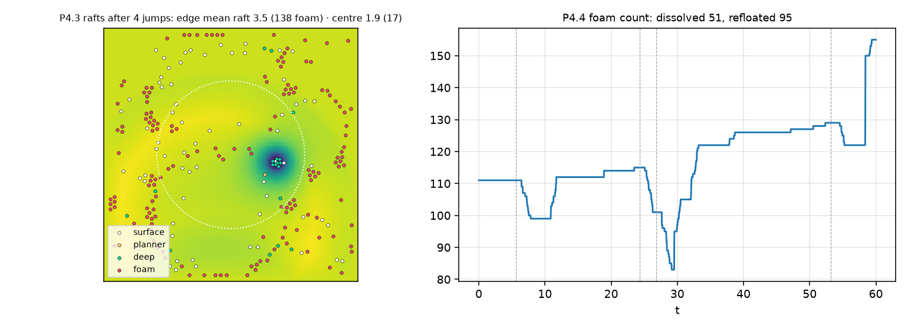

## Scorecard

| Item | Verdict |
|---|---|
| 1.1 \(K_0\) | holds (1.9%) |
| 1.2 edges | holds |
| 1.3 cohesion sweep | does not hold as predicted; higher \(T\) = farther and shallower; capture needs \(w \propto T\) |
| 1.4 corridors | holds (×2.5) |
| 1.5 convergence | holds |
| 2.1 crowd pushes ball | holds |
| 2.2 radius process | holds |
| 2.3 repel / merge | holds |
| 2.4 static in \(w\) | holds; static in \(r\) depends on how many people push a wide ball (decision) |
| 3.1 ratchet | empties the inside (finding); frozen \(\delta\) lock-out (artifact); no exponential without digging (missing mechanism) |
| 3.2 tolerance order | holds weakly |
| 3.3 relapse by kind | holds; planners most |
| 3.4 belief loss → swimmers | holds |
| 4.1 dissolution | holds |
| 4.2 foam mass | measured; decision his |
| 4.3 rafts | holds |
| 4.4 refloat | direction holds; rule over-fires (artifact) |

## Rule changes queued for the next pass

1. Demand relaxes: \(\dot\delta = \chi(\overline{d}_{\text{in}} - \delta) - \mu(\delta - \delta_0)\).
2. Molecules can dig: a conformist adds load \(m_c\) at its own position while inside (performative conformity). This is the term that should produce the linear-then-exponential dose when combined with the ratchet, and it should be tested against Phase 0's result that planners fall furthest.
3. Refloat requires a real deficit \(R < -R_\ast\) sustained, and a low rate.
4. Crowd force on the ball: per-capita (same people) or per-footprint (more people) — the user chooses.
5. At high cohesion, scale ball weight with \(T\) when comparing societies, or report both depth and reach separately.
