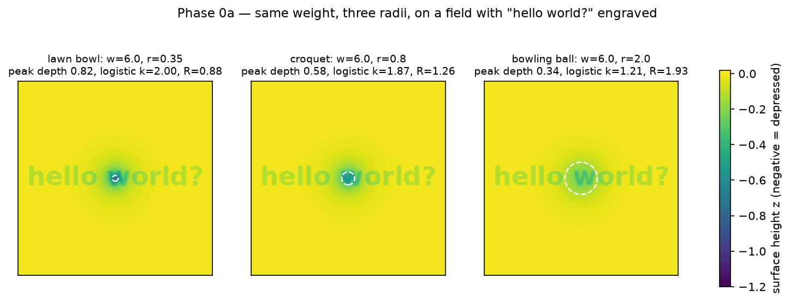
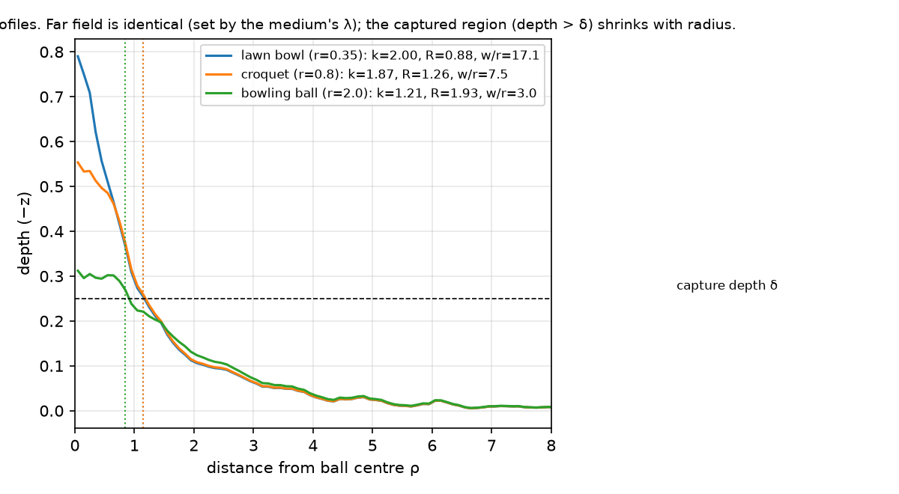
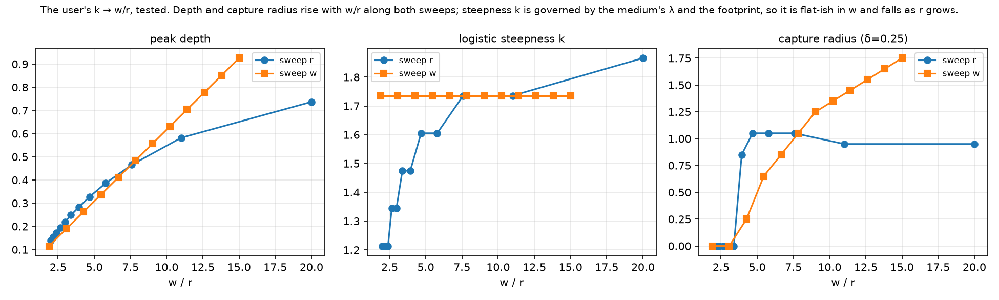
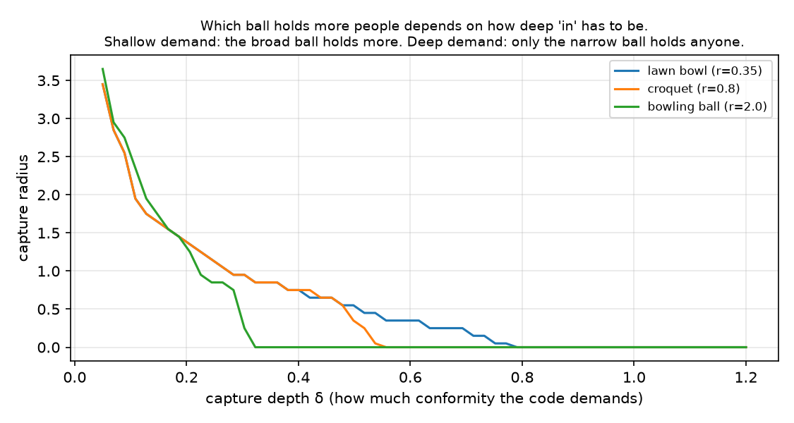
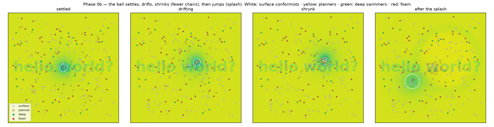
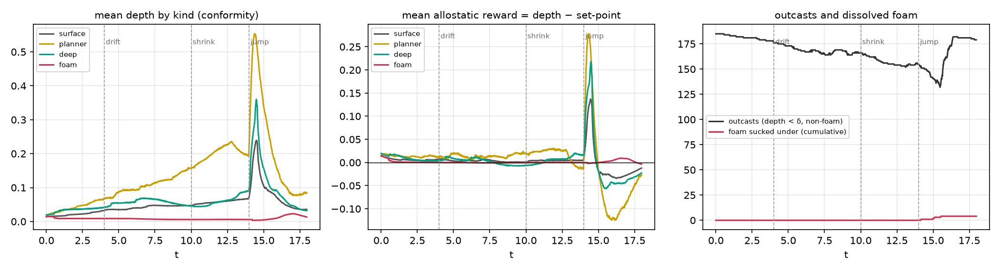

# Report — the Honor Well: grounding the fluid-mattress derivation in math and a simulable system

**Date:** 2026-10-10  
**Source:** Dylan McCapes's derivation of 2026-10-10 (honor code as a ball on a fluid mattress; molecules, foam, waves, musical chairs, the neuroadaptive allostatic trap). This report translates each element into equations, states which claims the math supports as written, which it supports in a modified form, and which remain open, and reports the Phase 0 "hello world?" run.  
**Companion files:** `GAMEPLAN_HONOR_WELL_SIM_20261010.md` (phases), `REFLECTION_HONOR_WELL_20261010.md` (what the model is for), `hello_world_well.py` (Phase 0 code), `session.jsonl` (run log), `p0a_sweep.csv`, `figures/`.  
**Convention:** the user's words are quoted; the math is ours; disagreements are stated as results, not softened.

---

## 1. The derivation, in his terms

A three-dimensional space "like a fluid mattress cushion" viewed from above. An **honor code** is a ball on it. The ball "decides what to be ashamed of and why you are guilty." A **lawn bowl** (small radius, heavy) makes a deep well whose influence spreads far; a **bowling ball** of the same weight spreads the mass and makes "a shorter radius of displacement." Proposed: the profile is a logistic decay in distance with steepness \(k \to w/r\).

The people are **molecules** with `location {x,y,z}` and `beliefs[]` below \(z\). "Rest is surface level." **Conformity requires depth.** The fluid rushes toward "not just the ball's x,y but where the ball is heading." The ball "may change radius at any time" (government, influencer). Bowling balls "become more static." "If you are not inside the well you are outcast. It is musical chairs."

**Convictions are foam.** Foam sits on top while the fluid moves below; "only a splash or wave can suck the foam under which may lead to dissolution." Foam drifts to the edges: "safe, but isolated."

Agents differ: some abstain (foam), some "plot ahead" (belief-oriented planners), some "dive deep to swim faster through highly fluid thought space (abandon beliefs)." Crowd propulsion as at concerts, home-run scrambles, crowd surfing.

And the engine: "It is the neuroadaptive allostatic trap," imported from his 7-OH account: dose trajectory linear-plus-exponential, reward following a logistic decay from above baseline to a sharp drop below it, then the addict "trapped," heading "back to the gas station."

## 2. The field: a membrane on a fluid foundation

The fluid mattress is modelled as a thin tensioned membrane resting on a restoring fluid. Surface height \(z(x,y,t)\), negative = depressed.

\[
\partial_t^2 z \;=\; c^2 \nabla^2 z \;-\; \kappa\, z \;-\; \gamma\, \partial_t z \;-\; p(x,y,t)
\]

- \(c^2\) (= tension \(T\) per unit density): **cohesion**, how strongly a point's height is coupled to its neighbours'. High \(T\) = a society in which your standing is pulled by the people next to you.
- \(\kappa\): **restoring stiffness**, the pull back to one's own level. High \(\kappa\) = people who return to their own position when the load passes.
- \(\gamma\): damping, how quickly waves die.
- \(p\): the load. A ball of weight \(w\) on footprint radius \(r\) is a uniform pressure \(w/\pi r^2\) inside the disc.

The static solution (\(\partial_t = 0\)) is \(T\nabla^2 z - \kappa z = p\), solved exactly on a grid by FFT: \(\hat z = -\hat p / (T|\mathbf{k}|^2 + \kappa)\). This is the Winkler-foundation / floating-ice-sheet problem; a point load gives the modified Bessel profile \(K_0(\rho/\lambda)\) with

\[
\lambda = \sqrt{T/\kappa}
\]

the **decay length of the medium**. This is the first result and it changes one line of the derivation: *the reach of a well is a property of the crowd, not of the ball.* The ball sets depth and footprint; the medium sets how far depth is felt.

## 3. Lawn bowl versus bowling ball

Same weight \(w=6\), radii 0.35 / 0.8 / 2.0, medium \(\lambda = \sqrt{3}\). Each radial profile was fitted with his form \(d(\rho) = D / (1 + e^{k(\rho - R)})\).

| ball | \(r\) | \(w/r\) | peak depth \(D\) | logistic \(k\) | logistic \(R\) |
|---|---|---|---|---|---|
| lawn bowl | 0.35 | 17.1 | 0.83 | 2.00 | 0.88 |
| croquet | 0.80 | 7.5 | 0.58 | 1.74 | 1.26 |
| bowling ball | 2.00 | 3.0 | 0.34 | 1.21 | 1.93 |

Sweeps (`p0a_sweep.csv`, `figures/p0a_k_vs_w_over_r.png`):

**What holds as written.** Smaller radius at equal weight → deeper well, steeper wall, higher \(k\). "The level is lower for the lawn ball" holds. The bowling ball's floor is flat and shallow; the ball's own curvature "fits the asymptotic leveling phase" in the sense that \(R \approx r\): the logistic's shoulder sits at the footprint edge.

**What holds in a modified form.** \(k \to w/r\). In a linear medium the *shape* parameter \(k\) depends on \(r/\lambda\) only; weight scales the amplitude and leaves \(k\) untouched (the "sweep w" rows: \(k = 1.736\) for every \(w\)). What a molecule actually feels is the gradient, the slope of the wall, which at the inflection is \(\approx Dk/4\). \(D\) grows with \(w\) and shrinks with \(r\); \(k\) shrinks with \(r\). So the **wall slope** scales like \(w/r\) to within the medium's spreading factor. His \(k\) is our \(Dk\): the force, not the shape. The intuition is right about the thing that moves people.

**What does not hold as written, and why that is the more interesting result.** "Shorter radius of displacement" for the bowling ball. The far field of every ball of weight \(w\) is identical (superposition: from far enough away, a disc looks like a point). So *displacement* reaches as far for both. What differs is the **captured region**, defined by his own premise "conformity requires depth": the set of points where depth exceeds a demand \(\delta\).

| capture depth \(\delta\) | lawn bowl | croquet | bowling ball |
|---|---|---|---|
| 0.10 | 2.15 | 2.25 | **2.55** |
| 0.25 | 1.15 | 1.15 | 0.85 |
| 0.50 | **0.55** | 0.35 | 0 |
| 0.80 | 0.05 | 0 | 0 |

When the code demands little (\(\delta\) small), the broad shallow ball holds *more* people, because its flat floor keeps a wide area just over the line. When the code demands a lot, only the narrow heavy ball holds anyone, and few. So the claim is true conditional on the demand: **a bowling ball is a broad, shallow conformity; a lawn bowl is a narrow, deep one.** Which one "spreads farther" depends on how deep "in" has to be. That reads directly onto his two-society observation (an honor code that captures nearly everyone shallowly, with a shame code underneath it that captures a few deeply) and it is a prediction the model makes that the prose did not.

### 3.1 Surface connection, displaced fluid, and curvature (added after the user's review)

The user's follow-up: the bowling ball has more *surface connection*; the elastic fluid transforms more easily under its stress; it has to *displace more fluid*; the difference is in the membrane's displacement curvature.

Integrate the static equation over the whole field. The tension term integrates to zero (no net curvature over a closed surface), leaving \(\kappa \int (-z)\,dA = \int p\,dA = w\). So

\[
V_{\text{displaced}} = \frac{w}{\kappa}
\]

for every radius. This is Archimedes on a foundation: **the two balls displace exactly the same fluid**. The bowling ball does not displace more; it displaces the same volume spread over a larger area and therefore shallower. That one clause of the follow-up does not track, and the rest tracks for the reason the numbers show.

What differs is **who carries the load**. The weight is balanced partly by the foundation directly under the footprint (\(\kappa z\) inside the disc) and partly by tension in the membrane transmitting it outward (\(T\nabla^2 z\)) to foundation beyond the disc. Computed at \(w = 6\), \(\lambda = 1.73\):

| \(r\) | \(V\) displaced | load carried under the footprint | load carried by tension to the surroundings | max curvature \(|\nabla^2 z|\) | peak depth |
|---|---|---|---|---|---|
| 0.35 (lawn bowl) | 6.00 | 4% | **96%** | 5.07 | 0.71 |
| 0.8 | 6.00 | 13% | 87% | 0.90 | 0.46 |
| 2.0 (bowling ball) | 6.00 | 37% | 63% | 0.12 | 0.22 |
| 4.0 (raft) | 6.00 | 60% | 40% | 0.03 | 0.09 |

So: the lawn bowl barely touches the fluid directly. It hangs almost entirely in the membrane, which has to curve sharply (curvature 5 vs 0.12) to generate the restoring tension, and that tension is what carries the weight outward to a region of size \(\lambda\). That is the physics behind the user's original intuition that the small heavy ball's influence "spreads farther": it has to recruit the surrounding membrane to hold it up. The bowling ball, with more surface connection, sits on the fluid; the foundation under it takes a third of the weight directly, the membrane needs little curvature, and less of the load is exported. "The elastic fluid transforms easier under stress" is the right description of the broad case: low curvature, low membrane strain, the fluid beneath doing the work. Take \(r \to \infty\) and it becomes a raft: all load under the footprint, zero curvature, depth \(w/\kappa\pi r^2\).

The social reading writes itself. A narrow heavy code is carried by the *surrounding* people, through their coupling, and bends them; a broad code rests on the people under it and bends almost nobody. Curvature is strain on the membrane, and strain is where molecules feel the pull.

One more thing the follow-up points at that the linear model cannot show: if the membrane is **strain-stiffening** (tension rises with slope, which real elastic sheets do), the lawn bowl's sharp wall stiffens against it and it cannot go as deep as the linear solution says, while the bowling ball, at low strain, is unaffected. That is the literal content of "transforms easier under stress" and it is a one-line change to the solver (\(T \to T(|\nabla z|)\)) for Phase 1.

## 4. Molecules

Each molecule \(i\): position \(\mathbf{x}_i\), depth \(d_i = -z(\mathbf{x}_i)\), belief count \(b_i\) (anchors below the surface), kind \(\in\) {surface, planner, deep, foam}, allostatic set-point \(s_i\).

Motion is first-order (overdamped, as in Helbing's social-force models for crowds):

\[
\dot{\mathbf{x}}_i = \mu_i \Big[ -\alpha_i \nabla z(\mathbf{x}_i) \;+\; \beta_i\, \hat{\mathbf{u}}_i \;+\; \sum_{j} \mathbf{f}_{ij} \Big], \qquad \mu_i = \frac{\mu_0}{1 + c_b\, b_i}
\]

- \(-\alpha \nabla z\): downhill toward the well (gradient descent on the surface; the force in §3).
- \(\hat{\mathbf{u}}_i\): for **planners**, the unit vector toward the ball's *predicted* position \(\mathbf{p}(t+\Delta)\). This is "the fluid rushes toward where the ball is heading." Surface molecules have \(\beta = 0\); they follow the slope they stand on.
- \(\mathbf{f}_{ij}\): soft repulsion when closer than a body radius. **Crowd propulsion**: a full well floor pushes latecomers up the wall, and a packed crowd pushed from one side surges on the other (the stadium scramble).
- \(\mu_i\): mobility falls with belief count. **Deep swimmers** carry few anchors (\(b_i \in \{0,1\}\)) and therefore move fastest through "highly fluid thought space"; they also reach the floor first. This is his "abandon beliefs to swim faster" as a mobility law.
- **Foam** has \(\alpha < 0\) (it rides the surface flow *away* from slopes) plus a weak outward drift, and a mobility of its own. Foam is not pulled by the gradient because it is not in the fluid.

**Outcast**: \(d_i < \delta\) and not foam. **Chairs**: the capture area \(\pi \rho_\delta^2\) divided by one body's footprint; when the ball's radius shrinks or the demand rises, chairs are removed.

## 5. The allostatic trap

From his 7-OH account, kept exactly: *dose* is depth, *reward* is depth relative to a moving set-point, and the set-point chases the dose.

\[
R_i(t) = d_i(t) - s_i(t), \qquad \dot{s}_i = \eta\,\big(d_i - s_i\big)
\]

Hold depth constant and the reward decays to zero on a timescale \(1/\eta\): tolerance. To keep \(R_i > 0\) a molecule must keep **deepening**, and the only way to deepen is to move toward the ball's centre or for the ball to get heavier/narrower. With the floor at depth \(D\), the molecule saturates; the reward goes to zero; it is now at full conformity with no reward for it. Then the ball moves or changes radius: \(d_i\) drops under \(s_i\) and \(R_i\) goes sharply negative. That is his "sharp drop below baseline" and "depressed and trapped," and the trapped molecule's only remedy is to find the new floor (the gas station). The dose trajectory he describes (linear early, then exponential) is what you get when the demand \(\delta\) itself ratchets with the crowd's mean depth, i.e. when "in" is defined relative to how deep everyone else already is. That coupling is Phase 3 in the game plan; Phase 0 keeps \(\delta\) fixed.

## 6. Foam, waves, and dissolution

Foam sits on the surface and is indifferent to the slope. It is moved by **surface velocity**, not by depth, and it is sucked under only when the local vertical speed exceeds a threshold:

\[
\text{foam } i \text{ is pulled under if } \; |\partial_t z(\mathbf{x}_i)| > v_\ast
\]

The wave equation in §2 supplies \(\partial_t z\). A ball that drifts slowly makes no wave; a ball that **jumps** (a new influencer, a sudden code change) makes a splash: the old site rebounds and the new site drops, and the ring between them is where foam goes under. A molecule pulled under becomes a surface molecule (it now has depth, a set-point, and a gradient to follow). In his taxonomy this is the conviction overturned: ego death, surrender, reconstruction. Foam far from any ball is never reached by a wave large enough: "the edges are safe, but isolated."

## 7. Phase 0b run: settle, drift, shrink, jump

240 molecules (45% surface, 20% planner, 15% deep, 20% foam). Ball at the centre for 4 time units, drifts for 6, shrinks its radius from 0.8 to 0.4 over 4 (fewer chairs, deeper floor), then jumps to a new site with radius 1.6 (splash).

What the run shows, from `session.jsonl`:

- **Planners lead.** Mean planner depth rises through the drift and shrink phases while surface molecules lag; the planners are already under the ball when it arrives. Being belief-oriented and logical "in pursuit of conformity" is rewarded as long as the ball is predictable.
- **The shrink deepens and ejects.** Mean depth of those inside rises as the radius shrinks; outcast count rises at the same time. Deeper for fewer: musical chairs.
- **The jump is the trap.** At \(t = 14\) the splash wave passes under the crowd (a transient spike in depth), then every kind's reward falls below zero and planners fall furthest, because their set-points were the highest. The crowd then streams toward the new site (last snapshot: a comet tail of surface molecules behind the new ball).
- **Foam went under only at the splash** (4 of 48 foam molecules, steps 709–777, none before). Slow drift never touched it. That is the behaviour specified.
- **Most molecules never entered any well** (178 of 240 outcast at the end). The medium's \(\lambda \approx 1.7\) on a 24-wide field means the slope at the edges is negligible. This is not a bug; it is the model saying that reach is a property of cohesion \(T\), and that in a low-cohesion medium an honor code is a local phenomenon. Raising \(T\) is the lever to test.

## 8. Mapping table

| His term | Model object | Nearest existing literature |
|---|---|---|
| fluid mattress | membrane on fluid foundation, \(T, \kappa, \gamma\) | Winkler foundation; floating plate under load |
| honor code / ball | footprint load \(w, r, \mathbf{p}(t)\) | — |
| "the heavier, the farther" | depth \(\propto w\); reach set by \(\lambda\) | superposition |
| \(k \to w/r\) | wall slope \(Dk/4 \sim w/r\) | — |
| conformity requires depth | capture depth \(\delta\); captured area \(\pi\rho_\delta^2\) | Granovetter threshold models |
| molecules, beliefs below z | agents with \(b_i\) anchors; mobility \(\mu_i \propto 1/(1+c_b b_i)\) | social-force model (Helbing & Molnár 1995) |
| rushes toward where the ball is heading | planner term \(\beta \hat{\mathbf{u}}\) toward \(\mathbf{p}(t+\Delta)\) | anticipation in pedestrian models (Moussaïd et al. 2011) |
| crowd propulsion | pairwise soft repulsion \(\mathbf{f}_{ij}\) | crowd turbulence (Helbing, Johansson & Al-Abideen 2007) |
| musical chairs / outcast | chairs = captured area / body area; \(d_i < \delta\) | — |
| allostatic trap | \(R = d - s\), \(\dot s = \eta(d - s)\) | opponent-process (Solomon & Corbit 1974); allostasis in addiction (Koob & Le Moal 2001) |
| convictions are foam | surface-riding agents, \(\alpha<0\), sunk when \(|\partial_t z| > v_\ast\) | spiral of silence (Noelle-Neumann 1974); preference falsification (Kuran 1995) for "edges are safe, isolated" |
| splash / wave | ball jump → impulse in \(\partial_t z\) | — |
| dissolution | foam → surface molecule (acquires set-point) | his own "Aslama" section: surrender, reconstruction |

## 9. Claims scored

| Claim | Status |
|---|---|
| Heavier ball → deeper well | Holds (depth linear in \(w\)) |
| Heavier ball → wider spread | Holds for captured area at fixed \(\delta\); far-field reach is set by the medium |
| Larger radius, same weight → shallower | Holds |
| Larger radius → shorter radius of displacement | Holds only when \(\delta\) exceeds the broad ball's floor; otherwise reversed. Correct statement: broad = shallow and wide; narrow = deep and small |
| Profile is logistic with \(k \to w/r\) | Logistic fits well (\(R \approx r\)); \(k\) depends on \(r/\lambda\) only; \(Dk\) (wall slope) scales like \(w/r\) |
| Fluid rushes toward where the ball is heading | Holds for planner agents; the field itself only lags (damping), it does not anticipate |
| Conformity requires depth; shallow is outcast | Modelled as \(\delta\); the run shows chairs removed when \(r\) shrinks |
| Foam sunk only by waves | Holds in the run (0 sinkings in drift, 4 in the splash) |
| Deep swimmers (few beliefs) are faster | Holds by construction via \(\mu_i\); to be *tested* against data it needs an independent measurement of \(b_i\) |
| Allostatic trap: reward → 0 at constant depth, sharp negative on ball change | Holds in the run; planners fall furthest |
| Bowling balls become more static | Not yet modelled; needs ball dynamics (Phase 2: ball inertia \(\propto w\), drag \(\propto r\)) |

## 10. Open items the user should decide

1. Is \(\delta\) a constant of the code, or does it ratchet with the crowd's mean depth (the dose escalation)? The second gives his linear-then-exponential trajectory.
2. Should foam have mass? If foam is weightless it never influences the field; if it has a little, a large foam population at the edge raises the rim and makes the well harder to leave.
3. What is one body's footprint, i.e. how many chairs does a well of area \(A\) have?
4. Is cohesion \(T\) uniform, or does it vary by region (clans, families, churches as high-\(T\) patches)?
5. How many balls at once, and do balls repel (rival codes) or merge?

## 11. One paragraph

The fluid mattress is a membrane on a fluid; the honor code is a footprint load; the medium's decay length, not the ball, sets how far a well is felt, and the ball sets how deep. At equal weight a narrow ball is deep and small and a broad one is shallow and wide, so which "spreads farther" depends on how deep the code demands you be; the user's \(k \to w/r\) is the wall slope a molecule feels, and that does scale as \(w/r\). Molecules descend the slope, planners run ahead of the ball, swimmers with no anchors move fastest, a packed floor pushes latecomers out, and foam rides the top until a splash takes it under. The allostatic set-point chases depth, so conformity's reward decays to nothing and the next ball change throws everyone below baseline, planners furthest. The hello-world run reproduces all of that, and adds one thing the prose did not have: in a low-cohesion medium most of the field never feels the well at all.
