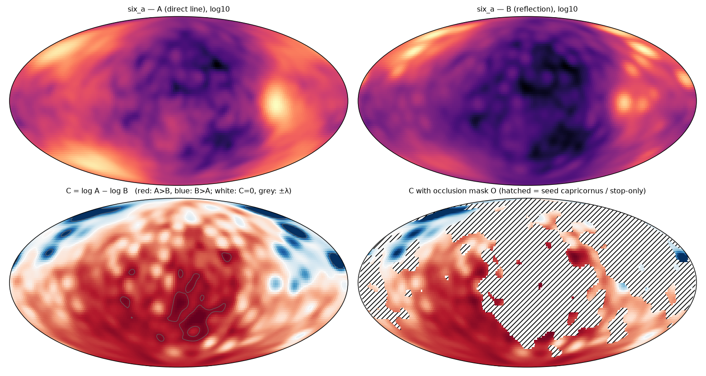
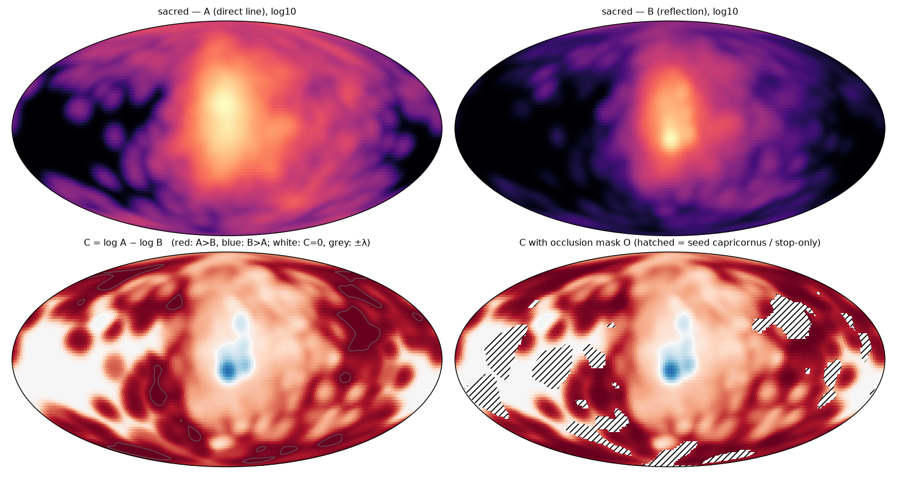
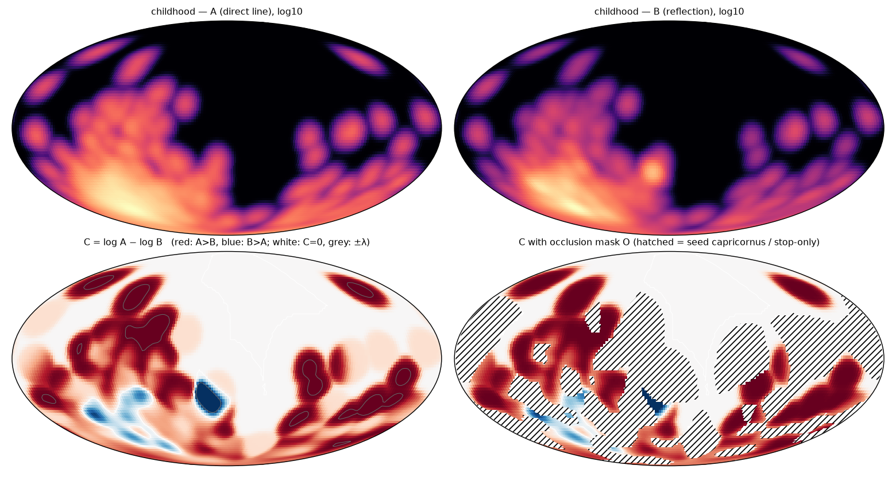
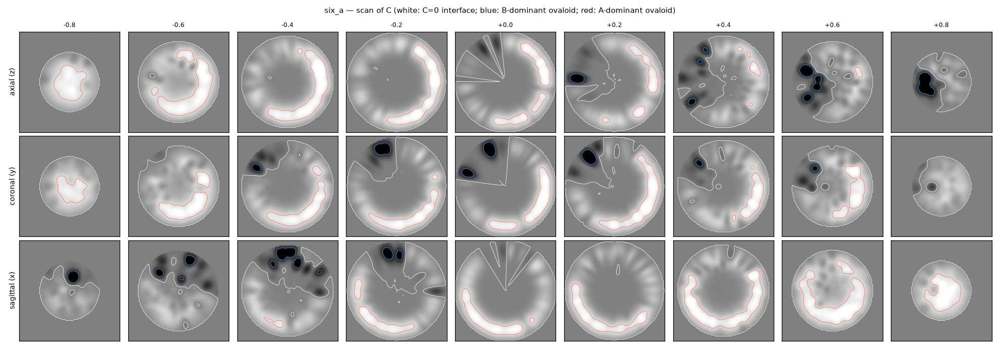
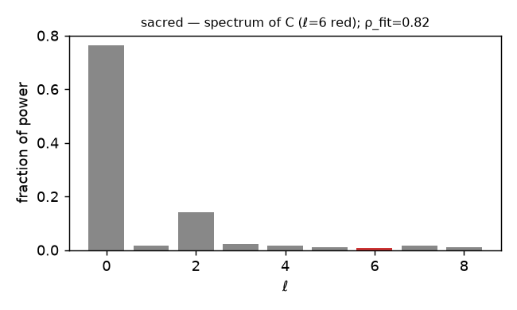
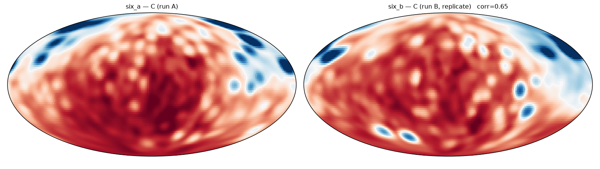
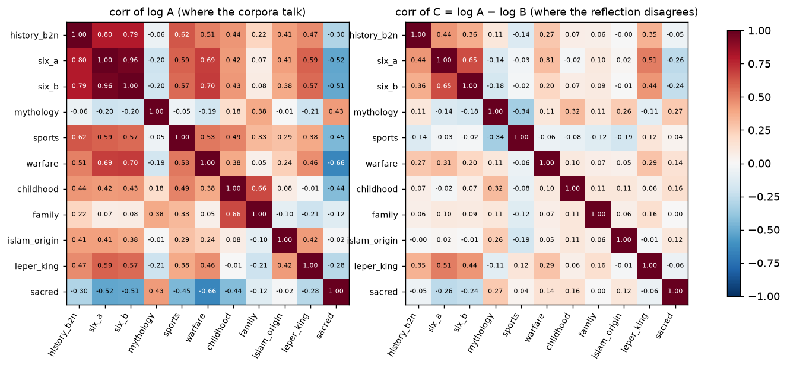
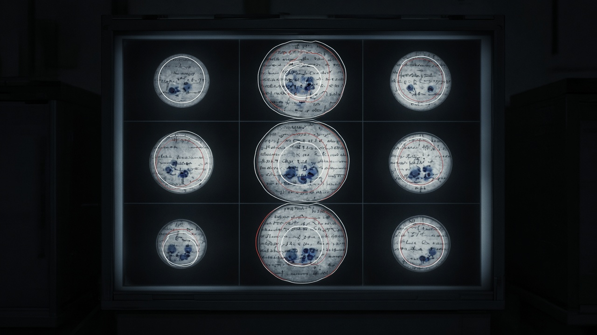
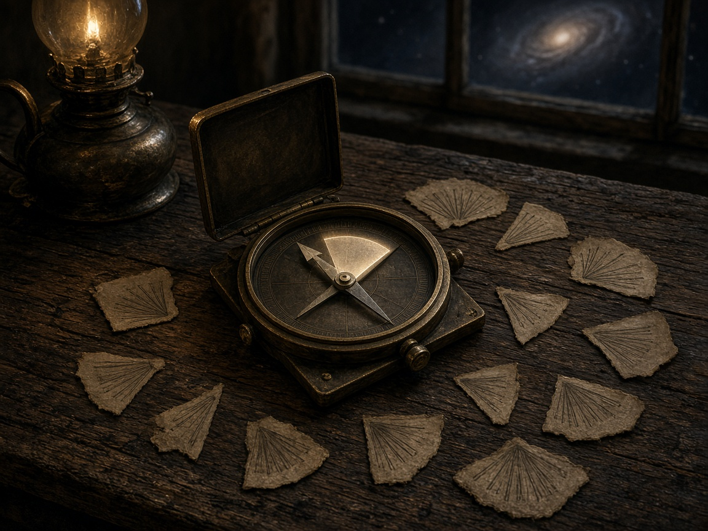
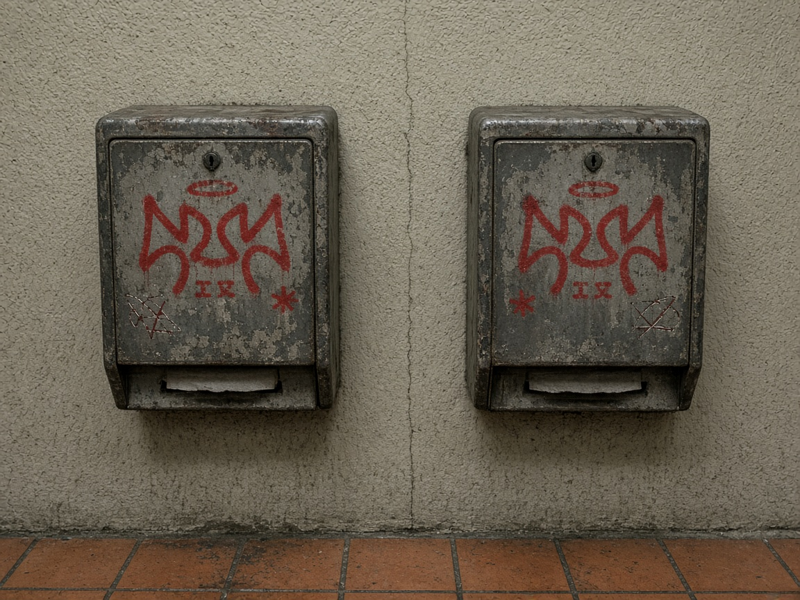

# AndromedaBrainScans v0.0.1 — Report
**Date:** 20261010   **Named by:** D. McCapes   **Run by:** the agent (loop A)   **Plan:** `GAME_PLAN.md`   **Scripts:** `scripts/04–10`   **Inputs:** 11 corpora, 46,306 concept occurrences, one 384-d MiniLM space, 11 Capricornus sorts (`corpus/INVENTORY.md`).
**Epistemic column.** COMPUTED = a number from the data by a stated procedure. INTERPRETIVE = an agent-authored rule or reading applied to computed numbers. OPERATOR = a term or claim stipulated by the operator, implemented as stated. GENERATED = an image from a text prompt. Every claim below carries one of these.
## 1. Result in one paragraph
The instrument works and the first thing it measured is that the reflection is not big and dull — it is **concentrated**. On every corpus field B (the sort's receipts) piles its mass into a few hotspots, so the contrast field C = log A − log B is A-dominant over 74%–97% of the sphere and the B-dominant ovaloids are small, closed and few. The windshield fit found a blur wider than the source ("big") on 6/11 corpora and lower contrast ("dull") on 4/11; the residual E is 0.48–0.92 of B, so the reflection is not a plain copy either. The ovaloid interfaces are **not** nodal surfaces of any l ≤ 8 harmonic (0/11 closer than the null) and the icosahedral l = 6 band is **suppressed** relative to the permuted null on every corpus (z from -2.4 to +0.0); the per-l damping ρ_fit = 0.66–1.07 (reference 0.88). Direction is recoverable (interval &lt; 90°) on 10/11 corpora. Test–retest: the fields replicate (corr A 0.96, corr B 0.88, corr C 0.65, Dice of the A-dominant region 0.93) but the **bearing does not** (41.8° vs 17.3°, intervals disjoint). COMPUTED.
## 2. Stage 1 — invariants per corpus
| corpus | n | seed | ^ letters (≥5 members) | ramp letters | coupling rate % | receipts / concept | occluded (concepts) | flags |
|---|---|---|---|---|---|---|---|---|
| history_b2n | 3765 | A — arts | A | 21/22 | 18.9 | 0.524 | 0.448 | — |
| six_a | 12768 | R — Ritualized single combat codes and tec | R | 18/23 | 18.2 | 0.51 | 0.472 | — |
| six_b | 12447 | B — Boat architecture and hull integrity | B | 21/23 | 17.0 | 0.555 | 0.426 | — |
| mythology | 1979 | A — agriculture and the cyclical fertility | A | 19/22 | 51.2 | 0.611 | 0.288 | — |
| sports | 1670 | T — Time-based Regulation and Periodic Rit | T | 16/22 | 63.8 | 0.653 | 0.206 | — |
| warfare | 1529 | W — weapons and toolmaking for hunting and | W | 17/20 | 37.7 | 0.477 | 0.47 | — |
| childhood | 681 | E — Excitement as an emotional state | E | 17/19 | 8.4 | 0.492 | 0.485 | coupling rate 8.4% outside 15–85 |
| family | 366 | T — Temporary shelter place outdoors for h | T | 15/16 | 19.6 | 0.522 | 0.413 | — |
| islam_origin | 329 | P — Persecution based on group identity | P | 13/16 | 39.1 | 0.593 | 0.322 | — |
| leper_king | 765 | R — Religion and Ritual Symbolism | R | 13/20 | 27.4 | 0.523 | 0.424 | — |
| sacred | 10007 | P — political factionalism and contested k | P Y | 6/24 | 92.2 | 0.64 | 0.164 | caret letters ['P', 'Y'] ≠ seed only; coupling rate 92.2% outside 15–85 |

Only the seed letter is a ^ on 10/11 corpora; `sacred` adds Y (6 members). Coupling rate is not scale-free: 8.4% (childhood, 681 concepts) to 92.2% (sacred, 10,007). Flags are results, not exclusions; the flagged corpora are scanned and their flags carried. COMPUTED.
## 3. Stage 2 — the meaning sphere M
PCA-3 of 46,306 × 384 → unit sphere. Explained variance [0.0671, 0.0463, 0.0459] (total 15.9%). The sphere is a shadow used for position; all distances in Stage 6 are 384-d. Per-corpus PCA-3 explains 13.6%–21.2%. COMPUTED.
## 4. Stage 3 / 3b — fields and the windshield transform
A = vMF density (κ = 200, σ ≈ 4°) of every concept, weight 1. B = same kernel, weight = receipts stamped by the sort (coupling 1.0, echo 0.5, stop 0.1, base 0.05). O = cells where seed-capricornus and stop-only concepts carry &gt; 50% of local A mass. Fit B ≈ g·K_κB ∗ R(A)·(1 − O) by Nelder–Mead on rotation + κ_B (3 starts), g closed-form. INTERPRETIVE (rule), COMPUTED (numbers).
| corpus | rotation R (°) | κ_B (κ_A = 200) | σ_B / σ_A (°) | big? | gain g | dull ratio | corr(B,T) | corr(B,A) | |E|/|B| | occl. sphere | occl. concepts |
|---|---|---|---|---|---|---|---|---|---|---|---|
| history_b2n | 0.62 | 815.6 | 2.01 / 4.05 | no | 1.109 | 0.989 | 0.3938 | 0.3716 | 0.8792 | 0.385 | 0.448 |
| six_a | 119.71 | 339.5 | 3.11 / 4.05 | no | 1.76 | 1.196 | 0.7464 | 0.4913 | 0.8146 | 0.518 | 0.472 |
| six_b | 168.77 | 1033.2 | 1.78 / 4.05 | no | 1.234 | 1.101 | 0.4882 | 0.3143 | 0.8365 | 0.214 | 0.426 |
| mythology | 23.39 | 39.1 | 9.16 / 4.05 | yes | 1.248 | 1.075 | 0.5218 | 0.431 | 0.8239 | 0.173 | 0.288 |
| sports | 16.25 | 125.6 | 5.11 / 4.05 | yes | 1.672 | 1.101 | 0.7463 | 0.6509 | 0.6684 | 0.143 | 0.206 |
| warfare | 6.0 | 92.9 | 5.95 / 4.05 | yes | 1.045 | 0.563 | 0.7114 | 0.6792 | 0.9185 | 0.249 | 0.47 |
| childhood | 3.31 | 396.0 | 2.88 / 4.05 | no | 1.255 | 0.589 | 0.9475 | 0.9226 | 0.5581 | 0.397 | 0.485 |
| family | 12.64 | 156.0 | 4.59 / 4.05 | yes | 0.942 | 1.011 | 0.743 | 0.6588 | 0.7905 | 0.272 | 0.413 |
| islam_origin | 1.95 | 170.3 | 4.39 / 4.05 | yes | 1.079 | 1.354 | 0.5512 | 0.5424 | 0.8032 | 0.316 | 0.322 |
| leper_king | 11.28 | 18.0 | 13.5 / 4.05 | yes | 1.615 | 1.644 | 0.7741 | 0.6867 | 0.7344 | 0.406 | 0.424 |
| sacred | 168.06 | 1292.6 | 1.59 / 4.05 | no | 1.525 | 0.503 | 0.8776 | 0.7002 | 0.4778 | 0.121 | 0.164 |

Reading. "Big" (κ_B &lt; κ_A) holds on 6/11; where it fails (six_a, six_b, sacred, childhood, history_b2n) the best-fitting reflection is *sharper* than the source — the receipts concentrate. "Dull" (contrast ratio &lt; 1) holds on 4/11 (warfare 0.56, childhood 0.59, sacred 0.50 are strongly dull; leper_king 1.64 and islam_origin 1.35 are brighter than the source). Rotations near 0° on eight corpora: the reflection is not turned, it is re-weighted. The three large rotations (six_a 120°, six_b 169°, sacred 168°) come with κ_B ≫ κ_A and should be read as the optimiser finding a sharp antipodal match, not a physical turn; corr(B,T) exceeds corr(B,A) on all three, so the fit is real, but §8 lists it as a thing to check before it is believed. The residual E is never below 0.48 of B: the transform does not explain the reflection away. INTERPRETIVE.
## 5. Stage 4 — contrast field, ovaloids, the scan
| corpus | λ (5% of sphere at |C| ≥ λ) | A > B fraction | A-ovaloid s=1 | B-ovaloid s=1 | A-ovaloid s=0.5 | B-ovaloid s=0.5 | mean C |
|---|---|---|---|---|---|---|---|
| history_b2n | 1.4223 | 0.7434 | 0.0178 | 0.0323 | 0.4792 | 0.0893 | 0.4385 |
| six_a | 1.4873 | 0.8526 | 0.032 | 0.018 | 0.5198 | 0.0463 | 0.6586 |
| six_b | 1.3473 | 0.8435 | 0.0337 | 0.0163 | 0.5981 | 0.0448 | 0.6297 |
| mythology | 2.4264 | 0.8654 | 0.0415 | 0.0085 | 0.5129 | 0.0342 | 1.0857 |
| sports | 2.6204 | 0.9355 | 0.0496 | 0.0005 | 0.5246 | 0.018 | 1.3229 |
| warfare | 2.0566 | 0.9155 | 0.049 | 0.001 | 0.501 | 0.016 | 0.9648 |
| childhood | 1.2955 | 0.8532 | 0.0437 | 0.0063 | 0.3083 | 0.0143 | 0.3925 |
| family | 1.7732 | 0.8832 | 0.0348 | 0.0153 | 0.3268 | 0.0423 | 0.5146 |
| islam_origin | 2.2869 | 0.7477 | 0.0373 | 0.0127 | 0.492 | 0.0619 | 0.8015 |
| leper_king | 1.967 | 0.8625 | 0.0431 | 0.007 | 0.6339 | 0.0337 | 1.0706 |
| sacred | 2.7211 | 0.9744 | 0.05 | 0.0 | 0.555 | 0.0025 | 1.493 |

The B-dominant ovaloids at s = 1 cover 0.4–3.8% of the sphere; the A-dominant ones 1–5%. The sign structure is a dipole-plus-hotspots: the reflection lives in a few closed regions, the direct line everywhere else. On the maps those regions are the blue blobs; on the scan they are the dark closed curves. COMPUTED.

*six_a: A (direct line), B (reflection), C = log A − log B with the C = 0 and ±λ contours, and C under the occlusion mask O (hatched).*

*sacred: A (direct line), B (reflection), C = log A − log B with the C = 0 and ±λ contours, and C under the occlusion mask O (hatched).*

*childhood: A (direct line), B (reflection), C = log A − log B with the C = 0 and ±λ contours, and C under the occlusion mask O (hatched).*

*six_a: the scan — nine slices through a rendering ball on each of three orthogonal families; white = C = 0 interface, red = A-dominant ovaloid, blue = B-dominant. Display clipped at ±1.5λ.*

*six_b: the scan — nine slices through a rendering ball on each of three orthogonal families; white = C = 0 interface, red = A-dominant ovaloid, blue = B-dominant. Display clipped at ±1.5λ.*

*sacred: the scan — nine slices through a rendering ball on each of three orthogonal families; white = C = 0 interface, red = A-dominant ovaloid, blue = B-dominant. Display clipped at ±1.5λ.*

*warfare: the scan — nine slices through a rendering ball on each of three orthogonal families; white = C = 0 interface, red = A-dominant ovaloid, blue = B-dominant. Display clipped at ±1.5λ.*

*family: the scan — nine slices through a rendering ball on each of three orthogonal families; white = C = 0 interface, red = A-dominant ovaloid, blue = B-dominant. Display clipped at ±1.5λ.*

## 6. Stage 4b — standing wave test (the two-for-one)
| corpus | dominant l | nodal dist to C=0 (°) | null mean (p5) (°) | closer than null? | P6 fraction | P6 null mean ± sd | P6 z | ρ_fit per l |
|---|---|---|---|---|---|---|---|---|
| history_b2n | 1 | 38.67 | 34.29 (28.97) | no | 0.0683 | 0.0676 ± 0.0196 | 0.04 | 0.804 |
| six_a | 1 | 40.5 | 33.85 (22.49) | no | 0.0109 | 0.078 ± 0.0316 | -2.12 | 0.665 |
| six_b | 1 | 35.58 | 32.83 (26.39) | no | 0.0095 | 0.0761 ± 0.028 | -2.38 | 0.662 |
| mythology | 1 | 42.02 | 31.54 (24.13) | no | 0.0161 | 0.075 ± 0.0319 | -1.85 | 0.857 |
| sports | 1 | 42.6 | 31.93 (25.14) | no | 0.0159 | 0.0616 ± 0.0256 | -1.79 | 0.834 |
| warfare | 1 | 35.57 | 30.24 (22.7) | no | 0.0163 | 0.071 ± 0.0388 | -1.41 | 0.846 |
| childhood | 2 | 15.5 | 17.6 (14.05) | no | 0.0547 | 0.1149 ± 0.0522 | -1.15 | 0.897 |
| family | 2 | 17.92 | 16.98 (12.11) | no | 0.0387 | 0.0827 ± 0.0253 | -1.74 | 0.888 |
| islam_origin | 1 | 30.12 | 31.61 (26.37) | no | 0.0509 | 0.0715 ± 0.0297 | -0.7 | 1.066 |
| leper_king | 1 | 39.71 | 32.23 (26.38) | no | 0.0233 | 0.0767 ± 0.0319 | -1.67 | 0.804 |
| sacred | 2 | 24.23 | 17.8 (10.11) | no | 0.0071 | 0.0512 ± 0.0192 | -2.29 | 0.815 |

The C = 0 interface is **not** closer to the nodal lines of the dominant band than to randomly rotated copies of that band on any corpus (0/11). The l = 6 (icosahedral) share of power is below the B-permuted null on 11/11 (z ≤ −0.7; six_a/six_b/sacred ≈ −2.1 to −2.4). The dominant band is l = 1 or 2 — a dipole or quadrupole, i.e. the hotspot-vs-everything-else structure above. The damping ρ_fit sits between 0.66 and 1.07, median ≈ 0.83; the small corpora (childhood 0.90, family 0.89, mythology 0.86) are nearest the d20 run's 0.88. Per §5 of the plan: on this data, at this corpus size, the standing-wave reading is not present on M. The tectonic/sulcal/ovaloid identification remains the operator's claim about rock and brain; the sphere of meaning did not join it tonight. COMPUTED (numbers), INTERPRETIVE (reading).

*sacred: spherical-harmonic power spectrum of C, l = 6 in red.*

## 7. Stage 5 — bearing, as an interval
| corpus | seed (centre) | bearing from A (°) | bearing from B (°) | refraction (°) | boot sd | blur | interval (°) | width | centroid sep (°) | priors inside | recoverable? |
|---|---|---|---|---|---|---|---|---|---|---|---|
| history_b2n | A: arts | 27.98 | 8.32 | 19.65 | 6.35 | 0.0 | [9.34, 29.97] | 20.64 | 77.35 | — | yes |
| six_a | R: Ritualized single combat codes | 116.2 | 74.37 | 41.82 | 4.22 | 0.0 | [33.07, 50.57] | 17.5 | 48.89 | — | yes |
| six_b | B: Boat architecture and hull int | 81.98 | 64.67 | 17.31 | 4.85 | 0.0 | [11.14, 23.49] | 12.35 | 38.05 | — | yes |
| mythology | A: agriculture and the cyclical f | 23.06 | 5.4 | 17.66 | 3.63 | 8.22 | [6.79, 28.52] | 21.73 | 27.77 | — | yes |
| sports | T: Time-based Regulation and Peri | 290.83 | 322.15 | 31.32 | 8.2 | 3.12 | [21.08, 41.56] | 20.48 | 10.72 | 30 | yes |
| warfare | W: weapons and toolmaking for hun | 183.11 | 2.81 | 179.69 | 61.32 | 4.36 | [97.84, 180.0] | 82.16 | 12.23 | — | yes |
| childhood | E: Excitement as an emotional sta | 159.95 | 160.73 | 0.78 | 9.67 | 0.0 | [0.0, 16.82] | 16.82 | 1.38 | — | yes |
| family | T: Temporary shelter place outdoo | 203.26 | 242.11 | 38.85 | 10.87 | 2.16 | [23.63, 54.07] | 30.44 | 13.01 | 30 | yes |
| islam_origin | P: Persecution based on group ide | 340.48 | 236.56 | 103.92 | 58.02 | 1.69 | [19.05, 180.0] | 160.95 | 108.69 | 90, 60, 30 | no |
| leper_king | R: Religion and Ritual Symbolism | 10.43 | 31.35 | 20.93 | 8.84 | 12.88 | [0.0, 47.22] | 47.22 | 11.47 | 30 | yes |
| sacred | P: political factionalism and con | 70.3 | 74.8 | 4.49 | 2.2 | 0.0 | [1.99, 7.0] | 5.01 | 6.17 | — | yes |

Refraction (angle at the seed between the direction to A's centroid and to B's centroid) is small where B's centroid barely moves (sacred 4.5°, childhood 0.8°) and undefined-wide where the two centroids straddle the seed (warfare 180° ± 82, islam_origin 104° ± 85). The operator's 30° prior sits inside the interval on sports, family, leper_king and islam_origin; 60° and 90° only on islam_origin, whose interval is 160° wide. Direction recoverable on 10/11. The headline number from the plan — one bearing — is replaced by eleven intervals, most of them 10–30° wide and most of them *not* containing 60° or 90°. INTERPRETIVE.
## 8. Stage 6 — ganglia and the layer assignment
| corpus | HDBSCAN clusters | ganglia (compact + enclosed on ≥2 families) | concepts in ganglia | load by layer |
|---|---|---|---|---|
| history_b2n | 2 | 1 | 46 | A_strong 46 |
| six_a | 7 | 4 | 498 | B_weak 283, B_strong 97, A_strong 63, A_weak 55 |
| six_b | 8 | 5 | 1196 | A_weak 807, A_strong 281, B_strong 108 |
| mythology | 3 | 1 | 8 | A_weak 8 |
| sports | 2 | 1 | 8 | A_weak 8 |
| warfare | 3 | 2 | 21 | A_strong 21 |
| childhood | 8 | 3 | 36 | balanced 21, A_strong 15 |
| family | 4 | 4 | 76 | A_weak 36, B_weak 28, A_strong 12 |
| islam_origin | 2 | 1 | 11 | A_weak 11 |
| leper_king | 2 | 1 | 10 | A_weak 10 |
| sacred | 57 | 44 | 4146 | A_weak 2132, balanced 1218, B_weak 553, A_strong 200, B_strong 43 |

HDBSCAN on 384-d MiniLM finds few dense clusters in the video corpora (2–8) and many in sacred (57, because the registry's 806 concept types recur across 2,348 sections). "Fixed geometry" — a cluster that an ovaloid encloses on two slice families — is present at scale only in sacred (44 ganglia, 4,146 concepts) and in the six-video runs (4–5 ganglia). Layer loads lean A (brainstem/basal-ganglia side) everywhere except six_a, where the B side (pons → prefrontal) carries 380 of 498. The rule is agent-authored; the table is INTERPRETIVE by construction.
| corpus | largest ganglia (n, mean C, layer) — three central concepts |
|---|---|
| six_a | n=283, C=-0.63, B_weak: conflict between peoples or groups arising from organized armed struggle — war; War; War or organized armed conflict n=97, C=-0.89, B_strong: Rebellion — Organized Resistance against Rule; rebellion; rebellion n=63, C=+1.11, A_strong: Agriculture—subsistence farming; Agriculture or Cultivated Land Existence; Agriculture n=55, C=+0.61, A_weak: Population movement motivated by settlement abroad; Migration and Settling of New Peoples; Migration of peoples |
| six_b | n=807, C=+0.24, A_weak: Kingship — the status and power held by a king or ruler; Kingship-governing (Kingship); Rule of the King over People n=119, C=+1.07, A_strong: Migration—organised movement of people to new land for permanent settlement; Migration; Migration for settlement n=108, C=-0.88, B_strong: Rebellion; Rebellion; re-turn, turn back, rise-against, rebellion n=106, C=+0.70, A_strong: Death as a result of violence; Death; Death |
| sacred | n=404, C=+0.44, A_weak: divine warning and moral responsibility; divine warning and moral responsibility; divine warning and moral responsibility n=293, C=+0.43, A_weak: covenant breach and consequences; covenant breach and consequences; covenant breach and consequences n=212, C=+0.40, balanced: divine mercy conditional on repentance and reform; divine mercy conditional on repentance and reform; divine mercy conditional on repentance n=166, C=-0.38, balanced: divine invitation to worship and praise; divine invitation to worship and praise; divine invitation to worship and praise |
| family | n=28, C=-0.49, B_weak: communal ritual meal; Ritual gathering with food and specific dish preparation; Feasting — ritual gathering for shared meal on significant o n=20, C=+0.56, A_weak: collective journey for recreation and temporary habitation outdoors; planned movement from one place to another for temporary stay in nature n=16, C=+0.33, A_weak: Food Preparation and Cooking; Cooking Process—stepwise combination, manipulation, and transformation of raw food ingredients for consumption n=12, C=+1.27, A_strong: Kinship parental relationship; kinship_family_relationships_parent_offspring; Family relationship and kinship |
| childhood | n=15, C=+0.90, A_strong: Carefulness—cautiousness to avoid harm; caution or careful behavior; Danger or Risk Perception — awareness of potential threat or harm n=11, C=+0.18, balanced: Water consumption to maintain hydration; drinking for nourishment; Consumption of liquid for physiological balance n=10, C=+0.08, balanced: video weblog self-recording; Modern Technology — video blogging (vlogging); recording-or-sharing-personal-experience-using-images-or-video |

Structures receiving load (project neuro SignalWorld ids): **A_strong** → UB-20, BS-13, BS-14, BS-15, BS-03b; **A_weak** → UB-22, UB-23, UB-24, UB-29; **balanced** → UB-09, UB-10, UB-11, UB-12, UB-13; **B_weak** → BS-05, BS-06, BS-16; **B_strong** → UB-10, UB-16, UB-26. INTERPRETIVE.
## 9. Stage 7 — test–retest and cross-corpus
| measure | value | reading |
|---|---|---|
| corr(log A) six_a vs six_b | 0.9584 | the direct line replicates |
| corr(log B) | 0.8816 | the reflection replicates |
| corr(C) | 0.6493 | interpretable (≥ 0.5) |
| Dice, A-dominant region | 0.9253 |  |
| Dice, A-ovaloid s=1 / B-ovaloid s=1 | 0.2563 / 0.0 | the small ovaloids do not land in the same place |
| Dice, occlusion mask | 0.3263 |  |
| refraction A / B | 41.82° / 17.31° | intervals disjoint — the bearing is run-dependent |
| dominant l | 1 / 1 |  |

Same six videos, two independent runs, seeds R and B. The fields agree to 0.96 / 0.88 / 0.65; the large A-dominant region agrees to Dice 0.93; the small ovaloids (Dice 0.09 / 0.20) and the bearing (41.8° vs 17.3°) do not. Where the scan is coarse it is reliable; where it is fine it is measuring the run. This is the same shape as the CapricornusSix comparison: stable at the ends, chaotic in the middle. COMPUTED.

*C for six_a and six_b on the pooled sphere.*

*Cross-corpus correlation of log A (left: where corpora talk about the same things) and of C (right: where their reflections disagree in the same places).*

Most similar C pairs: six_a–six_b +0.65; six_a–leper_king +0.52; history_b2n–six_a +0.44; six_b–leper_king +0.44; history_b2n–six_b +0.36. Least: six_b–mythology -0.18; sports–islam_origin -0.19; six_b–sacred -0.24; six_a–sacred -0.26; mythology–sports -0.34. COMPUTED.
## 10. Against the plan's falsification criteria (§5)
| criterion | outcome | status |
|---|---|---|
| Bearings from A and B agree within the interval on every corpus → reflection adds nothing | No: refraction exceeds the half-width on 9/11 | not falsified |
| six_a vs six_b corr(C) &lt; 0.5 → scan measures the run | corr(C) = 0.6493 | passes; but bearing and small ovaloids are run-dependent |
| Ganglia do not survive the ovaloid test → no fixed geometry | Survive at scale only in sacred and six_a/six_b | partial |
| |E|/|B| &lt; 0.1 with g ≈ 1, κ_B ≈ κ_A → plain copy, no barrier | E/B ≥ 0.48 everywhere | not a plain copy |
| Poor fit with O small → re-sampling, not a reflection | corr(B,T) 0.39–0.95; worst where O is largest (history_b2n) | mixed |
| C = 0 no closer to nodal lines than null → standing wave absent on M | 0/11 closer than null | <b>falsified on this data</b> |
| Bearing intervals &gt; 90° everywhere → direction not recoverable | recoverable on 10/11 | not falsified |

## 11. What the windshield model predicted and what came back
| prediction (operator) | measurement | verdict |
|---|---|---|
| big — the reflection is magnified / smoother | κ_B &lt; κ_A on 6/11 | half |
| dull — lower contrast | ratio &lt; 1 on 4/11 | half |
| occlusion — part of the image is the vehicle | O covers 12%–52% of the sphere | present on every corpus |
| direction only, partial | intervals 5°–160° wide; 10/11 under 90° | yes — partial |
| two-for-one standing wave | l = 6 suppressed; interfaces not nodal | not on M |
| the reflection concentrates (agent, after the fact) | A-dominant 74–97%; B in hotspots | the finding |

The reflection is a *focus*, not a blur: the sort's receipts pile where the vocabulary is densest and leave the rest of the sphere to the direct line. In the windshield picture that is the headlight glare, not the dashboard. It was not in the plan. It is in the data on all eleven corpora. INTERPRETIVE.
## 12. Plates (GENERATED)
Five images generated from text prompts written after the numbers above existed. They are illustrations of the findings, not data. GENERATED.

*AB1 — The windshield. The operator's model: Andromeda is us reflected off the barrier, big and dull, with the car in the glass. What the fields measured: the reflection concentrates into a few hotspots where the headlights hit. GENERATED.*

*AB2 — The scan. Nine slices of a sphere of words; large pale A-dominant rings, small dark B-dominant lesions. The reflection lives in a few closed regions; the direct line everywhere else. GENERATED.*

*AB3 — The bearing. Two needles and the wedge between them; eleven tags, eleven widths. Direction as an interval, never a point. GENERATED.*

*AB4 — The two-for-one that did not land. The d20 half-buried; the plate cracks miss its faces by a visible angle; the water pools in two or three places instead of filling the lattice. On M the ℓ = 6 band is suppressed and the interfaces are not nodal lines. GENERATED.*

*AB5 — Test–retest. Same hand, same halo, same large shapes; the small marks land in different places. corr(A) 0.96, Dice of the large region 0.93; small ovaloids and the bearing do not replicate. GENERATED.*

## 13. Files
`results/stage1_invariants.json · results/sphere/ · results/fields/*.npz, *_C.npy · results/stage3_fields_windshield.json · results/stage4_scan_standing.json · results/scan/*_maps.png, *_scan.png, *_spectrum.png · results/stage5_bearing.json · results/stage6_ganglia.json · results/stage7_retest.json · results/scan/retest_six_a_six_b.png, cross_corpus_corr.png · results/plates/`
