# Blood Type Sugars — and glucose, fructose, glucenate, and the two Cokes

**Date:** 2026-10-10  
**For:** Dylan McCapes, who flagged a remembered thought about blood type as careless and asked for the whole picture before making claims.  
**Scope:** every sugar that makes a blood type; what else makes a blood type (the Rh protein); who can receive what and why; the three dietary sugars (glucose, fructose, sucrose) and the two sweeteners (cane sugar, high-fructose corn syrup); and *glucenate*, the repo's word for glutamate, which is not a sugar and is built from one.  
**Images:** 2-D structures are RDKit depictions from PubChem isomeric SMILES. 3-D structures are RDKit conformers (ETKDG + MMFF) drawn as ball-and-stick. Protein traces are from RCSB PDB coordinates. The electron micrographs are U.S. National Cancer Institute scanning electron micrographs (public domain). §11 says plainly what a microscope can and cannot show at the scale of a sugar.  
**Not medical advice.**

---

## 1. The cell the sugars sit on

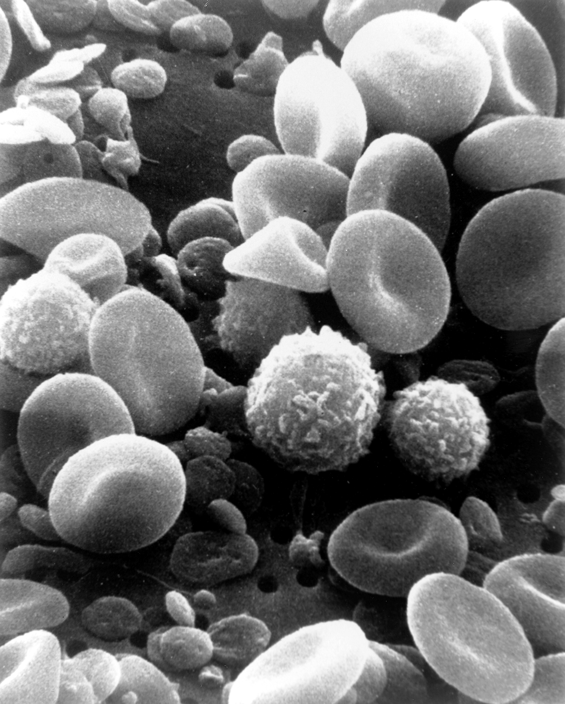

*Scanning electron micrograph of circulating human blood: biconcave red cells (~7 µm across), knobbly white cells (lymphocytes), and small activated platelets. Bruce Wetzel & Harry Schaefer, National Cancer Institute, public domain.*

A red cell is a bag of haemoglobin with no nucleus and a membrane studded with proteins and lipids. Nearly every one of those proteins and many of the lipids carry chains of sugar pointing outward. That sugar coat is the **glycocalyx**. Blood type lives in it. The A, B and H antigens are the *last one or two sugars* on the ends of those chains, and there are on the order of a million A or B sites on a single type-A or type-B red cell.

At this magnification the sugars are invisible; a single sugar ring is about 0.5 nm across, ten thousand times smaller than the cell. Everything in §2–§5 is below the resolution of this image.

## 2. The sugar roster

Six monosaccharides build the ABO/H/Lewis antigens. Two more (glucose, fructose) are the dietary sugars of §9. Glutamate is in the grid because it is the subject of §10 and because, drawn next to the sugars, it is visibly a different kind of molecule.

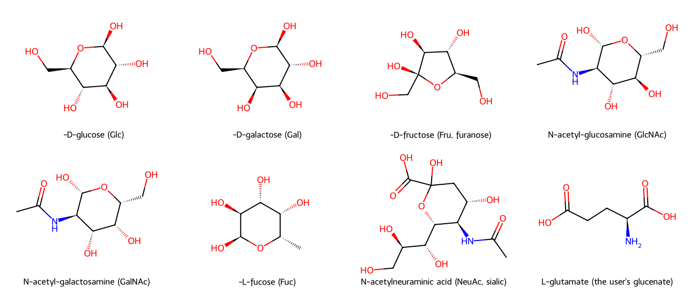

| Sugar | Abbrev. | Formula | Where it comes from | Role in blood type |
|---|---|---|---|---|
| D-glucose | Glc | C₆H₁₂O₆ | diet, blood | the root of the chain on glycolipids; the fuel every other sugar is made from |
| D-galactose | Gal | C₆H₁₂O₆ | made from glucose (UDP-Glc → UDP-Gal, epimerase) | the sugar the H fucose attaches to; **the B sugar** |
| N-acetyl-D-glucosamine | GlcNAc | C₈H₁₅NO₆ | glucose + glutamine (hexosamine pathway) | the chain's backbone unit |
| N-acetyl-D-galactosamine | GalNAc | C₈H₁₅NO₆ | epimerised from UDP-GlcNAc | **the A sugar** |
| L-fucose | Fuc | C₆H₁₂O₅ | made from GDP-mannose, which is made from glucose | **the H sugar**; a 6-deoxy sugar (one OH replaced by H, hence the methyl group in the drawing) |
| N-acetylneuraminic acid | NeuAc (sialic acid) | C₁₁H₁₉NO₉ | made from GlcNAc + pyruvate | caps many chains; carries the red cell's negative charge; not part of ABO |
| D-fructose | Fru | C₆H₁₂O₆ | diet (fruit, honey, sucrose, HFCS) | none; it is the subject of §9 |

Three things to notice in the drawings. Glucose and galactose differ by the orientation of one hydroxyl (carbon 4). GlcNAc and GalNAc differ by the same single flip. Fucose is galactose with its carbon-6 hydroxyl removed, and the L mirror form. So the whole ABO alphabet is written with variations on one hexose.

## 3. How the antigens are built

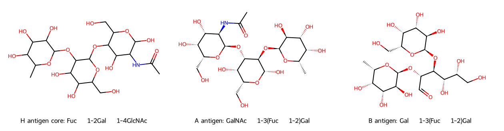

Every red cell starts with a **precursor chain** ending in galactose. Two chain types matter:

- **Type 2** chain: Galβ1→4GlcNAc–R. This is what is on red cells.
- **Type 1** chain: Galβ1→3GlcNAc–R. This is what is in secretions (saliva, milk, gut mucus, seminal fluid) and plasma glycolipids.

**Step 1 — H.** A fucosyltransferase adds fucose to carbon 2 of the terminal galactose: **Fucα1→2Gal…**. This is the **H antigen**, the base of ABO. Two genes do it: *FUT1* (the H gene) on red cells, and *FUT2* (the **secretor** gene) in secretory tissue. About 80% of people are secretors and carry ABH sugars in their saliva and milk; 20% (*se/se*) do not. The vanishingly rare **Bombay phenotype** (*hh*, no FUT1) has no H at all, types as O on a routine test, and carries anti-H, so it can only receive Bombay blood.

**Step 2 — A or B.** The *ABO* gene (chromosome 9q34) encodes a glycosyltransferase that adds one more sugar to carbon 3 of that same galactose, next to the fucose:

- **A allele** → enzyme GTA → adds **GalNAc** → **GalNAcα1→3(Fucα1→2)Gal…** = **A antigen**.
- **B allele** → enzyme GTB → adds **Gal** → **Galα1→3(Fucα1→2)Gal…** = **B antigen**.
- **O allele** → a single-base deletion (261delG) shifts the reading frame; the enzyme is truncated and inactive. Nothing is added. The cell shows bare H. **O is the absence of the second step.**

GTA and GTB are 354-residue proteins that differ at **four amino acids** (176, 235, 266, 268); residues 266 and 268 are the ones that decide whether the enzyme picks up UDP-GalNAc or UDP-Gal. Four letters out of 354 are the entire difference between type A and type B. The user's phrase for type O in the other document, *the inverting group*, fits here too: it is the type defined by the enzyme that does not act.

Subgroups: **A₁** (about 80% of type A) has a more active GTA and roughly five times more A sites than **A₂**; some A₂ people make a weak anti-A₁. The **Lewis** antigens (Le^a, Le^b) are fucose added by *FUT3* to the GlcNAc of type 1 chains, on plasma glycolipids that red cells pick up; Le^b requires FUT2 as well, so Lewis typing reads out secretor status. *H. pylori* binds Le^b, which is one reason secretor status shows up in gastric disease.

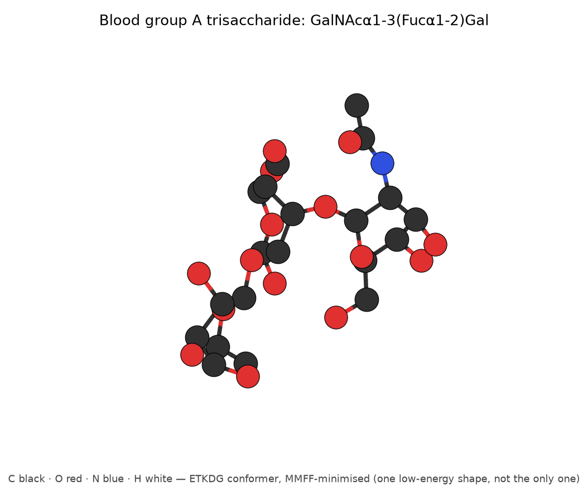
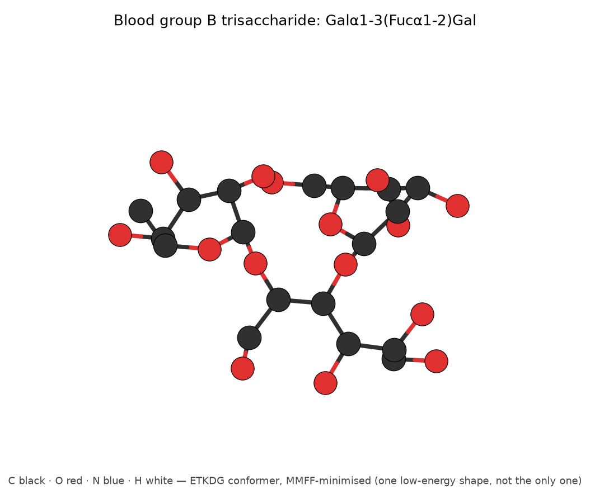
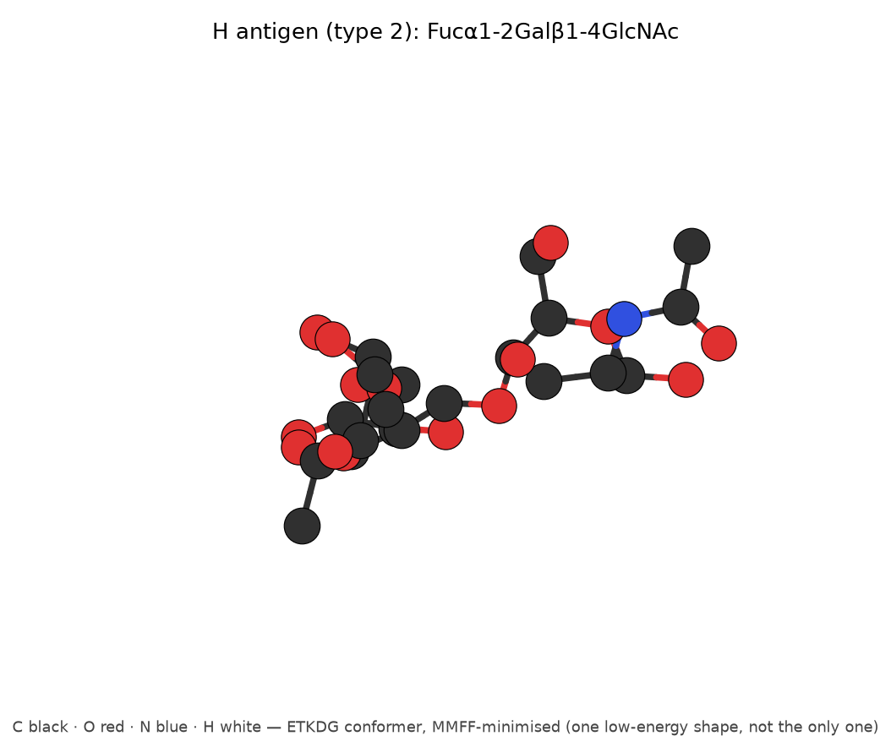

*The three antigen tips in 3-D. In A and B, the fucose (left-hand ring with the methyl) and the added sugar (upper right) both hang off the same central galactose, side by side. That branched shape is what an anti-A or anti-B antibody recognises.*

## 4. The enzyme in 3-D

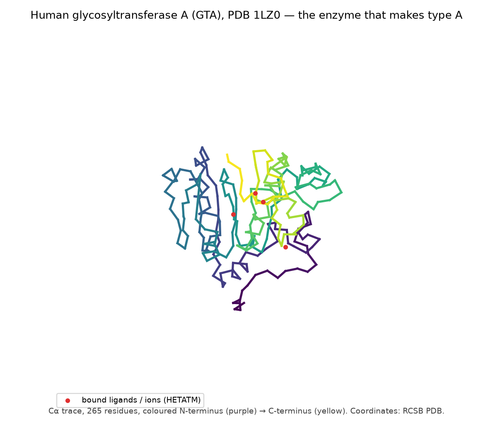
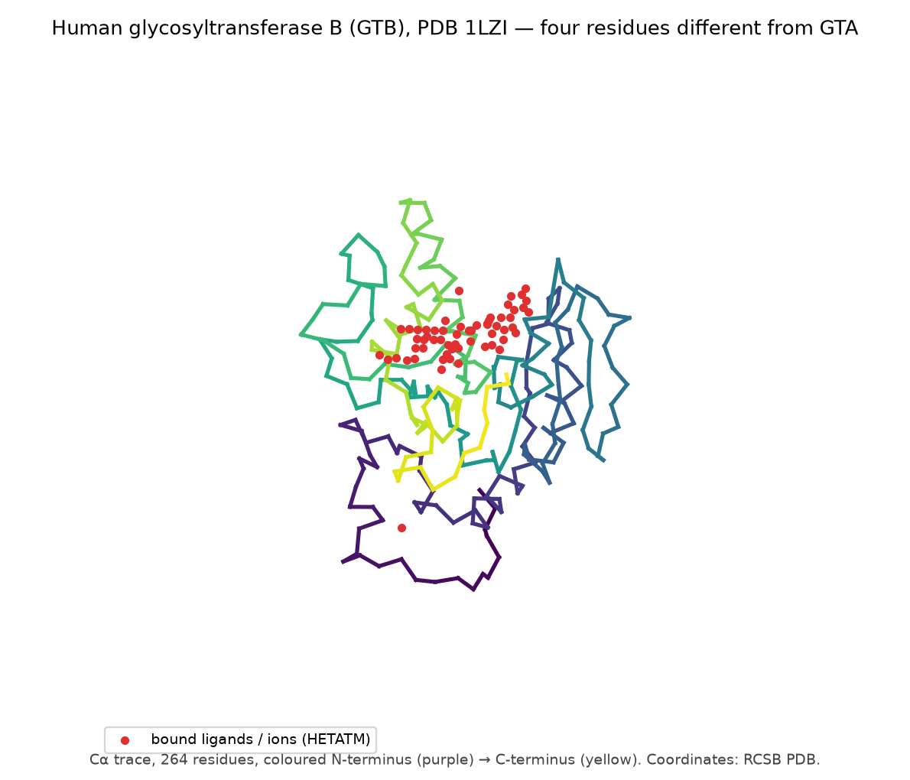

*Cα traces of human GTA (PDB 1LZ0) and GTB (PDB 1LZI), catalytic domains, residues ~64–354. Patenaude, S. I., Seto, N. O. L., Borisova, S. N., Szpacenko, A., Marcus, S. L., Palcic, M. M. & Evans, S. V. (2002) "The structural basis for specificity in human ABO(H) blood group biosynthesis." Nature Structural Biology 9, 685–690. The structures are nearly superimposable; the four differing residues sit in the sugar-donor pocket.*

Interactive 3-D versions: [rcsb.org/3d-view/1LZ0](https://www.rcsb.org/3d-view/1LZ0) and [rcsb.org/3d-view/1LZI](https://www.rcsb.org/3d-view/1LZI). The PDB files are in `pdb/` alongside this report.

## 5. The antibodies (why any of this matters)

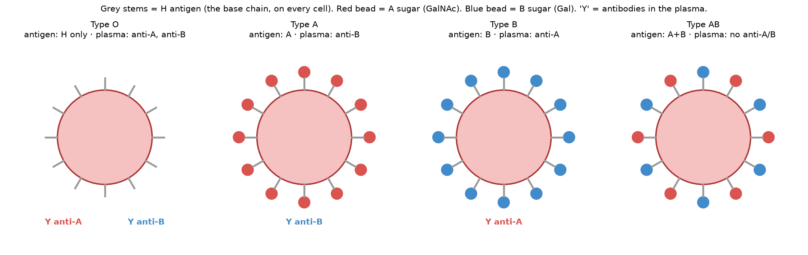

Your plasma contains antibodies against whichever ABO sugars **you lack**. They are not made in response to foreign blood; they appear in the first months of life, as IgM, raised against gut and environmental bacteria whose surface sugars happen to look like A and B. So:

- Type **O** plasma: anti-A and anti-B.
- Type **A** plasma: anti-B.
- Type **B** plasma: anti-A.
- Type **AB** plasma: neither.

These are **naturally occurring, complement-fixing IgM**. If type-A red cells enter a type-O person, anti-A binds them, complement punches holes, haemoglobin spills into the plasma, the kidneys clog with it, and the clotting system is triggered everywhere at once. That is an acute haemolytic transfusion reaction, and it is why ABO is the first thing checked.

The point worth carrying from this section into the other documents: the antibody system that decides whose blood you can take was calibrated by the bacteria you grew up with. The sugar on the cell is genetic; the antibody against the other sugar is ecological.

## 6. Rh: the part that is a protein

Rh is not a sugar. **RhD** is a 417-residue membrane protein with twelve membrane-spanning segments, part of an ammonium-transporter family, sitting in a complex with RhCE and RhAG. "Rh-positive" means the *RHD* gene is present and the protein is on the cell; "Rh-negative" in Europeans is almost always a complete deletion of *RHD*. There are over fifty Rh antigens; D is the one that matters most because it is the most immunogenic.

The key difference from ABO: **there is no natural anti-D.** An Rh-negative person makes anti-D only after exposure to Rh-positive cells, by transfusion or by pregnancy (fetal cells crossing into the mother at delivery). Once made, anti-D is **IgG**, which crosses the placenta. An Rh-negative mother sensitised by a first Rh-positive child can destroy the red cells of the next one (haemolytic disease of the fetus and newborn). Anti-D immunoglobulin given at 28 weeks and after delivery mops up fetal cells before the mother's immune system sees them. That single intervention took the condition from a leading cause of neonatal death to a rarity.

ABO and Rh are inherited independently (chromosome 9 and chromosome 1), which is why the eight common types are just the 4 × 2 grid.

## 7. Who can receive what

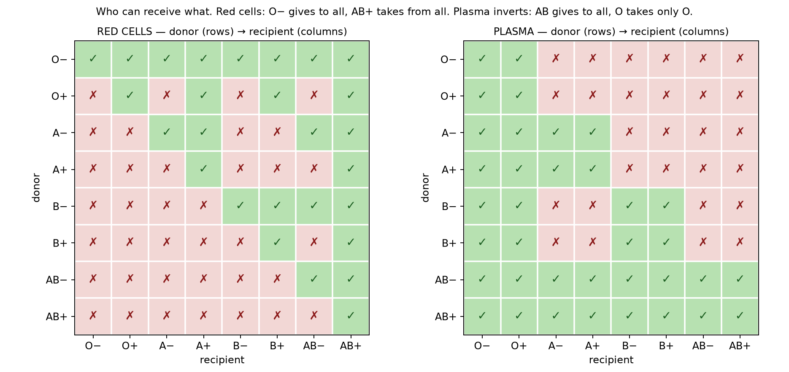

The rule for **red cells**: the donor's cells must carry no antigen the recipient has antibodies against. O− cells carry no A, no B, no D, so anyone can take them. AB+ plasma carries no anti-A, anti-B, and the person is already D-positive, so an AB+ recipient can take anything.

The rule for **plasma** is the reverse, because now the hazard is the *donor's* antibodies hitting the *recipient's* cells. AB plasma has no anti-A/anti-B and goes to anyone; O plasma has both and goes only to O.

For the user, **A+**: red cells from O−, O+, A−, A+. Plasma from A or AB. His red cells can go to A+ and AB+. His plasma can go to A and O recipients.

In practice, hospitals cross-match (mix donor cells with recipient plasma and watch for clumping) and type for several minor systems (Kell, Duffy, Kidd) for anyone who will be transfused repeatedly.

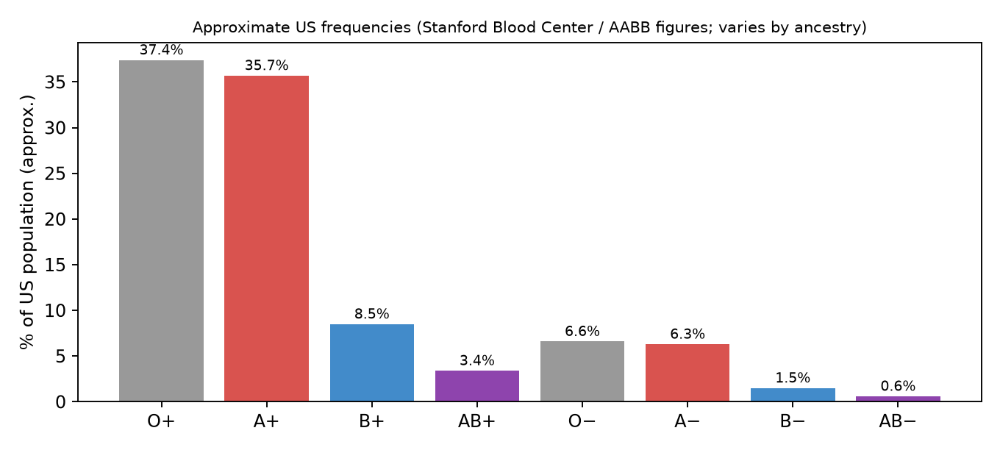

A+ is the second most common type in the US. Nothing about it is rare, and nothing about it is protective in general.

## 8. Blood type and disease, including SARS-CoV-2

Blood group sugars are on far more than red cells: gut lining, airway epithelium, platelets, von Willebrand factor, and (in secretors) every mucosal surface. So pathogens that bind sugars see them, and ABO shows up as a small risk modifier across many diseases.

| Disease / trait | Direction | Mechanism (where known) |
|---|---|---|
| **SARS-CoV-2 infection** | O slightly lower, A slightly higher (OR roughly 0.8–1.2 across meta-analyses) | Spike RBD binds the group-A glycan on respiratory cells (Wu et al., *Blood Advances* 2023); anti-A in O people may neutralise virions carrying a type-A host's glycans; O has ~25% lower von Willebrand factor so less clotting |
| Norovirus (Norwalk) | Non-secretors (*se/se*) almost completely resistant to the classic strain | Virus binds H type 1 in the gut; no FUT2, no receptor |
| Cholera | O more severe disease | Toxin binding modulated by ABH |
| Severe falciparum malaria | O protective | Infected cells "rosette" less with O cells |
| Venous thromboembolism | Non-O higher | Higher vWF and factor VIII |
| Bleeding | O slightly more | Lower vWF |
| *H. pylori* / peptic ulcer | O and Le^b-positive higher | Bacterial adhesin BabA binds Le^b |
| Gastric cancer | A slightly higher | Historical association (Aird 1953); mechanism unclear |
| Pancreatic cancer | Non-O higher | GWAS signal at *ABO* locus |

For the user's specific question: an A+ person is on the slightly *more* susceptible side of the SARS-CoV-2 effect, and the effect is small enough that age, sex, and weight swamp it. The remembered thought ("A+ is less susceptible") had the sign reversed. Rh status has no consistent association.

## 9. Glucose, fructose, sucrose, and the two Cokes

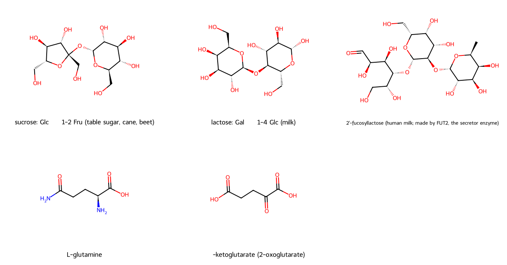

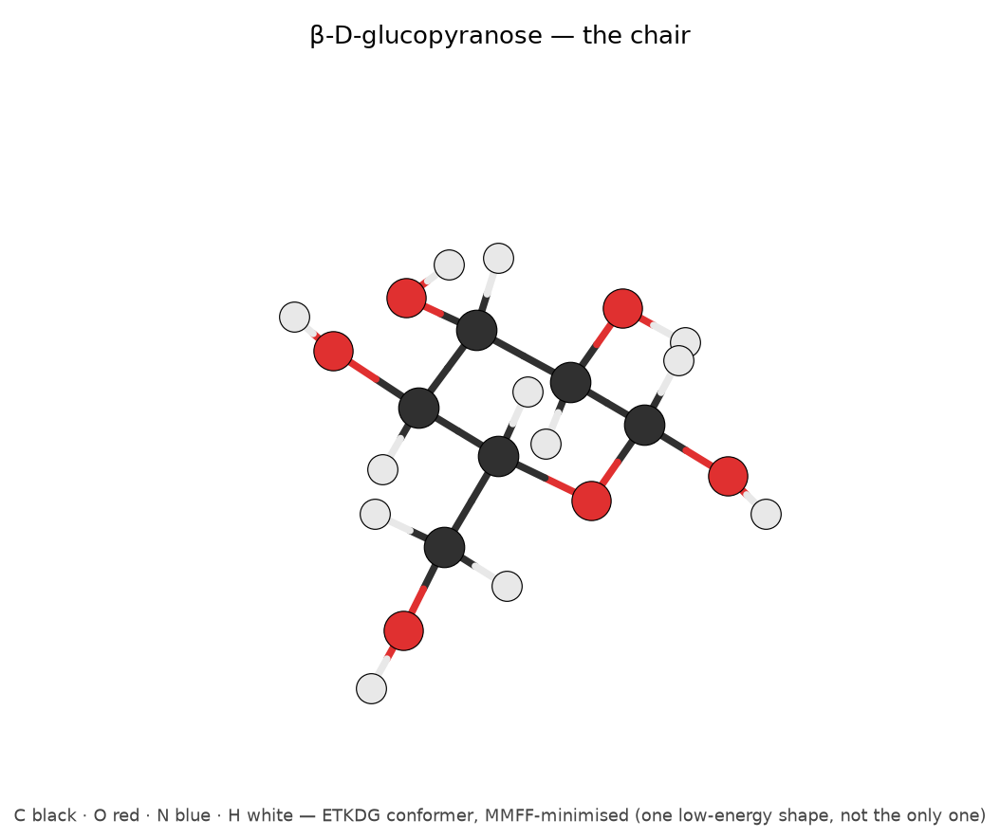
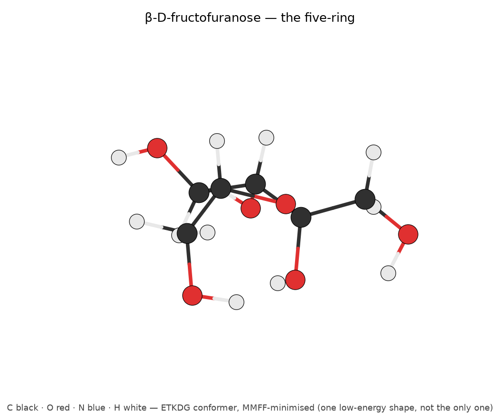
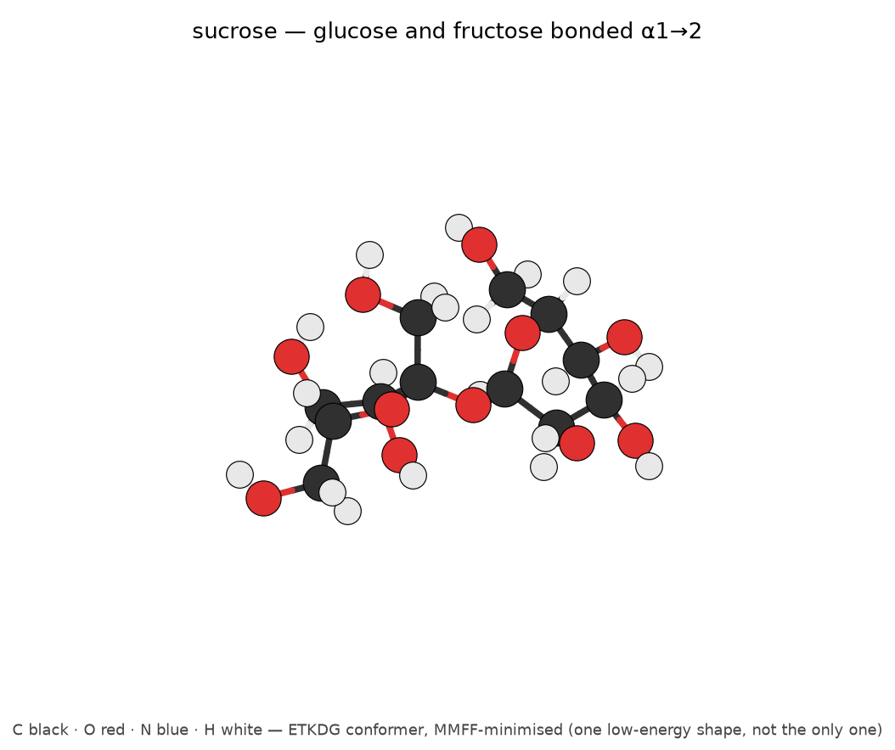

**Glucose** is a six-carbon aldose that closes into a six-membered ring (a pyranose) and sits in a chair. **Fructose** is a six-carbon ketose that mostly closes into a five-membered ring (a furanose) in sucrose, and in solution flips between five- and six-ring forms. Same formula, C₆H₁₂O₆, different carbonyl position, different ring, different taste (fructose is about 1.5–1.7 times as sweet as sucrose by weight), and different fate in the body.

**Sucrose** is one glucose and one fructose joined head-to-head through both anomeric carbons (Glc α1→2 Fru). That bond locks both rings closed, so sucrose does not react as a reducing sugar and has to be cut before it can be absorbed. The enzyme sucrase-isomaltase in the small intestine cuts it; so does acid. Cane sugar, beet sugar and "real sugar" on a label are all sucrose.

**High-fructose corn syrup** is corn starch broken to glucose, then part of the glucose isomerised to fructose by glucose isomerase. **HFCS-55** (soft drinks) is nominally 55% fructose, 42% glucose, 3% higher saccharides, *all as free monosaccharides in water*. HFCS-42 goes into baked goods.

### What happens in the body

Both sugars are absorbed in the small intestine, glucose by SGLT1/GLUT2, fructose by GLUT5. From there:

- **Glucose** raises blood glucose, triggers insulin, enters every tissue, and goes through glycolysis past phosphofructokinase-1, which is the regulated gate: when the cell has enough energy, PFK-1 slows and glucose is parked as glycogen.
- **Fructose** is mostly taken up by the liver (and gut), phosphorylated by **fructokinase (KHK)** to fructose-1-phosphate, and split by aldolase B into trioses that enter glycolysis *below* the PFK-1 gate. There is no brake. Excess fructose carbon goes to fat (de novo lipogenesis), to uric acid (from the ATP burned by fructokinase), and it does not trigger insulin or leptin directly. This is the biochemical basis of the fructose-and-fatty-liver literature, and it is real at high intakes. It is the fructose *fraction and dose* that matter, from any source.

### Mexican Coke vs American Coke

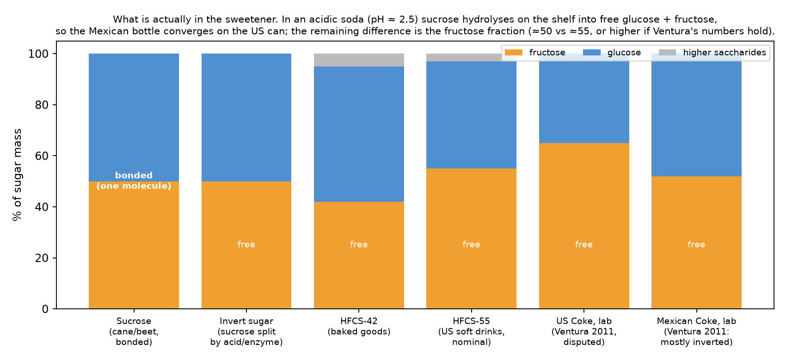

The label difference: Mexican Coca-Cola is sweetened with sucrose (cane sugar); US Coca-Cola with HFCS-55. The chemical difference as consumed is smaller than the label suggests, for two reasons.

1. **Sucrose inverts on the shelf.** Coke is at pH ≈ 2.5 (phosphoric acid). At that acidity sucrose hydrolyses to free glucose + fructose ("invert sugar") over weeks. Ventura, Davis & Goran (*Obesity* 2011, 19:868–874) measured retail Mexican Coke and found it already mostly free glucose and fructose, not sucrose. So by the time it is drunk, a bottle of Mexican Coke is roughly 50:50 free fructose:glucose.
2. **The HFCS fructose fraction is 55%, or possibly higher.** The same study measured US HFCS sodas at 59% fructose on average, with Coca-Cola at ~65%. That number is disputed: the corn industry (White, 2012) argued the HPLC method overcounted, and later enzymatic assays came in near the nominal 55. The honest statement is "55%, with one laboratory finding higher."

So the real difference in the glass is a fructose fraction of about 50% (Mexican) versus 55% (US, nominal), both as free sugars, in the same total dose (about 39 g per 355 mL). On the biochemistry above, the Mexican bottle delivers about 10% less fructose per can. That is a real difference and a small one. The taste difference that people report is partly the sweetener (sucrose has a slightly different sweetness curve), partly the glass bottle, partly carbonation and water, and partly expectation; blind tests are mixed. The American Chemical Society's *Reactions* channel has a good short treatment (§12).

## 10. Glucenate — the repo's name for glutamate

In this repo's lexicon (handoff 2026-09-28, table of renamed terms) **glucenate = glutamate**. The name encodes the thing the BBB reports established: glutamate in the brain is made *from glucose*, on the brain side of the barrier.

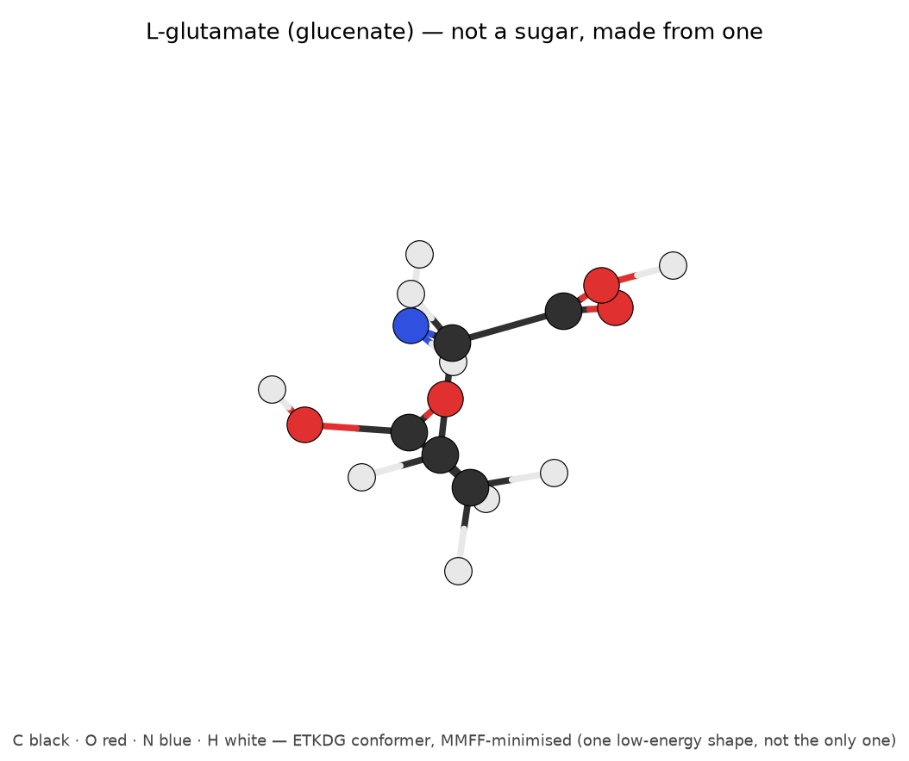
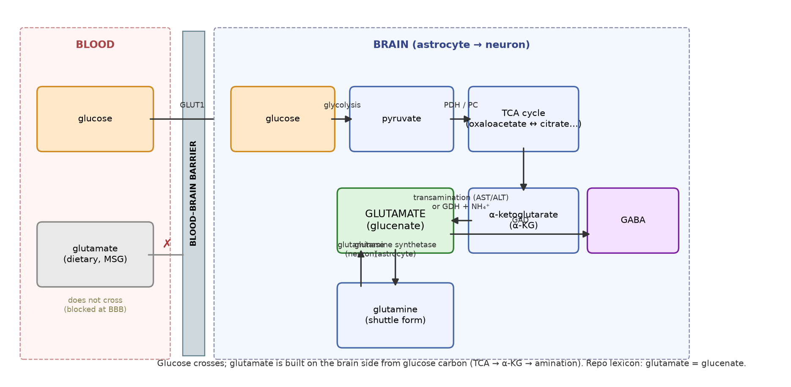

Glutamate is not a sugar. It is an amino acid: a five-carbon chain with an amine on carbon 2 and carboxylic acids on both ends (C₅H₉NO₄). Compare its drawing in §2 with the sugars: no ring, one nitrogen, two acids, no run of hydroxyls.

**Why it is made from glucose rather than imported.** Dietary glutamate (including MSG) is almost entirely consumed by the gut lining as fuel, and what reaches the blood is blocked at the blood-brain barrier, which actively pumps glutamate *out* of the brain. So brain glutamate is built in place:

1. Glucose crosses the barrier on GLUT1.
2. Glycolysis → pyruvate.
3. Pyruvate enters the TCA cycle (via pyruvate dehydrogenase, or in astrocytes via pyruvate carboxylase, which tops up the cycle's four-carbon pool).
4. The cycle runs to **α-ketoglutarate** (2-oxoglutarate), the five-carbon acid.
5. α-KG picks up an amine group, either by transamination from another amino acid (aspartate or alanine aminotransferase) or directly from ammonium via glutamate dehydrogenase, and becomes **glutamate**.

That is the carbon path: the user's "radioactive carbon is present in brain glucenate after infusion into blood" (BBB inference report) is this chain traced with ¹³C or ¹⁴C glucose.

**What it then does.** Glutamate is the main excitatory neurotransmitter. After release, astrocytes take it up, convert it to **glutamine** (glutamine synthetase, which also disposes of ammonia), and hand the glutamine back to neurons, which cut it back to glutamate (glutaminase). This **glutamate–glutamine cycle** is how the brain recycles the molecule without letting free glutamate accumulate in the synapse, where in excess it kills neurons (excitotoxicity, the mechanism in stroke damage). One decarboxylation (glutamate decarboxylase, GAD) turns glutamate into **GABA**, the main inhibitory transmitter, so the brain's on-signal and off-signal are one carbon apart. On the tongue, glutamate is umami.

So *glucenate* is a good name: glucose in, glutamate out, and the barrier between them is the reason the name is earned.

## 11. What the microscopes can and cannot show

A request was made for 3-D electron-microscope images of the sugars. The honest state of the art:

- **Scanning electron microscopy** (the images in §1) resolves cells and surface texture, down to tens of nanometres. A monosaccharide is ~0.5 nm. SEM cannot see a sugar.
- **Transmission EM** gets to about 0.1 nm on crystalline inorganic samples, and biological material is destroyed well before that.
- **Cryo-EM** resolves proteins to 2–3 Å and shows glycans as blurred density attached to them; the SARS-CoV-2 spike glycan shield is the famous example (Watanabe et al., *Science* 2020). You see *that* a sugar is there and roughly its first ring, not its full shape.
- **X-ray crystallography** is where the atomic-resolution sugar pictures come from. The GTA/GTB structures in §4 contain the bound acceptor sugar at ~1.3–1.8 Å, which is atom by atom.
- **Scanning tunnelling microscopy of single glycans.** In 2020 a group at the Max Planck Institute for Solid State Research soft-landed individual glycan molecules on a cold metal surface by electrospray and imaged them one at a time at sub-nanometre resolution: Wu, X., Delbianco, M., Anggara, K., *et al.* "Imaging single glycans." *Nature* 582, 375–378 (2020), [doi:10.1038/s41586-020-2362-1](https://www.nature.com/articles/s41586-020-2362-1). The follow-up imaged glycans still attached to their proteins and lipids: Anggara, K. *et al.* "Direct observation of glycans bonded to proteins and lipids at the single-molecule level." *Science* 382, 219–223 (2023), [doi:10.1126/science.adh3856](https://www.science.org/doi/10.1126/science.adh3856). Those are the closest thing that exists to "a photograph of a sugar," and they are 2-D height maps of molecules lying on a surface, not 3-D volumes.

The 3-D renders in this report are therefore *computed* shapes (force-field minimised conformers), which is also what every textbook 3-D sugar picture is. The crystal structures are measured; the conformers are calculated; the micrographs are of cells.

## 12. Videos (IDs verified live on 2026-10-10)

Blood type sugars and enzymes:

- *Biochemistry of ABO Antigens* — Hussain Biology, 4:31 — [youtu.be/Kf4eb-CBF-s](https://youtu.be/Kf4eb-CBF-s)
- *Glycosyltransferases and ABO Blood Groups* — Andrey K, 8:57 — [youtu.be/YSVbO2sHlBE](https://youtu.be/YSVbO2sHlBE)
- *H antigen | Bombay* — Blood Talks, 6:41 — [youtu.be/KlD93mYNtfc](https://youtu.be/KlD93mYNtfc)
- *ABO Blood Types Made Easy!* — Dr Matt & Dr Mike, 8:05 — [youtu.be/Amn2EWTY2Lk](https://youtu.be/Amn2EWTY2Lk)

Glucose, fructose, sucrose:

- *Carbohydrates & sugars — biochemistry* — Osmosis from Elsevier, 11:57 — [youtu.be/jQi84TnstI4](https://youtu.be/jQi84TnstI4)
- *Monosaccharides — Glucose, Fructose, Galactose & Ribose* — The Organic Chemistry Tutor, 5:59 — [youtu.be/p0soyMv8-Xo](https://youtu.be/p0soyMv8-Xo)

The two Cokes:

- *Everyone is Wrong About Mexican Coke* — Reactions (American Chemical Society), 9:55 — [youtu.be/NY66qpMFOYo](https://youtu.be/NY66qpMFOYo)

Glucenate:

- *Glutamate-Glutamine cycle* — Animated biology with Arpan, 3:40 — [youtu.be/AUnaf1heRD0](https://youtu.be/AUnaf1heRD0)
- *Astrocytic glutamate uptake* — alex constantinescu, 4:52 — [youtu.be/XLmixyRrLVo](https://youtu.be/XLmixyRrLVo)

Interactive 3-D (browser, no install): [RCSB 1LZ0](https://www.rcsb.org/3d-view/1LZ0) · [RCSB 1LZI](https://www.rcsb.org/3d-view/1LZI) · PubChem 3-D conformers: [glucose 64689](https://pubchem.ncbi.nlm.nih.gov/compound/64689#section=3D-Conformer) · [fructose 439709](https://pubchem.ncbi.nlm.nih.gov/compound/439709#section=3D-Conformer) · [sucrose 5988](https://pubchem.ncbi.nlm.nih.gov/compound/5988#section=3D-Conformer) · [A trisaccharide 49852448](https://pubchem.ncbi.nlm.nih.gov/compound/49852448) · [L-glutamate 33032](https://pubchem.ncbi.nlm.nih.gov/compound/33032#section=3D-Conformer)

## 13. Sources

- Yamamoto, F., Clausen, H., White, T., Marken, J. & Hakomori, S. (1990). Molecular genetic basis of the histo-blood group ABO system. *Nature* 345, 229–233.
- Patenaude, S. I. *et al.* (2002). The structural basis for specificity in human ABO(H) blood group biosynthesis. *Nature Structural Biology* 9, 685–690. PDB 1LZ0, 1LZI.
- Daniels, G. *Human Blood Groups*, 3rd ed. (Wiley-Blackwell, 2013). Chapters 2 (ABO, H, Lewis) and 5 (Rh).
- Cooling, L. (2015). Blood groups in infection and host susceptibility. *Clinical Microbiology Reviews* 28, 801–870.
- Wu, S.-C. *et al.* (2023). Blood group A enhances SARS-CoV-2 infection. *Blood Advances* / ASH press release, June 2023.
- Haile *et al.* (2025) review of ABO and COVID-19 outcomes, PMC12274851.
- Ventura, E. E., Davis, J. N. & Goran, M. I. (2011). Sugar content of popular sweetened beverages based on objective laboratory analysis: focus on fructose content. *Obesity* 19, 868–874. (Disputed by White, J. S., 2012, *Obesity*.)
- Hanover, L. M. & White, J. S. (1993). Manufacturing, composition, and applications of fructose. *Am. J. Clin. Nutr.* 58, 724S–732S.
- Lustig, R. H. (2010). Fructose: metabolic, hedonic, and societal parallels with ethanol. *J. Am. Diet. Assoc.* 110, 1307–1321.
- Hawkins, R. A. (2009). The blood-brain barrier and glutamate. *Am. J. Clin. Nutr.* 90, 867S–874S.
- Bak, L. K., Schousboe, A. & Waagepetersen, H. S. (2006). The glutamate/GABA-glutamine cycle. *J. Neurochem.* 98, 641–653.
- Wu, X. *et al.* (2020). Imaging single glycans. *Nature* 582, 375–378.
- Anggara, K. *et al.* (2023). Direct observation of glycans bonded to proteins and lipids at the single-molecule level. *Science* 382, 219–223.
- Watanabe, Y. *et al.* (2020). Site-specific glycan analysis of the SARS-CoV-2 spike. *Science* 369, 330–333.
- Repo: `handoff_20260928/HANDOFF_20260928.md` (lexicon: glutamate → glucenate), `BBBInferenceReport_20260930.md`, `BBBAgentInferenceTrap.md`.
- Images: NCI Visuals Online, Bruce Wetzel & Harry Schaefer, public domain. PubChem (NIH) for SMILES. RCSB PDB for coordinates.

*Figures and PDF generated by `make_figures.py` and `build_pdf.py` in this directory.*
