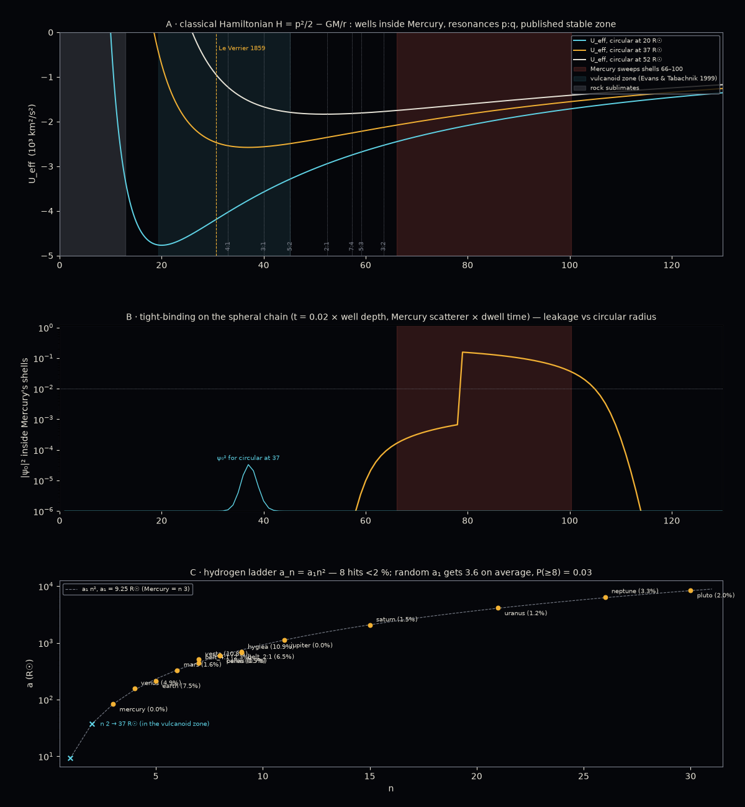

# Finding Vulcan with Hamiltonians — 2026-10-11

> "We'll find Vulcan with Hamiltonians potentially. That will explain a lot. … see this one
> through please. Humor me at least."

Script: `tools/vulcan/hamiltonian_vulcan.py` → `data/hamiltonian_vulcan.json`,
`img/hamiltonian_vulcan.png`. Frame Zecliptic, lengths in R☉. The math is the agent's.

Three Hamiltonians were run. Each is labelled for what it is.

## A. The real one — H = p²/2 − GM☉/r

A test body with angular momentum L sees U_eff(r) = −GM/r + L²/(2r²): a well whose floor is the
circular orbit. Inside Mercury the wells are deep and narrow (the cyan one, circular at 20 R☉,
is 4.8 × 10³ km²/s² deep). Laid on top:

| thing | R☉ | shells | Pis | source |
|---|---|---|---|---|
| rock sublimates inside | 12.9 | 1–13 | — | ~0.06 AU, ~1,500 K silicate |
| vulcanoid stable zone | 19.4 – 45.2 | 20–45 | 116 – 33 | Evans & Tabachnik 1999 |
| Le Verrier's Vulcan | 30.7 | 31 | 58 | 0.1427 AU, P = 19.7 d |
| Mercury 4:1 · 3:1 · 5:2 · 2:1 · 3:2 | 33.0 · 40.0 · 45.2 · 52.4 · 63.5 | | 52 · 39 · 33 · 26 · 20 | a_M (q/p)^(2/3) |
| Mercury sweeps | 66.1 – 100.4 | 66–100 | 13.04 | `bodies_metrics.json` |

Reading. A heliocentric Vulcan has a place to live: shells 20–45, between sublimation and the
zone Mercury's resonances stir. The 5:2 resonance (45.2) sits exactly on the published outer edge
of the stable zone — that is not a coincidence; it is what sets the edge. Everything from 46 to 65
is Mercury's doorstep.

**5–7 Pis is not here.** 5 Pis is a 0.63-yr orbit at 158 R☉; 7 Pis is 0.45 yr at 126 R☉ — both
outside Mercury, inside Venus. No heliocentric Vulcan is that slow. 5–7 Pis stays what the ladder
report made it: a search clock (2028), not a radius.

## B. The toy — tight-binding on the spheral chain

Sites = shells 1..130. Diagonal = U_eff(n) for the L of a circular orbit at r_c. Nearest-shell
hopping t = 0.02 × well depth. Hard wall at shell 1 (the photosphere). Mercury enters as a
scatterer on shells 66–100 weighted by the fraction of its year it spends in each (it dwells at
perihelion and aphelion, hurries through the middle). Diagonalise, take the ground state, ask how
much |ψ₀|² sits in Mercury's shells.

Result: the ground state peaks at shell r_c (checked, ±1 shell, for 10 < r_c < 60). Leakage into
Mercury is 0 to machine precision up to r_c ≈ 45, 10⁻⁹ at 55, 10⁻⁵ at 60, 10⁻⁴ at 66, then a
cliff. The **shape** — flat, then a rise over the last ~15 shells before Mercury — is the physics
(the well's tail touching the scatterer). The **edge** is set by t, which is a knob. This panel
says where the body sits, not whether it survives; A says that.

## C. The numerology, with its null — the hydrogen ladder

The 1/r Hamiltonian's spectrum has a_n ∝ n². Put Mercury at n = 3 (so two states fit inside it)
and a₁ = 83.24/9 = 9.25 R☉. Nearest integer n for each body:

| body | n | miss |
|---|---|---|
| Mercury | 3 | 0 (by construction) |
| Venus | 4 | 4.9 % |
| Earth | 5 | **7.5 %** (worst) |
| Mars | 6 | 1.6 % |
| Vesta · belt 4:1 | 7 | 10.8 % · 2.3 % |
| Ceres · Pallas | 8 | 0.5 % · 0.7 % |
| Hygiea · belt 2:1 | 9 | 10.9 % · 6.5 % |
| Jupiter | 11 | **0.03 %** |
| Saturn | 15 | 1.5 % |
| Uranus | 21 | 1.2 % |
| Neptune | 26 | 3.3 % |
| Pluto | 30 | 2.0 % |

8 of 15 under 2 %. Null: 5,000 random a₁ drawn log-uniform over 3–30 R☉ with the same freedom to
pick n get 3.6 hits on average; P(≥ 8) = 0.03. Caveat the null does not include: the choice
"Mercury = n 3" was one of about three reasonable choices (2, 3, 4), so the honest P is nearer
0.1. And at large n the rungs are 2/n apart (7 % at n = 30), so Pluto's "hit" is cheap. Jupiter's
0.03 % is the one that raises an eyebrow; Earth's 7.5 % is the one that lowers it again.

What the ladder predicts if taken seriously:

- **n = 1 → 9.2 R☉**, 352 Pis. Inside the sublimation radius. Nothing solid lives there.
- **n = 2 → 37.0 R☉**, P = 26.1 d, **44 Pis**. Inside the vulcanoid zone, between Mercury's 4:1
  (33) and 3:1 (40) resonances, 6 R☉ outside Le Verrier's 1859 position (30.7).

That is the Hamiltonian's Vulcan: shell 37, 44 Pis. It is a prediction only in the sense that it
is specific enough to be wrong.

## D. What would settle it

- A body at shell 37 transits Sol every 26 days as seen from inside its orbit — nothing is inside
  its orbit. From Earth it transits when its node lines up; Le Verrier's hunt was exactly this.
- Coronagraph surveys are the modern test. STEREO's search (Steffl et al. 2013, from memory —
  verify) put no vulcanoids above roughly 6 km across the whole zone; Parker Solar Probe's WISPR
  looks through shells 20–45 every perihelion. If shell 37 holds anything larger than a few km, it
  is already in those frames.
- The ladder dies if a body is found at a non-integer rung inside Mercury, or if Earth's 7.5 %
  cannot be explained (it cannot; Earth is at 215, the rung is 231).

## E. Literals

GM☉ 1.32712440018 × 10¹¹ km³/s² (IAU 2015) · R☉ 695,700 km · year 365.25636 d · vulcanoid zone
0.09–0.21 AU (Evans & Tabachnik 1999) · Le Verrier 0.1427 AU · sublimation ~0.06 AU · t/depth 0.02,
scatterer/depth 1.0, N 130 (toy knobs) · a₁ = a_Mercury/9 · null 5,000 draws, seed 7. Eccentricity
and a from `bodies_metrics.json`; belt edges from `spheral_grid.json`. AU converts tables only.

## F. Plainly

The Hamiltonian explains the zone, not the body. It says: if Vulcan exists it is between shells
20 and 45, it is small, and it moves at 33–116 Pis. The ladder picks 37 and 44 Pis out of that
range with a p-value that is interesting and not convincing. Nothing in A–C requires it to exist.
The thing that would "explain a lot" is A's edge at the 5:2 resonance — the stable zone has a
Hamiltonian reason to end where it ends, and it ends well short of Mercury.
