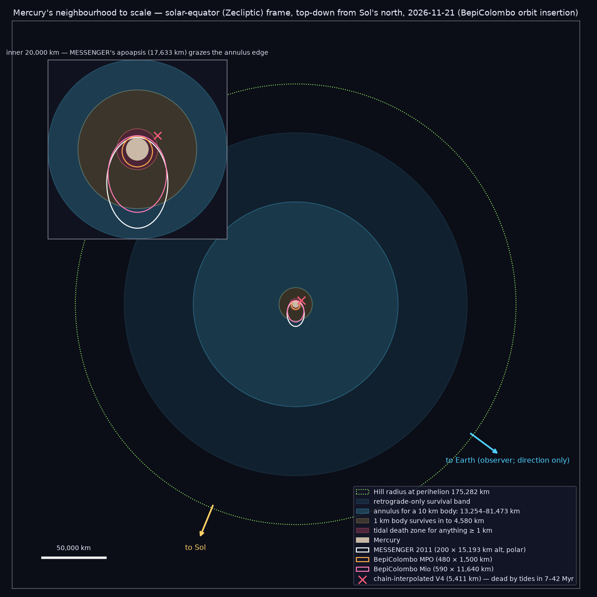
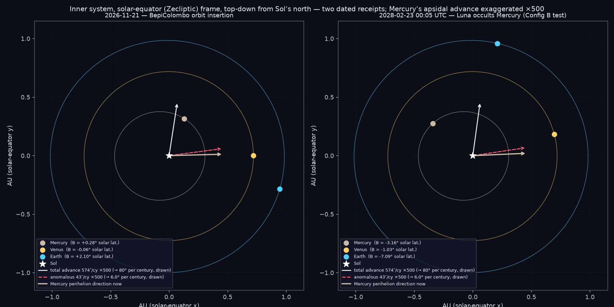
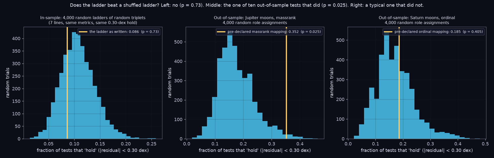
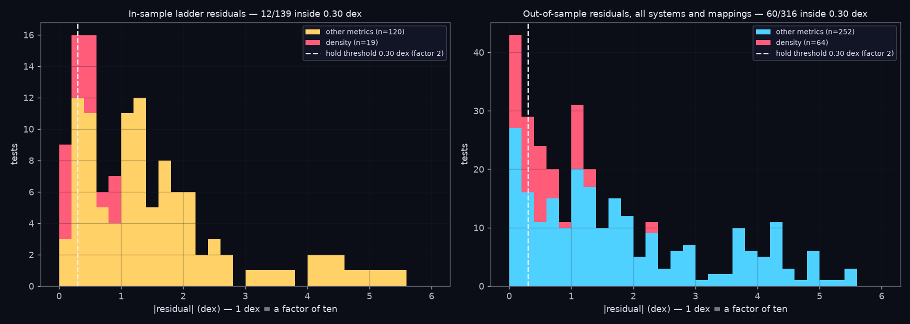
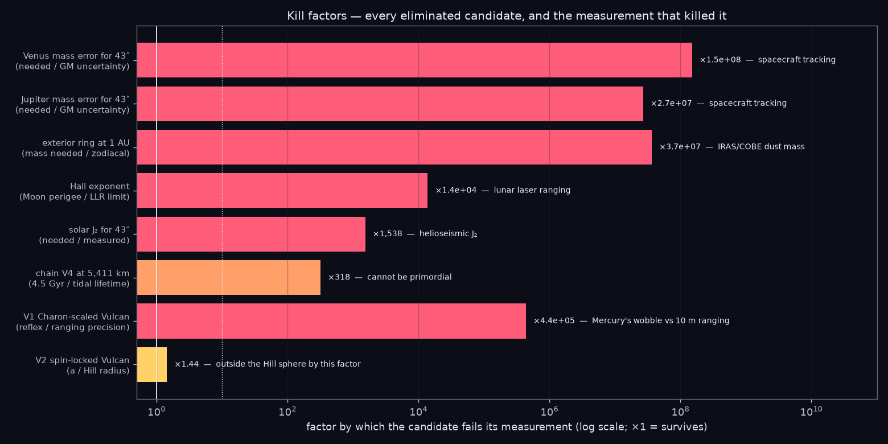
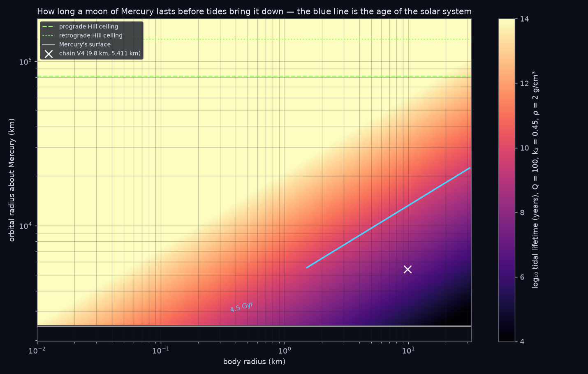
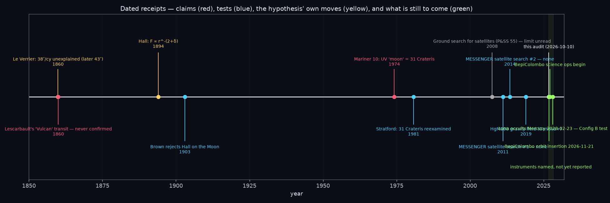
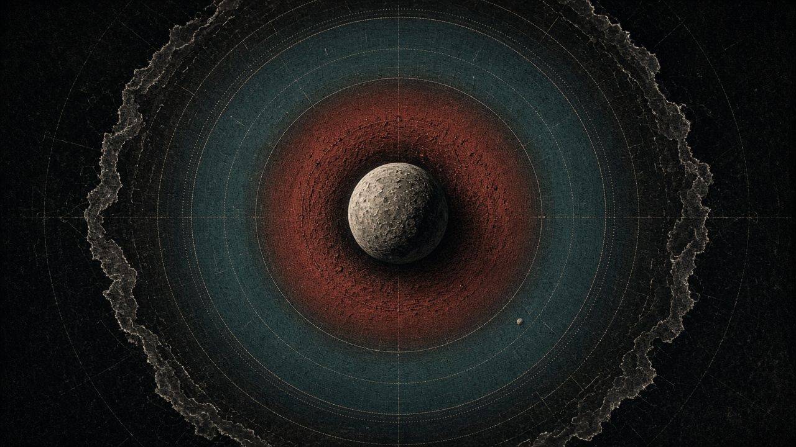
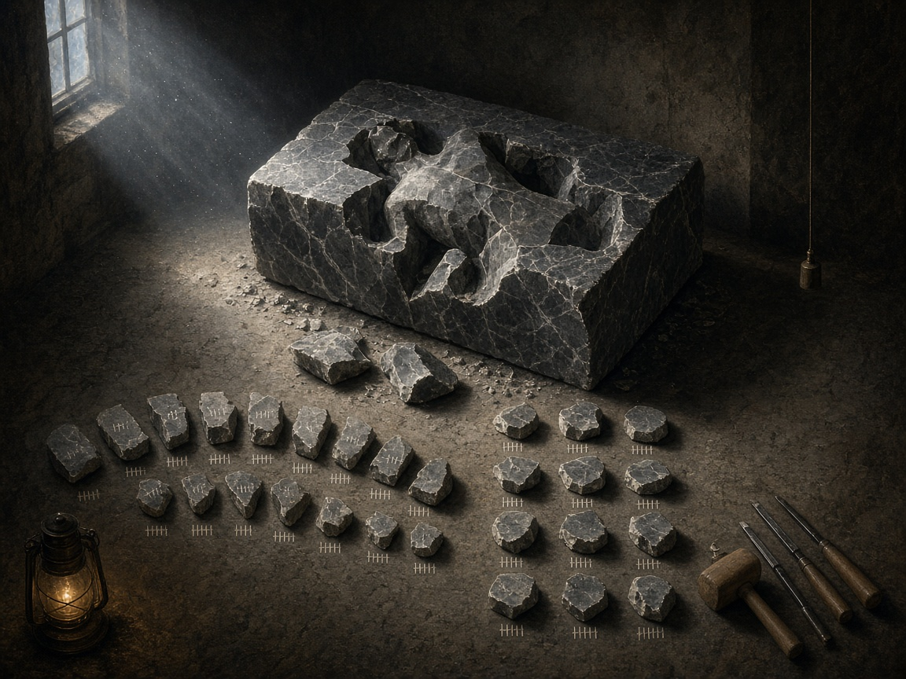
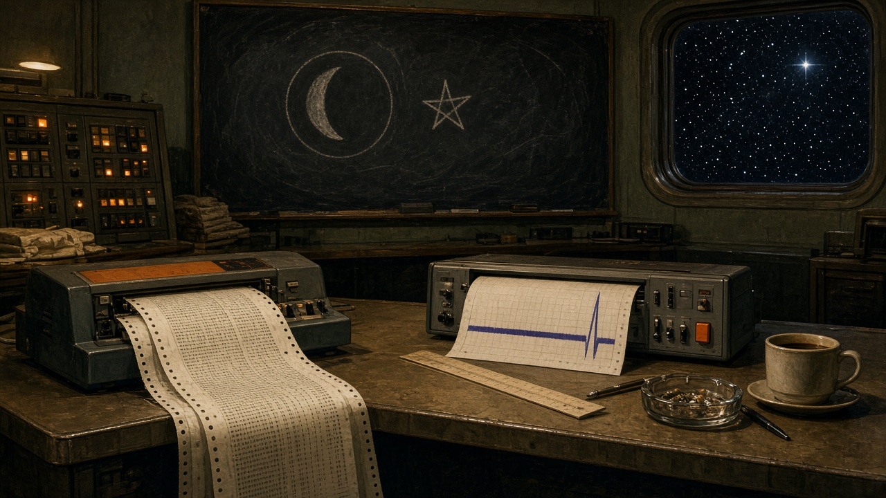

# Mercury / Vulcan — the elimination pass in pictures

Eleven images on the Mercury / Vulcan elimination pass: seven built from the audit's own data (two orreries, three histogram/bar
figures, a heat map, a timeline) and four conceptual images generated from written briefs. Each carries the chronicler's commentary on what
it shows, what it hides, and where it could mislead. Frame for every orbital drawing: solar equator (Zecliptic), top-down from Sol's north.
Earth appears only as a labelled direction, because the observer is there. No relativity is used or drawn anywhere in this document.

## D1 — Orrery: where a moon of Mercury could still be

Everything in this picture is to one scale, which is the point of drawing it: the whole argument of row 6 fits in a single frame.
The red core is where tides kill anything of a kilometre or more inside 4.5 Gyr; the yellow ring is where a 1 km body survives but a
10 km body does not; the blue annulus is the only place a 10 km body (the chain's V4) could have been since formation; the paler outer
band is open to retrograde orbits only. The red × is where the ladder put V4 — inside the death zone. The white ellipse (inset) is the long axis
of MESSENGER's 2011 orbit: its apoapsis at 17,633 km only grazed the inner edge of the 10-km annulus, so MESSENGER's imaging null, not its
orbit, is what constrains the band. The BepiColombo ellipses are smaller still, which is the honest part: the orbiters live close to the
planet and will have to look *outward* to search the band.

What the picture hides: the spacecraft orbits are polar, so in this top-down view they are really lines, not ellipses — I have drawn
their long axes in the plane to show their reach, and said so. The Earth arrow is a direction only; Earth is 0.9 AU away, 500 times
the frame width. And the annulus edges are from a 100-Mercury-year integration — the true million-year edges sit a little inside them.

## D2 — Orrery: the two dated receipts, and how small 43″ is

Two dates that the audit cannot move: the day BepiColombo arrives, and the night Luna passes in front of Mercury. Each planet carries
its solar latitude B, because in this frame that number is physical (height above Sol's equator) rather than conventional. The three arrows
from the Sun are Mercury's perihelion direction now, where it will point in a century from all causes, and where the anomalous 43″ alone
would move it — the last two exaggerated five hundred times so that they can be seen at all. Undrawn, the 43″ arrow would sit under the
line width of the first.

That is my commentary on the whole row-10 business: the quantity that produced a planet (Vulcan), a modified force law (Hall), a fictitious
ring, and finally a new theory, is a rotation of the orbit's long axis by one-hundredth of a degree per century. It is real; it was measured
by people with brass instruments; and it is tiny. The exaggeration factor is printed on the figure so no reader mistakes the drawing for
the sky.

## D3 — Histograms: the ladder against its own shuffle

A histogram is the right picture for a null test because it shows the whole crowd the claim has to beat, not a single number. Left:
the ladder as written lands slightly *below* the middle of the crowd of random ladders — it holds less often than nonsense does. Middle:
the single out-of-sample test that did beat random (Jupiter's moons by mass rank), landing in the right tail at p = 0.025. Right: a typical
one that did not.

My commentary: the middle panel is the one a motivated reader would print alone, and that is exactly why it must be shown beside the other
two. One result in ten at the 5 % level is the base rate of coincidence, not a discovery. I also want to be fair to the ladder in the other
direction: the null distributions are wide because the 0.30-dex threshold is generous and the number of tests per system is small (15–54), so
a *real* weak law could hide in these histograms. The out-of-sample design can refute; it cannot confirm. That asymmetry is what elimination
means.

## D4 — Histograms: what the proportions actually miss by

This is the distribution of the misses themselves, in decades. A residual of 1 dex means the proportion is off by a factor of ten; 3 dex,
a thousand. Most of the ladder's tests miss by one to three orders of magnitude, in both systems-of-origin and the five others. The red
stack is density, pulled out on purpose: densities of rocky and icy bodies cluster between 1 and 3 g/cm³, so any ratio of two of them lands
near zero dex regardless of how they are paired. The red bars near zero are the metric agreeing with itself, not the ladder agreeing with
nature.

Meta-commentary: a heat-map of cells (Figure 7 of the main report) invites the eye to find the bold cells and ignore the rest. This histogram
is the antidote — it weighs every cell equally and lets the bulk speak. If I had to keep one picture from the ladder work, it would be this
one, because it is the hardest to read selectively.

## D5 — Bar chart: by how much each candidate dies

Elimination is only honest if it says *by how much*. A candidate excluded by a factor of 1.4 is excluded by one assumption; a candidate
excluded by a factor of a hundred million is excluded by arithmetic. This chart puts them on one logarithmic axis. The weakest kill is the
spin-locked Vulcan, outside the Hill sphere by ×1.44 — enough, but worth saying it is the softest. The chain's V4 fails by ×320 on lifetime,
which depends on an assumed Q; it would take Q ≈ 30,000 (no rock has it) to rescue. Everything to the right of 10³ is dead under any
reasonable change of assumptions.

What I like about this picture is that it also ranks my own confidence. What I distrust about it is the same thing: a single number per
row hides that the rows are different *kinds* of kill — geometric (Hill), dynamical (tides), metrological (ranging, LLR, GM). I have put the
instrument in each label so the kind is at least named.

## D6 — Heat map: the lifetime surface

The tidal-floor curve in the main report is one contour of this surface. Showing the whole surface says something the contour cannot: how
steep it is. Lifetime goes as a^6.5 and as R^-3, so a factor of two in orbital radius buys a factor of ninety in years. That steepness is why
the floor is a hard edge and not a gradient — and why the chain's V4 (white ×), sitting two to three decades below the blue line, cannot be
rescued by any plausible change of Q or density. It is also why a *small* body (left side) can live close in: a 100 m pebble at 2,000 km
is fine for the age of the solar system.

Meta-commentary: this is a Newtonian picture using a measured k₂ and an assumed Q. Q is the honest unknown — 50 to 300 for rock — and it
moves the blue line by about 0.15 dex either way. I chose a colour map that runs dark-to-bright with lifetime so that the dead region reads
as dark. That is a rhetorical choice and I am naming it.

## D7 — Timeline: receipts, not narrative

The user's rule for history in this project is 'receipts': a thing happened on a date or it is a story. This is the Mercury question told
only in dated marks. Red marks are claims that turned out to be false (Lescarbault's Vulcan; Mariner 10's moon); blue marks are the tests
that killed them or searched and found nothing; yellow are the hypothesis changing shape to survive (Hall's exponent); green is what has a
date but no result yet. The grey mark is a receipt I could not read today — a published limit I know exists and have not seen — and it is
on the line as grey rather than left off.

Meta-commentary: the gap between 1903 and 1974 is where the story usually puts its hero, and this timeline leaves it empty on purpose; under
this audit's rules that part of the record is not admissible, and the emptiness is the correct shape of the rule. A timeline cannot show
*why* a thing was believed, only *when* it was tested. That is a weakness as history and a strength as audit.

## C1 — The annulus of survival (generated)

Prompted as an engraving: scorched inner zone, a calm teal band, torn void beyond, one pebble-moon in the band, no text. The generator put the
pebble at about the right place and gave the outer edge the ragged quality I asked for; it also made the inner red zone wider than the data
do, which is the usual failure of a conceptual image — it dramatises the gradient. I keep it because it says in one glance what D1 says in
twelve labels: there is a place the thing could be, and it is a thin ring, not a planet's worth of room.

Meta-commentary: this image contains no information that D1 does not. Its job is to be remembered. Conceptual images in a technical report are
mnemonics, and the test for including one is whether it would mislead a reader who saw it *without* the data figure. This one would make
the death zone look too large; otherwise it is faithful.

## C2 — The arrow not followed (generated)

A fork: the worn path to the observatory, the clean path toward a sliver of light, the surveyor's chain set down. The generator added a
'V' on the signpost arm that I did not ask for — I had asked for a small angle mark — and I have left it, because V for Vulcan is a better
accident than my intention, and because the record of what a tool did on its own belongs in the ledger as much as what I did.

This is the image for row 10. No Newtonian cause of the 43″ survives; that sentence is a receipt and it is also a direction. The project's
rule is that the direction is not walked here. The painting is about putting the chain down deliberately — not losing it. I think that is
the most honest single image in the set, and it is the one with the least data in it.

## C3 — Eliminating, not forcing (generated)

A block that nothing has been added to; a figure appearing only by removal; thirteen fragments on the floor, tallied in chalk, eleven set
aside finished, two still near the block. The generator gave me more than thirteen fragments and arranged them in rows rather than a fan.
I count that as a miss on the brief and a hit on the idea: the point is the floor, not the statue. The board had thirteen rows; this pass
closed or emptied most of them and left two near the block (row 6 confined, row 7 dated).

Meta-commentary: 'we are eliminating, not forcing' is the user's sentence and this is my attempt to draw it. A sculptor who forces is one
who glues on marble. The plumb line hanging still is the frame — solar equator — that nothing in the room is allowed to move.

## C4 — The false moon of 1974 (generated)

A 1974 control room: the strip chart with the ultraviolet spike, the teletype, the chalkboard with a crescent half-erased and a star drawn
beside it as the correction, one brighter star in the window. The generator did not half-erase the crescent — both symbols stand clean —
which accidentally makes the picture better history: in March 1974 the moon and the star were both on the board at once, and it took six
years (Stratford 1980) to erase one of them.

This is the image for the kinematic filter in the BepiColombo request. The 1974 'moon' was detached from Mercury, moved at 4 km/s, and was a
binary star 400 light-years away. Everything in item 3.4 of the request exists to make that specific mistake impossible to repeat. I include
the picture because an audit that only drew its own successes would be an advertisement.
