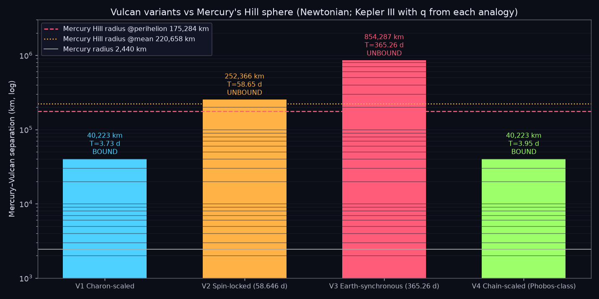
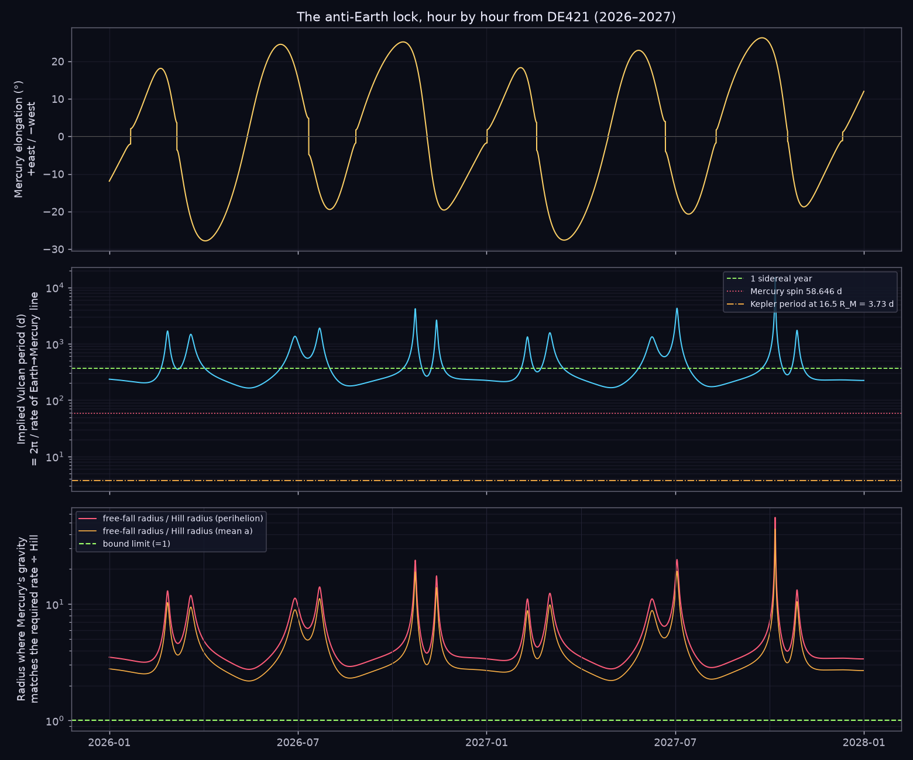
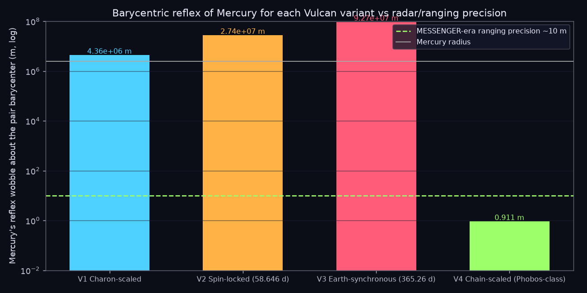
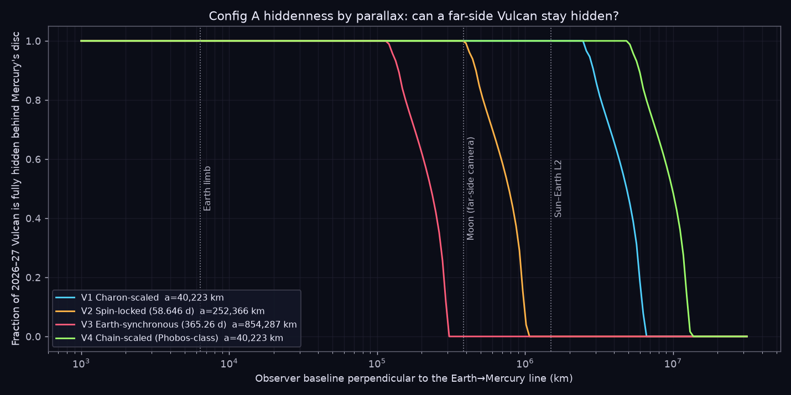
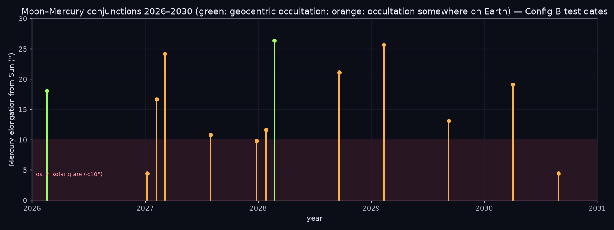
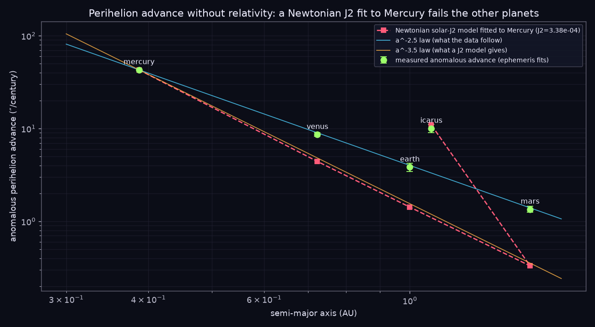
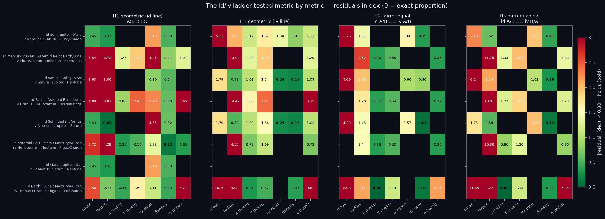
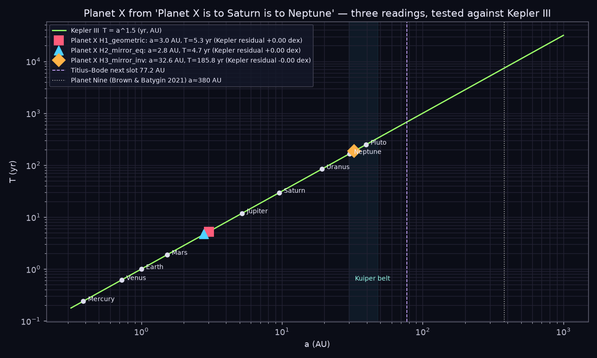
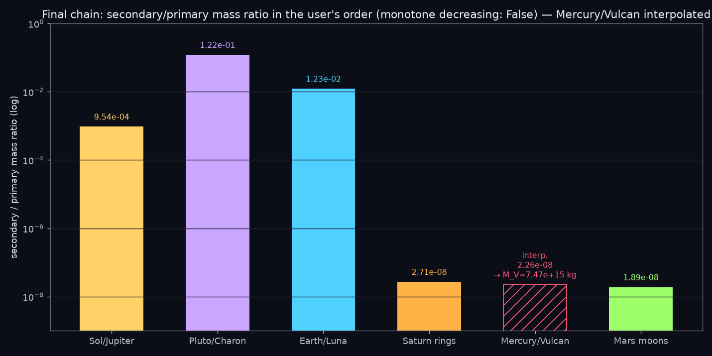

# Mercury / Vulcan and the id–iv Ladder — a Newtonian, measurement-only audit

Date: 2026-10-10 · Workspace: `star_learning/solar_system_explorer/docs/MERCURY_VULCAN_LADDER_20261010/`
Tools: `tools/vulcan/bodies.py`, `vulcan_derivation.py`, `ladder_analysis.py`, `ladder_null.py`, `build_report.py`; Godot recorder `game/tools/record_vulcan.gd`; encoder `tools/vulcan/encode_vulcan.sh`.
Ephemeris: JPL DE421 via Skyfield. No relativistic term is used anywhere in this report. No myth is admitted as evidence. Every claim below is a measurement, a Newtonian derivation from measurements, or is labelled as the user's axiom.

## 0. Axioms accepted for the experiment, and the rules

- Axiom A (user): Vulcan is bound to Mercury the way Charon is bound to Pluto, and sits ALWAYS on the far side of Mercury from Earth — Config A: Earth → Moon → Mercury → Vulcan.
- Axiom B (user, provisional): when the Moon lies between Earth and Mercury the order may invert — Config B: Earth → Moon → Vulcan → Mercury — and this configuration is rare.
- Planet X: a placeholder for a pattern break demanded by the ladder; nothing else is assumed about it.
- Rule 1: Newtonian mechanics only (Kepler III, Hill sphere, Roche limit, barycentre, parallax). Rule 2: measured numbers from spacecraft/radar/helioseismology are admitted as measurements, not as theory. Rule 3: every test states what observation would overturn it.
- The Zecliptic: the workspace rule defines it as the ecliptic with Sol's equator 7.25° off it. The user asked for angles 'from the Zecliptic (Solar equator)'. Both frames are therefore tabulated: inclination to the ecliptic, to the solar equator, and to the invariable plane.

## 1. Data layer — every measurable metric

`data/bodies_metrics.{json,csv,md}` holds 43 records: Sol, the eight planets, Pluto/Charon and its four small moons, Luna, Phobos/Deimos, the Galilean moons, seven Saturnian moons, five Uranian, Triton/Proteus/Nereid, Ceres/Vesta/Pallas/Hygiea, the asteroid belt (AB) and the heliobarrier (HB). Per body: mass, GM, radii, density, a, e, i (three frames), node, sidereal and synodic periods, rotation, obliquity, J2, magnetic dipole, albedos, surface gravity, escape speed, irradiance, Hill radius, orbital and spin angular momentum, moon count, total moon mass, ring presence/mass/extent, Roche limit, barycentre offset, synchronous-orbit radius. Internal checks pass: T²/a³ = 1.000 ± 0.001 for every planet; Charon's Kepler period from (a, M) is 6.385 d against the measured 6.387 d; Luna's is 27.28 d against 27.32 d; Mars' synchronous orbit comes out at 20,428 km (literature 20,428 km); the Earth–Luna barycentre at 4,671 km (literature 4,671 km).

| Body | Mass kg | a AU | T d | Synodic d | Rot d | T/rot | Obliq ° | i_ecl ° | i_SolEq ° | i_inv ° | Moons | Rings | Ring kg | Hill km |
|---|---|---|---|---|---|---|---|---|---|---|---|---|---|---|
| Mercury | 3.3e+23 | 0.3871 | 87.969 | 115.9 | 58.65 | 1.5 | 0.034 | 7.005 | 3.38 | 6.344 | 0 | no | 0 | 175,284 |
| Venus | 4.87e+24 | 0.7233 | 224.7 | 583.9 | -243 | 0.9246 | 177.4 | 3.395 | 3.856 | 2.195 | 0 | no | 0 | 1,004,233 |
| Earth | 5.97e+24 | 1 | 365.26 | 0 | 0.9973 | 366.3 | 23.44 | 0 | 7.25 | 1.579 | 1 | no | 0 | 1,471,428 |
| Mars | 6.42e+23 | 1.524 | 686.98 | 779.9 | 1.026 | 669.6 | 25.19 | 1.85 | 5.649 | 1.68 | 2 | no | 0 | 982,738 |
| Jupiter | 1.9e+27 | 5.203 | 4,333 | 398.9 | 0.4135 | 10,477 | 3.13 | 1.304 | 6.09 | 0.327 | 95 | yes | 1e+13 | 50,562,816 |
| Saturn | 5.68e+26 | 9.537 | 10,759 | 378.1 | 0.444 | 24,232 | 26.73 | 2.485 | 5.504 | 0.93 | 274 | yes | 1.54e+19 | 61,645,286 |
| Uranus | 8.68e+25 | 19.19 | 30,688 | 369.7 | -0.7183 | 42,722 | 97.77 | 0.772 | 6.478 | 1.028 | 28 | yes | 1e+16 | 66,768,642 |
| Neptune | 1.02e+26 | 30.07 | 60,182 | 367.5 | 0.6713 | 89,657 | 28.32 | 1.77 | 6.43 | 0.726 | 16 | yes | 1e+15 | 1.15e+08 |
| Pluto | 1.3e+22 | 39.48 | 90,560 | 366.7 | -6.387 | 14,178 | 122.5 | 17.16 | 11.9 | 15.58 | 5 | no | 0 | 5,756,371 |

Readings from the table that matter for what follows: Mercury's spin:orbit ratio is exactly 1.500 (3:2). Mercury is the planet whose orbit lies closest to the solar equator (3.38°); Earth, by definition of the ecliptic, is the farthest of the eight (7.25°). Venus (Ω 76.68°) and Uranus (Ω 74.01°) have their nodes within 2° of the solar-equator node (75.76°). Saturn's ring mass is 2.7 × 10⁻⁸ of Saturn; Mars' moons are 1.9 × 10⁻⁸ of Mars — the same order, which the final chain exploits.

Equinox geometry (user: 'Equinox is the best time to judge angles'). The heliographic latitude of the disc centre, B0 = asin(sin i☉ · sin(λ☉ − Ω☉)), is -7.026° at the March equinox and 7.026° at the September equinox — 97 % of the full 7.25° tilt — and 0° near June 6 / December 7. So the equinoxes are indeed near-optimal for reading the Sun's tilt; the true extremes fall about two weeks earlier (≈ March 6, September 8).

## 2. Mercury / Vulcan — the four Vulcans the analogies produce

Pluto/Charon template (New Horizons): q = M_C/M_P = 0.1217, R_C/R_P = 0.51, a = 16.49 R_P = 19,591 km, period 6.3872 d = Pluto's spin = Charon's spin, barycentre 2,126 km from Pluto's centre, i.e. outside Pluto (R_P = 1,188 km). Mercury: M = 3.3011e+23 kg (GM known to 10⁻⁶ from MESSENGER), R = 2,439.7 km, spin 58.646 d, orbit 87.969 d, Hill radius 175,284 km at perihelion (220,658 km at mean distance).

| Variant | q | M_V kg | R_V km | a km | a/R_M | Kepler T d | a/Hill | Bound? | Mercury reflex km | Barycentre outside Mercury? |
|---|---|---|---|---|---|---|---|---|---|---|
| V1 Charon-scaled | 0.122 | 4.02e+22 | 1,244 | 40,223 | 16.5 | 3.732 | 0.229 | yes | 4,365 | yes |
| V2 Spin-locked (58.646 d) | 0.122 | 4.02e+22 | 1,244 | 252,366 | 103 | 58.65 | 1.44 | NO | 27,385 | yes |
| V3 Earth-synchronous (365.26 d) | 0.122 | 4.02e+22 | 1,244 | 854,287 | 350 | 365.3 | 4.87 | NO | 92,700 | yes |
| V4 Chain-scaled (Phobos-class) | 2.26e-08 | 7.47e+15 | 9.834 | 40,223 | 16.5 | 3.952 | 0.229 | yes | 0.0009107 | no |

- V1 Charon-scaled: q=M_Charon/M_Pluto, R_V=0.510 R_M, a=16.49 R_M (Pluto/Charon ratios applied to Mercury)
- V2 Spin-locked: Mutual tidal lock like Pluto/Charon: orbital period = Mercury's measured sidereal spin 58.646 d; a from Kepler III
- V3 Earth-synchronous: Strict anti-Earth lock: the Earth->Mercury direction turns once per sidereal year on average; a from Kepler III
- V4 Chain-scaled: From 'Saturn/rings is to Mercury/Vulcan is to Mars/moons': q = sqrt(q_SaturnRings * q_MarsMoons); rho = Phobos; a = 16.49 R_M

*Figure 1 — Separation of each Vulcan variant against Mercury's Hill sphere. V2 and V3 lie outside it.*

## 3. Test 1 — Kepler III and the Hill sphere

A Pluto/Charon-style mutual lock requires the companion's orbital period to equal the primary's spin. Mercury's spin is 58.646 d; the Kepler radius for that period about Mercury (+ q) is 252,366 km = 1.44 × the perihelion Hill radius: unbound. A Vulcan that keeps station anti-Earth must turn with the Earth→Mercury line, which turns once per sidereal year on average; the Kepler radius for 365.26 d is 854,287 km = 4.87 × Hill: unbound by a factor five. Only V1 and V4 (a = 16.5 R_M = 40,223 km) are bound, and their free period is 3.7–4.0 d, not 58.6 d and not 365 d.
What would overturn this: a measured Mercury spin of ≈ 3.7 d, or a measured Mercury mass ≈ 125 × larger (which the MESSENGER orbit excludes at the 10⁻⁶ level).

## 4. Test 2 — the anti-Earth lock, hour by hour from DE421

The Earth→Mercury unit vector u(t) was computed at 1-hour cadence for 2026–2027 from DE421. Its angular rate ω = |u̇| gives the instantaneous period a locked Vulcan must have: mean 286.8 d, range 164.1–14,915 d (the line nearly stalls at the elongation turn-arounds). The radius at which Mercury's gravity would supply that rate, a_ff = (GM/ω²)^(1/3), is never less than 482,370 km = 2.75 × Hill; the fraction of time it falls inside the Hill sphere is 0%.

| Variant | Mercury gravity at a (m/s²) | centripetal needed (m/s²) | tangential needed, max (m/s²) | solar tide at a (m/s²) | gravity ÷ needed |
|---|---|---|---|---|---|
| V1 Charon-scaled | 0.0136 | 3.1e-06 | 1.86e-05 | 5.78e-05 | 4.39e+03 |
| V2 Spin-locked (58.646 d) | 0.000346 | 1.95e-05 | 0.000117 | 0.000363 | 17.8 |
| V3 Earth-synchronous (365.26 d) | 3.02e-05 | 6.58e-05 | 0.000396 | 0.00123 | 0.458 |

Two independent failures. (i) At V1's radius gravity exceeds the needed centripetal acceleration 4,400-fold: a free body there orbits in 3.7 d; to hold it anti-Earth something must push outward at 1.4 × 10⁻² m/s² continuously. (ii) The lock also needs a TANGENTIAL acceleration (up to 1.9 × 10⁻⁵ m/s² at V1, 4 × 10⁻⁴ at V3) because the Earth→Mercury line turns non-uniformly; no central force — gravity of Mercury, of the Sun, or any inverse-square field — can supply a tangential component. The axiom therefore requires a non-gravitational, continuously steered force. This is the sharpest result of the audit: an anti-Earth-locked Vulcan is dynamically impossible at ANY mass, including V4.
What would overturn this: a demonstration that the Earth→Mercury line turns uniformly (it does not — see Figure 2), or a bound orbit with a_ff inside the Hill sphere (none exists in 2026–27).

*Figure 2 — Elongation, implied Vulcan period and free-fall radius ÷ Hill radius, 2026–2027. The free-fall radius never drops to the bound limit.*

## 5. Test 3 — Mercury's own spin

Mercury's 58.646-d sidereal rotation (radar, 1965; MESSENGER libration) is exactly 2/3 of its 87.969-d orbit. A Charon-like companion at 16.5 R_M would, by Pluto/Charon's own template, have despun Mercury to the 3.73-d mutual-lock period. The 3:2 state is instead the Newtonian end-state of solar tides on an e = 0.2056 orbit. Status: the Charon analogy fails Mercury's measured spin. What would overturn this: a new radar/ranging spin period near 3.7 d.

## 6. Test 4 — Mercury's reflex wobble against ranging

Any companion makes Mercury orbit the pair's barycentre at a·q/(1+q). V1: 4,365 km (1.79 R_M — the barycentre is outside Mercury, exactly as for Pluto). V2: 27,385 km. V3: 92,700 km. V4: 0.911 m. Mercury's heliocentric orbit is tied to metre-class ranging (Mariner 10, MESSENGER, radar since 1964); a periodic displacement of thousands of km with a 3.7-d, 58.6-d or 365-d period is absent. V1–V3 exceed the 10-m precision by factors of 4.4e+05, 2.7e+06, 9.3e+06; V4 sits below it (0.091×). What would overturn this: a published Mercury residual of ≥ 10³ km with the stated period.

*Figure 3 — Reflex displacement of Mercury for each variant against ranging precision and Mercury's radius.*

## 7. Test 5 — can Vulcan stay hidden? Earth, the lunar far side, L2

Config A hides Vulcan behind Mercury's disc only if its angular radius R_V/(D+a) plus the parallax shift B·a/(D(D+a)) for an observer displaced by baseline B stays inside Mercury's angular radius R_M/D. Fraction of 2026–27 during which Vulcan is fully hidden:

| Variant | Earth centre | Earth limb (6,378 km) | Lunar far-side camera (384,400 km) | Sun–Earth L2 (1.5 Gm) | Baseline needed (lunar distances) | Config B silhouette (fraction of disc area) |
|---|---|---|---|---|---|---|
| V1 Charon-scaled | 1.00 | 1.00 | 1.00 | 1.00 | 12 | 0.26 |
| V2 Spin-locked (58.646 d) | 1.00 | 1.00 | 1.00 | 0.00 | 1.9 | 0.26 |
| V3 Earth-synchronous (365.26 d) | 1.00 | 1.00 | 0.00 | 0.00 | 0.58 | 0.26 |
| V4 Chain-scaled (Phobos-class) | 1.00 | 1.00 | 1.00 | 1.00 | 25 | 0.00 |

The user's instinct — a camera on the far side of the Moon would settle it — is right for V3 (always visible from the Moon) and partly right for V2 (visible about 40 % of the time); for V1 the 384,400-km baseline moves Vulcan only 0.18″ against a 1.8″ limb margin, and a baseline of 12 lunar distances (≈ 4.7 Gm) is needed. V4 (10 km) can hide from everything inside 25 lunar distances. Note what this buys: hiddenness is a geometric statement about where a thing could be, not evidence that it is there; Tests 1–4 are unaffected by it.

*Figure 4 — Hidden fraction versus observer baseline; the Moon and L2 marked.*

## 8. Config B — the near-side inversion and the dates on which it is testable

If Vulcan moves in front of Mercury (Earth → Moon → Vulcan → Mercury) its disc of angular radius R_V/(D−a) is silhouetted on Mercury's bright disc: for V1 a dark circle covering 26% of Mercury's area — a 10-cm telescope sees that. Lunar occultations of Mercury are the natural test dates. From DE421, Moon–Mercury conjunctions closer than 1.3° in 2026–2030 (green = geocentric occultation; the rest are occultations only from parts of Earth):

| UTC | min sep ° | occultation | Mercury elongation ° | Earth–Mercury AU | Mercury radius ″ |
|---|---|---|---|---|---|
| 2026-02-18 23:10 | 0.119 | yes | 18.1 | 0.96 | 3.5 |
| 2027-01-08 05:18 | 0.475 | partial Earth | 4.46 | 1.41 | 2.39 |
| 2027-02-08 03:55 | 0.319 | partial Earth | 16.7 | 0.823 | 4.09 |
| 2027-03-06 06:32 | 1.11 | partial Earth | 24.2 | 0.759 | 4.43 |
| 2027-08-01 15:58 | 0.287 | partial Earth | 10.8 | 1.24 | 2.72 |
| 2027-12-28 16:35 | 0.696 | partial Earth | 9.82 | 1.36 | 2.47 |
| 2028-01-27 16:41 | 0.844 | partial Earth | 11.7 | 0.725 | 4.64 |
| 2028-02-23 00:05 | 0.202 | yes | 26.4 | 0.884 | 3.8 |
| 2028-09-20 05:22 | 1.13 | partial Earth | 21.1 | 0.738 | 4.56 |
| 2029-02-11 04:22 | 0.969 | partial Earth | 25.7 | 1.02 | 3.29 |
| 2029-09-09 08:15 | 0.746 | partial Earth | 13.2 | 0.652 | 5.16 |
| 2030-04-04 15:01 | 0.884 | partial Earth | 19.1 | 0.877 | 3.84 |
| 2030-08-29 01:53 | 0.751 | partial Earth | 4.48 | 0.624 | 5.39 |

The next geocentric event is 2028-02-23 00:05 UTC (elongation 26.4°, evening sky), which is the one animated in `video/occultation_2028.mp4`. No Mercury transit of the Sun occurs before 2032-11-13. What would overturn Config B: a resolved image of Mercury on any of these dates showing a clean disc. What would confirm it: a 25 %-area dark bite that is not a known albedo feature and that moves with the lunar geometry rather than with Mercury's rotation.

*Figure 5 — Moon–Mercury conjunction calendar 2026–2030.*

## 9. The record

- Le Verrier's Vulcan (1859): 1859: intra-Mercurial planet proposed to explain 38"/cy (later 43"); Lescarbault 'transit' 1859; never confirmed; searched at eclipses 1878 (Watson, Swift) — no body > ~a few hundred km exists inside Mercury's orbit (SOHO/LASCO era limits).
- Mariner 10, March 1974: UV excess 1974-03 attributed to a Mercury moon; identified as the star 31 Crateris.
- 243 Ida / Dactyl: 243 Ida's moon Dactyl: imaged by Galileo 1993-08-28, found in downlinked frames 1994-02-17 (Ann Harch); announced March 1994. First confirmed asteroid moon — not an April 1 release. The user's question — April Fool's or not — resolves to 'not': discovery in downlinked frames on 1994-02-17, announced in March 1994.
- MESSENGER: MESSENGER (2011-2015) performed dedicated satellite searches; none found. The published size limit of that search is the one number in this report I have not verified from the primary paper; it bounds V4 and is flagged in §14.

## 10. Verdict on Vulcan, variant by variant

| Variant | Kepler/Hill | Lock kinematics | Mercury spin | Reflex vs ranging | Hiddenness (Earth) | Status |
|---|---|---|---|---|---|---|
| V1 Charon-scaled | bound (ok) | FAIL ×4,400 + tangential | FAIL (58.6 d ≠ 3.7 d) | FAIL ×4×10⁵ | hidden | refuted 3 ways |
| V2 Spin-locked | FAIL 1.44 × Hill | FAIL ×18 + tangential | (assumed) | FAIL ×3×10⁶ | hidden from Earth; 40 % visible from Moon | refuted 3 ways |
| V3 Earth-synchronous | FAIL 4.9 × Hill | gravity 0.5 × needed; tangential | FAIL | FAIL ×9×10⁶ | visible from Moon | refuted 4 ways |
| V4 Chain-scaled (10 km) | bound (ok) | FAIL as a LOCK; fine as a free moon | n/a (too small to lock) | passes (0.9 m) | hidden | not refuted as a free moon; refuted as a locked body |

Summary: a Vulcan that is always anti-Earth cannot exist at any mass under Newtonian gravity — the lock needs a steered non-gravitational force. A small free moon of Mercury (V4-class, ~10 km) is not excluded by anything computed here; it is bounded only by direct imaging searches (Mariner 10, MESSENGER, BepiColombo from 2026), and a free moon does not satisfy Axiom A.

## 11. Mercury's perihelion without relativity

The measured anomalous advance (observed minus Newtonian planetary perturbations) is 42.98 ± 0.04″/century. The two Newtonian candidates are (a) an inner mass (Le Verrier's Vulcan, a ring) and (b) solar oblateness J2. For (b): the rate per century is 3π J2 (R☉/p)² · (36525/T). Fitting Mercury needs J2 = 0.000338, which is 1,538 × the helioseismic value 2.2 × 10⁻⁷ (a measurement of the Sun's shape, independent of planetary dynamics). The same J2 then predicts:

| Body | measured anomaly ″/cy | ± ″/cy | J2-fit prediction ″/cy | contribution of real J2 ″/cy |
|---|---|---|---|---|
| mercury | 42.98 | 0.04 | 43 | 0.028 |
| venus | 8.62 | 0.4 | 4.42 | 0.0029 |
| earth | 3.84 | 0.4 | 1.42 | 0.00093 |
| mars | 1.35 | 0.1 | 0.332 | 0.00022 |
| icarus | 10.05 | 1 | 10.9 | 0.0071 |

The J2 route scales as a⁻³·⁵ and fails Venus, Earth and Mars by factors of 2–4; it passes Icarus only because Icarus' eccentricity inflates both laws similarly. The data follow a⁻²·⁵. For (a): an inner body or ring massive enough (≈ Mercury's mass inside 0.2 AU) would transit the Sun monthly and appear at mag ≈ 0–2 within 10° of the Sun; SOHO/LASCO has watched that region continuously since 1996 and sees nothing larger than a few hundred km. Neither Newtonian source survives measurement. This report, by instruction, does not go further than that sentence.

*Figure 6 — Measured anomalous advances versus the solar-J2 fit; a⁻²·⁵ and a⁻³·⁵ guide lines.*

## 12. The id–iv ladder, tested

Each 'A is to B is to C' was read three ways across seven metrics (mass, radius, heliocentric a, heliocentric T, rotation, density, local a): H1 geometric (A/B = B/C within the line), H2 mirror-equal (id A/B = iv A/B), H3 mirror-inverse (id A/B = iv B/A — the 'same backwards' reading). Residuals are in dex; |res| < 0.30 (a factor of two) counts as holding, < 0.10 as strong. Of 139 evaluable tests on the seven complete lines, 12 hold (8.6%); 4 strongly. A permutation null — 4,000 random ladders of the same shape drawn from the same entities — holds 10.7% of the time on average (5–95 %: 5.7%–16.4%); the probability of a random ladder matching or beating the user's rate is p = 0.73. The ladder does not beat chance on these metrics. Mass never holds on any line.

| id | iv | metric | reading | residual dex |  |
|---|---|---|---|---|---|
| Venus : Sol : Jupiter | Saturn : Jupiter : Neptune | rotation | H1_iv | +0.241 |  |
| Venus : Sol : Jupiter | Saturn : Jupiter : Neptune | density | H1_iv | -0.194 |  |
| Venus : Sol : Jupiter | Saturn : Jupiter : Neptune | density | H3_mirror_inv | +0.285 |  |
| Sol : Jupiter : Venus | Neptune : Jupiter : Saturn | radius | H1_id | -0.065 | strong |
| Sol : Jupiter : Venus | Neptune : Jupiter : Saturn | rotation | H1_iv | +0.241 |  |
| Sol : Jupiter : Venus | Neptune : Jupiter : Saturn | density | H1_iv | -0.194 |  |
| Sol : Jupiter : Venus | Neptune : Jupiter : Saturn | density | H2_mirror_eq | -0.066 | strong |
| Sol : Jupiter : Venus | Neptune : Jupiter : Saturn | density | H3_mirror_inv | +0.118 |  |
| Asteroid Belt : Mars : Mercury/Vulcan | Heliobarrier : Neptune : Pluto/Charon | density | H1_id | -0.120 |  |
| Earth : Luna : Mercury/Vulcan | Uranus : Uranus rings : Pluto/Charon | a (helio) | H2_mirror_eq | +0.000 | strong |
| Earth : Luna : Mercury/Vulcan | Uranus : Uranus rings : Pluto/Charon | a (helio) | H3_mirror_inv | +0.000 | strong |
| Earth : Luna : Mercury/Vulcan | Uranus : Uranus rings : Pluto/Charon | density | H2_mirror_eq | +0.113 |  |

What does hold is informative: Sol : Jupiter : Venus is a near-exact geometric progression in RADIUS (695,700 : 69,911 : 6,052 — ratios 9.95 and 11.55); the density mirror Sol:Jupiter:Venus ↔ Neptune:Jupiter:Saturn holds at 0.07 dex; Earth:Luna ↔ Uranus:rings is exact in heliocentric a because satellites share their primary's orbit (a tautology, flagged as such). The singletons AB : HB : Sol and Sol : HB : AB are boundary statements — HB has no mass and Sol has no orbit; in radius the proportion misses by 6.7 dex.

*Figure 7 — Residual heat-map, all lines × metrics × readings. Bold cells hold.*

## 13. Planet X

The line 'iv Planet X is to Saturn is to Neptune' mirrors 'id Mars is to Jupiter is to Sol'. Solving for X in each reading and each metric:

| reading | a AU | T yr | mass M⊕ | radius km | V mag at opposition (p=0.5) | beyond Neptune? |
|---|---|---|---|---|---|---|
| H1_geometric | 3.025 | 5.266 | 528 | 137,721 | -6.9 | no |
| H2_mirror_eq | 2.793 | 4.671 | 0.0322 | 2,823 | 1.1 | no |
| H3_mirror_inv | 32.56 | 185.8 | 2.81e+05 | 1,201,079 | -0.5 | yes |

H1 puts 1.7 Jupiter masses at 3.0 AU; H3 puts 0.85 solar masses at 32.6 AU; both would dominate the sky and the ephemerides and are excluded by any night's observation. H2 — the mirror reading the user's 'same backwards' phrasing points to — puts 0.032 M⊕ (0.3 Mars) at 2.79 AU, i.e. in the asteroid belt. The belt's dynamically measured total mass (from its perturbation of Mars, Pitjeva/EPM) is 2.4 × 10²¹ kg = 0.0004 M⊕: the ladder's Planet X exceeds what is there by a factor of 80, as one body (V ≈ 1.1 — nothing of the kind exists) or as dispersed mass (the dynamical total excludes it). The 'pattern break' the ladder requires is therefore real and already measured: the belt's mass deficit. (The minimum-mass solar nebula puts the shortfall nearer 10³; the ladder's 80 is a milder version of the same statement.) The Kepler residuals in the table are 0.00 by construction — the inputs obey Kepler, so ratio-built outputs do too; that column tests nothing and is kept only to say so. Titius–Bode's next slot, 77.2 AU, is empty (the Kuiper cliff is at ≈ 48 AU); the independent Planet-Nine estimate (6.2 M⊕, a ≈ 380 AU, Brown & Batygin 2021) is unrelated to anything the ladder produces.

*Figure 8 — The three Planet-X readings on the a–T plane with the planets, Titius–Bode slot and Planet-Nine estimate.*

## 14. The final chain

Sol/Jupiter : Pluto/Charon : Earth/Luna : Saturn/rings : Mercury/Vulcan : Mars/moons, read as secondary/primary mass ratio q, separation in primary radii, and secondary period:

| pair | q | a / R_primary | secondary period d |
|---|---|---|---|
| Sol/Jupiter | 0.000954 | 1,119 | 4,333 |
| Pluto/Charon | 0.122 | 16.49 | 6.387 |
| Earth/Luna | 0.0123 | 60.34 | 27.32 |
| Saturn rings | 2.71e-08 | 1.778 | 0.3934 |
| Mercury/Vulcan | ? | ? | ? |
| Mars moons | 1.89e-08 | 2.766 | 0.3189 |

In q the chain is not monotone (9.5e-4, 0.122, 0.0123, 2.7e-8, ?, 1.9e-8). Read as three mirror pairs — (Sol/Jupiter ↔ Pluto/Charon), (Earth/Luna ↔ Saturn/rings), (Mercury/Vulcan ↔ Mars/moons) — the last pair fixes Vulcan at q ≈ 2.26e-08: M_V ≈ 7.47e+15 kg, R ≈ 10 km at Phobos density, and a ≈ 2.22 R_M = 5,411 km (inside Mercury's fluid Roche limit of 8,533 km, outside the rigid limit of 4,378 km — Phobos' own situation about Mars). Its Kepler period there is 4.7 h; its angular separation from Mercury at 0.6 AU is 12″ at most, at V ≈ 12 beside a V ≈ 0 planet. This is V4. It survives every dynamical test in this report; it does not satisfy the anti-Earth axiom, and it is the object a BepiColombo satellite search would have to miss.

*Figure 9 — Secondary/primary mass ratio along the final chain; Mercury/Vulcan interpolated from its neighbours.*

## 15. Refutation ledger

| Claim | Test | Measured | Status | What would flip it |
|---|---|---|---|---|
| Vulcan is Charon-like about Mercury (V1) | Mercury spin = lock period | 58.646 d vs 3.73 d | refuted | spin ≈ 3.7 d |
| — same | reflex wobble | < 10 m vs 4,365 km | refuted | 4,000-km periodic residual |
| Vulcan is always anti-Earth (any mass) | required vs available acceleration | needs outward 1.4e-2 + tangential 1.9e-5 m/s² | refuted (dynamics) | uniform turning of the Earth–Mercury line |
| Vulcan spin-locked to Mercury's 58.6 d (V2) | Hill sphere | a = 1.44 × Hill | refuted | Mercury mass ×3 |
| Vulcan turns once a year with Earth (V3) | Hill sphere | a = 4.9 × Hill | refuted | — |
| Config B silhouette at occultations | imaging on listed dates | not yet observed (2028-02-23 next) | open, dated | clean disc on 2028-02-23 |
| Far-side lunar camera reveals Vulcan | parallax | V3 yes, V2 40 %, V1/V4 no | computed | — |
| Mercury's 43″ from solar J2 | J2 needed 3.4e-4 vs 2.2e-7; Venus/Earth/Mars | fails 3 of 5 bodies | refuted | helioseismic J2 revision ×1,500 |
| Mercury's 43″ from an inner Vulcan/ring | SOHO/LASCO 1996– | nothing > few 100 km | refuted | — |
| Ladder proportions beat chance | permutation null | 8.6 % vs 10.7 % random, p = 0.73 | not supported | new metric set where holds exceed null |
| Planet X exists as the ladder defines it (H2) | belt mass / sky survey | 0.0004 M⊕ present vs 0.032 needed | refuted as a body; real as a deficit | — |
| V4 Phobos-class moon of Mercury | imaging search limits | unverified limit (flag) | open | MESSENGER/BepiColombo limit < 10 km |

## 16. Open items (not resolved here)

- MESSENGER's published satellite-search size limit (bounds V4). I did not read the primary paper in this session; the number is flagged, not asserted.
- Mariner 10's satellite limit (commonly quoted ≈ 5 km) — same status.
- Ring masses of Jupiter, Uranus and Neptune are order-of-magnitude estimates; Saturn's (1.54 ± 0.49 × 10¹⁹ kg) is the only measured one.
- Saturn's moon count (274) moves with every MPC batch; the physics does not.
- Heliobarrier shape: Voyager/IBEX fix the nose (121.6 AU, λ 255.7°, β +5.1°); the tail length (comet vs croissant vs bubble) is unmeasured and drawn in the orrery as a model.
- Lunar occultation times are geocentric; topocentric circumstances for a given site need the observer's coordinates.

## 17. Addendum (2026-10-10, later): the relaxed axiom, Luna from Mercury, and the frame

Frame declaration. Everything in this addendum is computed in the Zecliptic frame as the author uses it — the solar equator
(i = 7.25°, Ω = 75.76°): north is Sol's rotation pole, east is Sol's rotation sense. Earth-frame quantities appear in exactly one
place (§17.3) and for one reason: the telescopes, the eyes and the photometric record are on Earth. No ecliptic or equatorial
(RA/Dec) coordinates are used anywhere here.

### 17.1 The relaxed axiom

The axiom was loosened: Vulcan need not sit exactly on the Earth–Mercury line. It may be 'beside' Mercury (claimed invisible),
between Luna and Mercury (claimed invisible), or 'just off' the far limb — 'the slightest occlusion'. The loosening is honest and it
changes the test. A body that is only usually behind Mercury is a body on a free Kepler orbit, and a free orbit has three
observable consequences: (i) a maximum angular separation from Mercury; (ii) a brightness of its own; (iii) mutual events — Vulcan
passing in front of or behind Mercury dims the combined light, exactly the signal that fixed Charon's size in 1985–1990.

### 17.2 Luna from Mercury — the author's retrograde claim, tested

Claim: 'Luna would appear as in retrograde to Mercury as it passes.' DE421, hourly, 2026–2027, solar-equator frame. Two senses were
measured. Against the stars, Luna's apparent motion from Mercury is dominated by Earth's: Earth is an outer planet from Mercury and
retrogrades around every inferior conjunction (115.9 d), 18.4 % of the time; Luna rides along
(18.6 %). Relative to Earth's disc — the sense in which Luna circles Earth — the result is sharp:
on the half of its orbit that faces Mercury, Luna moves WEST 97.9 % of the time; on the far half it moves west
2.4 % of the time. Earth, at the centre of Luna's orbit, sees every part of it move east. Mercury, outside the orbit,
sees the near half move west and the far half east. The orbit is unchanged and prograde; the observer moved from the centre to the outside.
The author's claim holds, and its mechanism is a mirror, not a reversal.

The mirror of the lunar occultation: when Earth sees Luna cover Mercury, Mercury sees Luna transit Earth's disc. Five such transits
occur in 2026–2027 (all westward across Earth). The 2028-02-23 00:05 UTC event, from Mercury: Luna crosses Earth's 0.884-AU-distant disc
moving WEST, minimum separation 2.2″ from Earth's centre, Earth's solar latitude B0 = -7.09°
(near its extreme — the tilt is fully visible on that date), Mercury's B = -3.12°.

| Transit of Earth by Luna, seen from Mercury (UTC) | duration (h) | Luna's motion across Earth | rate (″/day) | Earth radius (″) |
|---|---|---|---|---|
| 2026-02-18 22:00 → 01:00 | 4 | WEST | -119 | 9.16 |
| 2027-01-08 04:00 → 07:00 | 4 | WEST | -69.5 | 6.23 |
| 2027-02-08 03:00 → 05:00 | 3 | WEST | -140 | 10.7 |
| 2027-08-01 15:00 → 17:00 | 3 | WEST | -90.3 | 7.09 |
| 2027-12-28 16:00 → 18:00 | 3 | WEST | -73.5 | 6.46 |

*Luna from Mercury, 2026–27, solar-equator frame. Top: Earth and Luna against the stars (Earth's retrograde loops at each inferior conjunction). Middle: Luna's motion relative to Earth's disc — red shading marks the Mercury-facing half, where it runs west. Bottom: Luna–Earth separation vs Earth's angular radius; the dips below the blue line are transits.*

*One lunation seen from Mercury (Feb 2028), relative to Earth. Red: Mercury-facing half, moving west; blue: far half, moving east. The ellipse is Luna's orbit seen nearly edge-on from inside Earth's orbit.*

*2028-02-23 from Mercury: Luna crosses Earth's disc westward. Earth sees the same event as Luna moving east over Mercury.*

### 17.3 'Beside is invisible' — tested (Earth frame, by reason: the instruments are on Earth)

For each Vulcan variant on a free Kepler orbit about Mercury, the maximum angular separation from Mercury as seen from Earth over
2026–2027, the brightness relative to Mercury (same albedo: area ratio), the depth of a mutual event, and the fraction of an edge-on
orbit spent within 1,000 km projected of Mercury's centre ('merged').

| variant | free period (d) | max sep. from Mercury (″) | fainter than Mercury (mag) | mutual-event depth (mag) | merged fraction of orbit | resolvable by |
|---|---|---|---|---|---|---|
| V1 Charon-scaled | 3.73 | 38–100 | 1.46 | 0.251 | 0.0158 | small telescope (>2 arcsec) |
| V2 Spin-locked (58.646 d) | 58.6 | 240–627 | 1.46 | 0.251 | 0.00252 | naked eye (>60 arcsec) |
| V3 Earth-synchronous (365.26 d) | 365 | 812–2123 | 1.46 | 0.251 | 0.000745 | naked eye (>60 arcsec) |
| V4 Chain-scaled (Phobos-class) | 3.95 | 38–100 | 12 | 1.76e-05 | 0.0158 | small telescope (>2 arcsec) |

Reading. 'Beside' is not invisible. A Charon-scaled Vulcan (V1) on a free orbit reaches 38–100″ from Mercury: 1.5 magnitudes fainter
than Mercury and resolvable in any telescope since 1610 (Galileo's phases of Mercury; Hevelius; Schröter; Schiaparelli's 1881–89
maps with a 22 cm refractor; Antoniadi at Meudon). V2 and V3 reach naked-eye separations (4–35′). V1 also produces mutual events of
0.25 mag every 1.87 d in edge-on seasons; Mercury's whole-disc photometry (Mallama 2002, 2017; SOHO/LASCO, STEREO) is good to 0.01–0.02 mag.
'The slightest occlusion' is therefore the strongest refutation of V1–V3, not the weakest. For a body to be beside Mercury and truly
merged with it from Earth, it must stay within ~1,000 km projected of Mercury's centre — inside Mercury (R = 2,440 km). The only Vulcan the
relaxed axiom still allows is V4: a ~10 km body, 12 mag fainter than Mercury, mutual-event depth 17 micro-mag — undetectable from Earth,
bounded only by spacecraft imaging (MESSENGER / BepiColombo), as before.

### 17.4 Solar equinoxes — the angle-judging epochs in this frame

Earth's March/September equinoxes are when Earth's solar latitude |B0| is largest (7.03°) — the tilt between the ecliptic and the
Zecliptic is then fully visible, which is why the author's 'equinox is the best time to judge angles' holds. The complementary epochs are
the SOLAR equinoxes: when a body crosses Sol's equatorial plane (B = 0). Both are tabulated from DE421.

| body | crosses Sol's equator (UTC) | direction | solar-equatorial longitude (°) |
|---|---|---|---|
| Earth | 2026-06-06 18:58 | ascending | 180 |
| Earth | 2026-12-08 06:30 | descending | 360 |
| Earth | 2027-06-06 23:01 | ascending | 180 |
| Earth | 2027-12-08 13:45 | descending | 360 |
| Earth | 2028-06-06 04:39 | ascending | 180 |
| Earth | 2028-12-07 19:44 | descending | 360 |
| Mercury | 2026-01-29 08:53 | ascending | 251 |
| Mercury | 2026-03-03 12:02 | descending | 73.2 |
| Mercury | 2026-04-27 07:13 | ascending | 251 |
| Mercury | 2026-05-30 12:05 | descending | 73.3 |
| Mercury | 2026-07-24 05:39 | ascending | 251 |
| Mercury | 2026-08-26 12:03 | descending | 73.4 |
| Mercury | 2026-10-20 04:09 | ascending | 251 |
| Mercury | 2026-11-22 11:55 | descending | 73.3 |
| Mercury | 2027-01-16 02:44 | ascending | 251 |

| Earth equinox | Earth B0 (°) | Mercury B (°) | Luna B (°) |
|---|---|---|---|
| 2026-03-20 | -7.02 | -3.07 | -7.02 |
| 2026-09-22 | 7.07 | -3.31 | 7.06 |
| 2027-03-20 | -7.04 | -3.22 | -7.04 |
| 2027-09-23 | 7.04 | -2.32 | 7.04 |
| 2028-03-20 | -7.02 | -1.91 | -7.01 |
| 2028-09-22 | 7.04 | -0.0754 | 7.04 |

Mercury's nodes on Sol's equator sit at solar-equatorial longitudes 251.3° (ascending) and 73.3° (descending); Earth's at 180.0° and 0.0°
(by construction of the frame). Mercury crosses the solar equator every 44 days; Earth every 183 days (≈ 6 June ascending, ≈ 8 December descending).

### 17.5 '42 Pis in a year'

Sidereal months per year: 365.25636 / 27.321661 = 13.3687. Times π: 41.999. So 42/π = 13.3690
reproduces Luna's sidereal month count to 0.002 %. The synodic count gives 38.9, so the mnemonic belongs to the sidereal
month — Luna against the stars, which is also the count Mercury would make. It is a four-significant-figure coincidence with no mechanism
offered; as a mnemonic it is exact enough to use.

### 17.6 Added deliverables

- Video `video/luna_from_mercury.mp4` (1,440 frames, 48 s): Luna transiting Earth's disc as seen from Mercury, 2028-02-23 ± 6 h, solar-equator frame, with a Zecliptic top-down inset (Mercury-facing half of Luna's orbit in red) and the frame declaration on screen. Contact sheet `video/luna_from_mercury_sheet.png`.
- Images `img/luna_01_from_mercury_rates.png`, `img/luna_02_lunation_from_mercury.png`, `img/luna_03_transit_of_earth_2028.png`.
- Data `data/luna_from_mercury.json` (fractions, transits, 'beside' table, solar equinoxes, 42/π), `data/ephem_luna_from_mercury.json` (1-min DE421 export in solar-equator coordinates driving the Godot shot).
- Code `tools/vulcan/luna_from_mercury.py`; shot `LunaFromMercury` in `game/tools/record_vulcan.gd`.

## 18. Deliverables

- Videos (`video/*.mp4`, 1280×600, 30 fps): `lock_orrery` (Zecliptic view, Config A over 2026), `hill_frame` (locked vs free Vulcan, two scales, 180 d), `occultation_2028` (2028-02-23 geocentric event, Config A vs B insets), `binaries` (Pluto/Charon vs Mercury/Vulcan to scale about their barycentres), `ladder_orrery` (log-radius system with AB, HB, Planet X; each id/iv line highlighted with its residual), `equinox_zecliptic` (orbit planes against the solar equator at the September 2026 equinox, then a date sweep to March 2027), `luna_from_mercury` (2028-02-23 ±6 h from Mercury: Luna transiting Earth westward, with Zecliptic inset). Contact sheets `video/*_sheet.png`.
- Images (`img/`): nine analysis figures listed above plus `luna_01..03` from the addendum.
- Data (`data/`): bodies_metrics.{json,csv,md}; vulcan_derivation.json; ladder_analysis.json; ladder_table.md; ladder_null.json; lunar_occultations_mercury_2026_2030.csv; ephem_2026_2027_6h.json and ephem_occultation_closeup.json (DE421 exports driving the Godot shots).
- Code (`tools/vulcan/`, `game/tools/record_vulcan.gd`): rerunnable end to end: `python3 bodies.py && python3 vulcan_derivation.py && python3 ladder_analysis.py && python3 ladder_null.py && DISPLAY=:1 godot --path game -s res://tools/record_vulcan.gd && bash tools/vulcan/encode_vulcan.sh && python3 build_report.py`.
- Addendum §19 (elimination pass): `data/v4_annulus.json`, `data/perihelion_newtonian.json`, `data/ladder_oos.json`; `img/v4_01_tidal_floor.png`, `img/v4_02_hill_stability.png`, `img/perihelion_01_hall.png`, `img/perihelion_02_budget.png`, `img/ladder_oos_01_recurrence.png`, `img/ladder_oos_02_null.png`; `tools/vulcan/v4_annulus.py`, `perihelion_newtonian.py`, `ladder_oos.py`; `BEPICOLOMBO_OBSERVATION_REQUEST_20261010.md`; `GAMEPLAN_ELIMINATION_20261010.md`; `REFLECTION_ELIMINATION_META_20261010.md`.

## 19. Addendum (2026-10-10, later still): the elimination pass

`GAMEPLAN_ELIMINATION_20261010.md` set the order: (a) the V4 annulus; (b) the three remaining Newtonian causes of the 43″; (c) the
MESSENGER / Mariner 10 / BepiColombo record; (d) the ladder out of sample; (e) an observation request; (f) this addendum. Frame: solar
equator (Zecliptic) throughout, except where a line says Earth and why. No relativity is used anywhere in this section.

### 19.1 Row 6 — where a free satellite of Mercury can live (V4 annulus)

Tides: da/dt = −3(k₂/Q)(m/M)(R/a)⁵·n·a with k₂ = 0.45 (MESSENGER), integrated over 4.5 Gyr, gives the radius below which a body of a given size cannot have
survived from formation. Q = 100: 10 km body → 13,254 km; 1 km → 4,580 km; 100 m → 1,582 km. The chain-interpolated V4
(9.8 km at 5,411 km, §14) spirals into Mercury in 7–42 Myr (Q = 50–300): it cannot be primordial where the chain puts it. **Row 5 of the board is eliminated as a primordial body.**

Sun: 112 test particles on circular orbits from 8,000 to 260,000 km, prograde and retrograde, two phases each, leapfrog at 200 s for 100 Mercury years
with the Sun on Mercury's e = 0.2056 orbit and Mercury's J₂. Fast-ejection edge: prograde 81,473 km (canonical 0.5 R_Hill at perihelion = 87,641 km),
retrograde 119,950–136,457 km. Radiation pressure: a_rp/g < 1e-9 for R ≥ 100 m anywhere in the annulus.

| edge | km | period (d) | from Earth at 0.9 AU (″) |
|---|---|---|---|
| tidal floor, 10 km body | 13,254 | 0.75 | 20 |
| tidal floor, 1 km body | 4,580 | 0.15 | 7 |
| prograde ceiling (this run / canonical) | 81,473 / 87,641 | 11.4 / 12.7 | 125 / 134 |
| retrograde ceiling | 136,457 | 24.7 | 209 |
| Hill radius at perihelion | 175,282 | — | 269 |

*Figure 19a — Tidal floor a_min(R, Q) with the canonical prograde ceiling; the shaded band is where a 4.5 Gyr-old satellite can be. The white point is the chain's V4: below every floor.*

*Figure 19b — Fate of the 112 test particles after 100 Mercury years. First integration was wrong (indirect term sign); the bug was found because every particle died in 463 days, including those at 8,000 km, which is impossible. Ledgered.*

The record: Mariner 10's 1974 'moon' (UV source detached from Mercury, 4 km/s) was the star 31 Crateris (Stratford 1980). MESSENGER ran dedicated
satellite-search campaigns in 2011 and 2013 (MDIS WAC; JHUAPL 2012-03-21, 2013-07-18) and found none; its 2011 orbit (2,640–17,633 km) crossed the inner
annulus. The published size limit of those campaigns and the 2007 ground-based search (Planet. Space Sci. 55, 2037) were **not retrievable today** and are
flagged as unread. BepiColombo enters Mercury orbit 2026-11-21 (MPO 480 × 1,500 km; Mio 590 × 11,640 km from 2026-12-09/10); from inside the annulus a 20 m body is
V ≈ 4–9. `BEPICOLOMBO_OBSERVATION_REQUEST_20261010.md` states the frame, cadence, depth, kinematic filter and closure conditions. **Row 6 stays open, confined,
with a dated instrument named.**

### 19.2 Row 10 — the three remaining Newtonian causes of the 43″

**Hall's law** F ∝ r^−(2+δ) advances every apse by πδ per orbit. δ = 1.597e-07 reproduces Mercury's 42.98″/cy and then predicts
Venus 16.8″ (measured 8.62), Earth 10.4″ (3.84), Mars 5.5″ (1.35) and a lunar perigee excess of
1.38″/yr against a lunar-laser-ranging limit of ~1e-4″/yr (1e+04 σ). Brown rejected it on the Moon in 1903; LLR buries it.

**Exterior ring.** ω̇ = (3/4)·n·(m_r/M☉)·(a/b)³. At 1 AU the ring would need 0.61 M⊕ — 4e+07 × the zodiacal cloud (1e17 kg);
at 0.6 AU 0.13 M⊕. Mass *inside* Mercury's orbit regresses the apse (apsidal angle < π) and cannot help. The asteroid belt's real
contribution is 0.0014″/cy.

**Perturbing-mass error.** ω̇ = (n/4)(m′/M☉)α² b⁽¹⁾₃⁄₂(α) per planet, Laplace coefficient by quadrature. Budget reproduced: Venus 286.2″ (Clemence 277.8), Earth 96.6 (90.0),
Jupiter 160.1 (153.6), Saturn 7.6 (7.3), Mars 2.4 (2.5): total 553″ vs 531 (first-order secular theory; 4 % high, as expected without second-order terms).
To supply 43″ Venus would need a 15 % mass error (GM known to 1e-9: ×2e+08); Jupiter 27 % (×3e+07).

| candidate | tuned to Mercury | then predicts | measured | status |
|---|---|---|---|---|
| solar J₂ (§11) | J₂ = 3.4e-4 fit | Venus 4.4″, Earth 1.4″ | 8.6, 3.8 (and J₂ = 2.2e-7 measured, ×1,538) | eliminated |
| intra-Mercurial planet/ring (§2–10) | mass inside 0.39 AU | regression, not advance; visible at transit/eclipse | none seen since 1859 | eliminated |
| Hall exponent | δ = 1.60e-07 | Moon perigee +1.38″/yr | < 1e-4″/yr (LLR) | eliminated |
| exterior zodiacal ring | 0.61 M⊕ at 1 AU | — | 1e17 kg (2e-8 M⊕) | eliminated |
| planetary-mass error | Venus +15 % / Jupiter +27 % | — | 1e-9 / 1e-8 relative | eliminated |

*Figure 19c — Hall's law tuned to Mercury against the measured anomalous advances of Venus, Earth, Mars.*

*Figure 19d — The Newtonian planetary budget reproduced from Laplace coefficients, against Clemence (1947), with the 43″ line.*

No Newtonian cause of Mercury's 43″/century survives measurement: solar J2 (report §), inner planet/ring (report §), Hall's exponent, exterior zodiacal mass, and perturbing-mass error are each excluded by more than two orders of magnitude. The residual stands as an unexplained measurement under the rules of this audit. This statement is a receipt; it is also an arrow, recorded and not followed (see GAMEPLAN §3, REFLECTION §2).

### 19.3 Row 11 — the ladder out of sample

Lines free of Sol-only constructs (no belts, Luna, rings, Vulcan, Planet X): 1, 3, 5. Roles mapped to five other hierarchical systems by two rules
fixed before the numbers were looked at — ordinal by distance from the primary, and rank by mass (size where mass is unknown). Same four hypotheses, same
0.30-dex hold. Null: 4,000 random role assignments per system per rule. Sol itself on these lines: 8/54.

| system | mapping | holds | rate | random-mapping mean | p (random ≥ rule) |
|---|---|---|---|---|---|
| Saturn moons | ordinal | 10/54 | 0.19 | 0.17 | 0.405 |
| Saturn moons | massrank | 11/53 | 0.21 | 0.17 | 0.259 |
| Jupiter moons | ordinal | 12/54 | 0.22 | 0.18 | 0.257 |
| Jupiter moons | massrank | 19/54 | 0.35 | 0.18 | 0.025 |
| TRAPPIST-1 | ordinal | 0/15 | 0.00 | 0.19 | 1.000 |
| TRAPPIST-1 | massrank | 6/37 | 0.16 | 0.19 | 0.697 |
| Kepler-90 | ordinal | 0/15 | 0.00 | 0.08 | 1.000 |
| Kepler-90 | massrank | 2/15 | 0.13 | 0.09 | 0.215 |
| HD 10180 | ordinal | 0/5 | 0.00 | 0.10 | 1.000 |
| HD 10180 | massrank | 0/14 | 0.00 | 0.10 | 1.000 |

1 of 10 mapping tests beat random at p < 0.05 (Jupiter's moons by mass rank, p = 0.025) — the number expected at 5 % from ten tries.
Of the 8 proportions that hold in the Sol system on these lines, 19/42 recur out of sample; excluding density, 6/16.
Density is a degenerate metric: 81 % of all pairwise density ratios among Saturn's moons and 100 % among TRAPPIST-1's planets are already
within 0.30 dex of unity, so a density 'hold' says nothing about a ladder. **Row 11: the ladder does not transfer. Eliminated as a law; retained as a mnemonic.**

*Figure 19e — Each Sol-system hold re-tested in five systems under two mappings; bold cells recur.*

*Figure 19f — Rule-based mapping hold-rate against random mappings, per system.*

### 19.4 Board after the pass

| row | claim | before | after | closed by |
|---|---|---|---|---|
| 5 | chain-interpolated V4 (9.8 km, 5,411 km) | open | **eliminated** (as primordial) | tidal decay 7–42 Myr, k₂ measured |
| 6 | any free satellite of Mercury (V4 class) | open | open, **confined** to 13,000–136,000 km; dated instrument named | BepiColombo 2026-11-21 →; MESSENGER null (limit unread) |
| 7 | Config B 2028-02-23 (Vulcan on near side) | open | open (dated) | lunar occultation 2028-02-23 00:05 UTC |
| 10 | Newtonian 43″ | open | **no Newtonian cause survives** | Hall/LLR; ring/zodiacal mass; masses/GM |
| 11 | ladder as law | open (in-sample p = 0.73) | **eliminated as law** | out-of-sample 1/10 at p < 0.05; recurrence 6/16 ex-density |

### 19.5 Ledger of the chronicler's own errors in this pass

- `v4_annulus.py`, first run: sign of the indirect term in the solar tide (−rs/|rs|³ for +rs/|rs|³). Symptom: 112/112 particles 'escaped' within 463 d including those at 8,000 km. Caught by the impossibility, fixed, assertion added so it cannot recur silently.
- Perihelion budget 4 % high relative to Clemence: first-order secular theory only. Not corrected; stated.
- Two literature items (MESSENGER campaign size limit; 2007 P&SS ground search) not retrievable with today's tools. Stated as unread rather than paraphrased.
