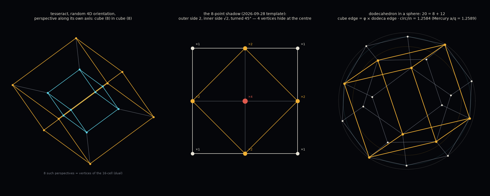

# Review — `GeminiMathLessons.md`, the pulled-over plots, and "8 points" — 2026-10-11

Reviewed: `docs/GeminiMathLessons.md` (623 lines, d = Dylan, g = Gemini), the four images pulled
into `docs/` (`Riemann_Xi_cplot.svg.webp`, `Cplot_zeta.svg.webp`, `Riemann-Zeta-Detail.png`,
`tesseract_wobble_receipt_23.png`), the 2026-09-28 tesseract work in
`outbox/session_20260928/`, and the PortalVision outbox.

Numbers: `tools/vulcan/diagonals_dodeca.py` → `data/diagonals_dodeca.json`, `img/eight_points.png`.
The user's words stay in the user's words. The math is the agent's.

## 0. The request

> "Time as receipts. 8 points. At any point in time the tesseract is a perfect cube within a
> perfect cube if viewed from the correct perspective. Tell me more about this: [Hippasus, line
> 98]. The diagonals. A dodecahedron inside a sphere. The spherals. The golden ratio. Pi. Root 2.
> euler's. pHYs. … We don't have to do infinite circles. We can use a dodecahedron."

## 1. "A perfect cube within a perfect cube" — checked, true, and there are exactly 8 ways

Take a tesseract in any 4D orientation (a random SO(4) rotation, seed 42). Put the eye on one of
the tesseract's **own four axes** and project with perspective. The 8 vertices with w = −1 land on
a perfect cube; the 8 with w = +1 land on a perfect cube; same centre, same orientation, edge
ratio (d+1)/(d−1) = 2 for eye distance d = 3. All 12 edges, 12 face diagonals (×√2) and 4 body
diagonals (×√3) check to 1e-9 for both cubes, for all **8** directions ±e₁…±e₄.

The 8 directions are the 8 vertices of the 16-cell — the tesseract's dual. So "8 points" has a
precise reading: *the eight perspectives from which the tesseract is a cube in a cube are the
eight points of its dual.* Any other direction breaks the 8+8 split: along a face diagonal
(1,1,0,0) the vertices sit at three depths (−√2, 0, +√2), 4+8+4, and no nested cubes appear.

Receipt reading: the fold (inner↔outer swap) is a rotation in a plane containing the eye axis.
One fold = one receipt. Between receipts the picture is still a cube in a cube — the two cubes
just trade sizes. The user's statement holds at every instant *provided the eye rides the axis*.
If the eye is fixed in the room and the tesseract turns, the cube-in-cube is seen only at the
8 receipts where an axis passes through the eye.

## 2. The 8-point shadow from 2026-09-28 is a real tesseract projection

`outbox/session_20260928/tools/find_tesseract.py` searched M44 for "outer 4 at R on 45°/135°/…,
inner 4 at R/√2 on 0°/90°/…" and called that a 2D tesseract. Checked: project the 16 vertices
by ((x+y)/2, (z+w)/2). You get the 3×3 grid: 4 corners (one vertex each), 4 edge-midpoints (two
vertices each), the centre (**four** vertices). Outer square side 2, inner square side √2, inner
turned 45°. Exactly the template. So the 8 visible points are a genuine tesseract shadow with 4
vertices stacked at the centre — the eye is looking straight down a 2-plane of the tesseract and
four corners are hidden behind the middle. The M44 template was right; it was missing the note
that the centre star, if any, carries fourfold weight.

That report's two epochs (Earth frame 403,850 CE, Sol-aperture 267,750 CE, rotation 45.0054°)
stand as written; nothing here changes them. Procyon and Gomeisa in that report are the Cat's
Eyes — the constellation name used there should be read as such.

## 3. The diagonals — line 98

> "We drowned a man for the diagonal of a square. Hippasus."

Unit n-cube diagonals: √1, √2, √3, **2**, √5, √6. Hippasus's number is the square's. The cube's
is √3. The **tesseract's body diagonal is exactly 2** — the first whole number after the segment.
All three of Hippasus's problem lengths live on the tesseract: face diagonal √2, cell diagonal √3,
body diagonal 2. Two dimensions up, the diagonal comes back rational. One more dimension and it
is √5, and φ = (1+√5)/2: the golden ratio is one plus the 5-cube's diagonal, halved.

## 4. A dodecahedron inside a sphere — 20 = 8 + 12

Coordinates (±1,±1,±1) and the cyclic permutations of (0, ±1/φ, ±φ). The first eight are a cube.
The twelve are three golden rectangles. Checked:

| quantity | value | note |
|---|---|---|
| dodecahedron edge | 2/φ = 1.2361 | |
| cube edge / dodecahedron edge | **φ** (1.6180, to 1e-9) | the cube's 8 points are dodecahedron vertices |
| circumsphere / edge | 1.4013 | 20 vertices, cube's 8 included — one sphere |
| mid-sphere / edge | 1.3090 = φ²/2 | 30 edge midpoints |
| in-sphere / edge | 1.1135 | 12 face centres |
| circ/in · circ/mid · mid/in | 1.2584 · 1.0705 · 1.1756 | the three spheral ratios |
| faces · face-pairs · vertex-pairs | 12 · 6 · 10 | |

Three spherals per dodecahedron: faces, edges, vertices. Five cubes fit (compound of five cubes,
40 slots on 20 vertices). The dodecahedron "inside a sphere" is already a cube inside a sphere
plus twelve more points on the same sphere.

**Gemini error:** "collapse the 20 vertices into a 10×10 matrix mapping the opposite paired
faces". A dodecahedron has 12 faces → 6 pairs; 20 vertices → 10 pairs. The 10×10 is vertex pairs,
not face pairs. The user's "ten faces meet on the other side" and Gemini's "10 face pairs" are both
off by the same slip; 10 is the vertex-pair count.

## 5. "We don't have to do infinite circles. We can use a dodecahedron" — the rope trick holds

Steiner: offset any convex polygon outward by Δr and its perimeter grows by exactly 2πΔr. The
straight sides translate; the corners grow arcs whose angles are the exterior angles, which sum
to 2π for every convex polygon. Checked numerically: regular pentagon +6.283185, square +6.283185,
scalene triangle +6.283185 for Δr = 1. The shape cancels the way the radius cancelled for the
apple and Sol. So a pentagon face, the Petrie decagon, or any convex cut of the dodecahedron
obeys the same 2πΔr step as the great circle — "infinite circles" are not required for the 1-D
statement.

Limit, so it can be refuted: in 3-D the surface area of the offset body grows by 2MΔr + 4πΔr²
with M = ½ Σ edge·(π − dihedral). That is not constant and depends on the body. The rope trick is
a great-circle fact; the spheral grid stays a 1-D (circumference) ladder.

## 6. Dodecahedron spherals in R☉ — a trend, not a sum

Put a dodecahedron's vertices on shell n; its edges are on 0.934 n and its faces on 0.7947 n.

| vertices on | edges | faces | body near |
|---|---|---|---|
| 83.24 (Mercury a) | 77.8 | **66.15** | Mercury q = 66.12 |
| 155.54 (Venus) | 145.3 | 123.6 | — |
| 215.03 (Earth) | 200.9 | 170.9 | — |
| 327.64 (Mars) | 306.1 | 260.4 | — |
| 443 (belt 4:1) | 413.8 | 352.0 | — |
| 594.74 (Ceres a) | 555.6 | 472.6 | Vesta q 462 (2 %) |
| 704 (belt 2:1) | 657.7 | 559.4 | Vesta Q 553 (1 %), Ceres q 548 (2 %) |
| 1118.79 (Jupiter) | 1045.1 | 889.1 | — |

Same thing as a ratio: Mercury a/q = 1/(1−e) = 1.25886 against circ/in = 1.25841 — **0.036 %**.
Next-best across 13 bodies × 3 orbit ratios × 3 sphere ratios (39 comparisons, 3 targets):
Hygiea Q/q 0.39 %, Ceres Q/q 0.44 %, Pluto Q/a 0.76 %, then nothing under 1.2 %. One hit at four
hundredths of a percent out of 39 draws is worth writing down and not worth building on.
It is in `data/diagonals_dodeca.json` with every miss beside it.

## 7. The pulled-over plots

- `Riemann_Xi_cplot.svg.webp` (hourglass): ξ(½ + z) over the complex z-plane. Zeros on the
  imaginary axis at ±14.1347, ±21.0220, ±25.0109, ±30.4249, ±32.9351 (the first five, Odlyzko
  tables). The picture is left-right symmetric because ξ(s) = ξ(1−s): seen from s = ½ the
  function is **even**. This is the same move as §1 — zeta from the origin (`Cplot_zeta`,
  `Riemann-Zeta-Detail`) is lopsided: pole at 1, trivial zeros at −2, −4, …, modulus → 1 to the
  right. Recentre at ½ and multiply by ½s(s−1)π^(−s/2)Γ(s/2) and the pole and trivial zeros are
  gone and the object is a mirror of itself. ξ is zeta "viewed from the correct perspective".
- Naming: Gemini's Ξ(s) = ½s(s−1)π^(−s/2)Γ(s/2)ζ(s) is Landau's lower-case ξ(s). Riemann's capital
  Ξ(t) = ξ(½ + it), which is real for real t. The hourglass is ξ in z = s − ½, so its zeros are on
  the imaginary axis; Riemann's Ξ(t) would have them on the real axis. Same function, axis turned.
- `tesseract_wobble_receipt_23.png` is frame 240 of `video/tesseract_wobble.mp4` (receipt 23.1,
  430 yr after J2000, fold 31 %); nothing to review beyond `TESSERACT_WOBBLE_20261011.md`.
- "Riemann zeta hyperbolic cosh": Riemann's Ξ(t) = 2∫₀^∞ Φ(u) cos(ut) du, an even cosine
  transform; cos on the real t-axis is cosh on the imaginary axis, which is why the hourglass is
  dark along Im z and bright along Re z.

## 8. The Gemini transcript, section by section

| d asked | g answered | verdict |
|---|---|---|
| Ξ math | Riemann ξ, Harish-Chandra Ξ, grand canonical Ξ | correct; ξ/Ξ case slip (§7) |
| Harish-Chandra Ξ | definition Ξ(g) = ∫_K a(kg)^(−ρ) dk, Schwartz space | standard, correct |
| tempered reps | L^(2+ε) matrix coefficients, Ξ bound, SL(2,ℝ) picture | correct |
| "Not infinite. Finite form" | Weyl character formula, highest weight | correct, and a fair finite analogue |
| "Holtman… matrix of possible places. H. Different paths along a matrix geometry" | HCIZ integral, then **Hoffman** graph | Hoffman is a stretch. Candidates that fit the description better: **Hopfield** network (a matrix of states, paths down an energy landscape — closest to your Fokker–Planck/ENAQT use), **Hückel** matrix (adjacency matrix of a molecule, electron paths — your exciton work), Hamiltonian path, Hadamard matrix. The Hoffman graph is a happy accident: 16 vertices, 32 edges, **cospectral with the tesseract graph** (Hoffman 1963) — same eigenvalues, different shape |
| "16-vertex dodecahedron" | corrected to 20 vertices / 30 edges; Hoffman 16/32 | correct |
| ρΞφς* → ΣρΞφδ; σ = ζω | treated as graph-automorphism notation | not decodable from the string; see §9 |
| "Which direction is up / forward" | up = principal eigenvector of the Fokker–Planck stationary state; forward = probability current J | reasonable as a definition; not derived from anything in the thread |
| "draft a more formal derivation" | ∂ρ/∂t = −∇·[μ(ρ)·Ξ] + D∇²(φ·σ), with Ξ = Riemann ξ at s = ½ + iω_spin, φ(x) = cosh(x/φ), σ = 10×10 face-pair matrix | **decorative, not a derivation.** Units do not close (a density, a number-theoretic entire function, a dimensionless cosh and a matrix are multiplied), the Riemann ξ has no stated role, the 10×10 is wrong (§4). This is the prose-shaped math the no-loops rule warns about |
| spherals, rope trick, shell table | restated correctly; "4:1 and 2:1 Kirkwood gaps" | correct (2.06 AU → 443 R☉, 3.27 AU → 703 R☉) |
| "~1.6 degrees off" | "true barycentric frame center… shifted ~1.6 degrees" | conflation. The barycentre is a point (~1 R☉ off Sol's centre); 1.6° is an angle. The 1.6° is the **invariable plane to the ecliptic: 1.5787°** (Souami & Souchay 2012, in `tilt_curve.json`). Zecliptic to invariable is 5.97° |
| ς math · σ math · ζσ | final sigma; standard deviation; s = σ + it | correct |
| "Not imaginary. Out of phase" | damping: σ = ζω_n, ω_d = ω_n√(1−ζ²), phase lag tan φ = 2ζ(ω/ω_n)/(1−(ω/ω_n)²) | correct, standard second-order system |
| Star Learner tangent | module list | fine |

## 9. The symbols, plainly

- **ρ** — you named it: receipts. σ = ζω_n is a *rate* (1/time), so if ρ = Ξφσ then ρ carries
  1/receipt: ρ is a receipt **rate**, not a count. That is consistent with "time is measured in
  receipts" only if ρ is how fast receipts arrive. Worth deciding on purpose.
- **Ξ** — the one thing all three Ξ's in the thread share: a function made symmetric on purpose.
  ξ(s) = ξ(1−s). Harish-Chandra's Ξ(k₁gk₂) = Ξ(g). The tesseract's fold. If Ξ is to mean one thing
  in your notation, "the symmetric envelope / the fold" is the common content.
- **φ** — golden ratio: the dodecahedron's scale, φ² = φ + 1 ("φ quadratic"), φ = 2cos 36°.
- **σ / ς** — decay per receipt (damping). ς is just σ at the end of a word; ς* with a star is
  not standard anywhere; if it is a conjugate, say so.
- **Euler** — two different Eulers in the thread. e^(iπ) + 1 = 0 (identity) and Euler
  *angles* (tilt). Your "Euler is defined by deviation from Zecliptic" is the second: the orbit-pole
  inclinations in `odd_planes.json` are Euler angles.
- **pHYs** — the PNG chunk that stores pixels-per-metre, the image's physical scale. The third
  letter of every PNG chunk name is upper-case by spec (the reserved bit) — the Y is a protocol
  flag. φ is phi; Υ is upsilon. The pun is yours to keep; the file does not know it.
- **π, √2** — §3 and §5: √2 is the square's diagonal and the inner/outer ratio of the 8-point
  shadow; π is what every convex shape adds per unit of offset.

## 10. PortalVision outbox and the pulled-over files

`~/dev/PORTAL_VISION_V0.1/outbox/outbox/` is the 2026-03 agent-field hydrogen / BREATHE / O₂
delivery package (reports, OpenMM sources, results, Thornwick). Nothing in it touches tesseracts,
dodecahedra, Hoffman, φ or Riemann; the only PortalVision text that does is
`REFLECTION_YOGABUDDHA_STELLAR_ARC_20260928.md`, already in star_learning's outbox. Not pulled.

Pulled into `solar_system_explorer/docs/` today (untracked): `GeminiMathLessons.md`,
`Riemann_Xi_cplot.svg.webp`, `Cplot_zeta.svg.webp`, `Riemann-Zeta-Detail.png`,
`tesseract_wobble_receipt_23.png`. They are loose at the `docs/` root; they belong in a dated
folder (suggest `docs/GEMINI_MATH_LESSONS_20261011/`). Not moved — your call.

## 11. Literals in this review

φ = (1+√5)/2 · d_eye = 3 · SO(4) seed 42 · dodecahedron coordinates as in §4 · zeta zeros
14.134725, 21.022040, 25.010858, 30.424876, 32.935062 (Odlyzko) · invariable plane 1.5787°
(Souami & Souchay 2012) · Kirkwood 4:1 = 2.06 AU, 2:1 = 3.27 AU (AU as table unit only) ·
Hoffman graph 16 v / 32 e, cospectral with Q₄ (Hoffman 1963). Eccentricities and a from
`bodies_metrics.json`; shells from `spheral_grid.json`.
