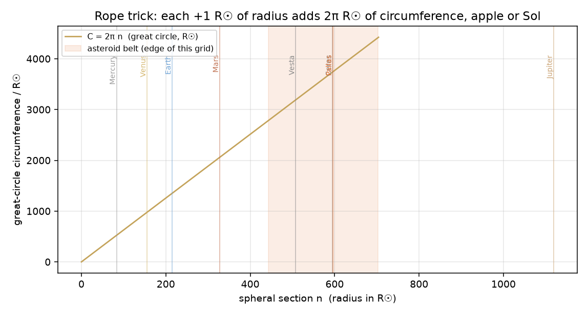

# Spheral grid — the rope trick as a sphere

**Date:** 2026-10-11 · **Unit:** 1 = Sol-centre to photosphere (695,700 km). **Edge of this grid:** asteroid belt, 443.0–703.2 R☉ (4:1 to 2:1 Jupiter). **File:** `data/spheral_grid.json` (705 shells, n = 0…704).

## The trick

A rope around an apple, lifted 1 m off the skin, needs **2π metres** of extra rope. A rope around Sol, lifted 1 R☉ off the photosphere, needs **2π R☉** of extra rope. The starting radius drops out:

```
C(r + Δr) − C(r) = 2π(r + Δr) − 2πr = 2π Δr
```
Here Δr = 1 R☉, so every step adds **6.283185 R☉** of circumference (= 4,371 km), whether you are standing on the photosphere or at the belt. That is why the grid is evenly spaced in radius and the plot of C against n is a straight line.



Shell 0 is the point at Sol's centre. Shell 1 is the bubbling surface. Shell n is the sphere of radius n R☉. The spheral section of shell n on the Zecliptic is the circle of circumference 2π n R☉.

## The grid (every 50th shell, plus the belt edges)

| n | r (R☉) | C (R☉) | ΔC from previous |
|---|---|---|---|
| 0 | 0 | 0.0000 | 0.0000 centre |
| 1 | 1 | 6.2832 | 6.2832 **photosphere** |
| 50 | 50 | 314.1593 | 6.2832 |
| 100 | 100 | 628.3185 | 6.2832 |
| 150 | 150 | 942.4778 | 6.2832 |
| 200 | 200 | 1256.6371 | 6.2832 |
| 250 | 250 | 1570.7963 | 6.2832 |
| 300 | 300 | 1884.9556 | 6.2832 |
| 350 | 350 | 2199.1149 | 6.2832 |
| 400 | 400 | 2513.2741 | 6.2832 |
| 443 | 443 | 2783.4511 | 6.2832 belt inner (4:1) |
| 450 | 450 | 2827.4334 | 6.2832 |
| 500 | 500 | 3141.5927 | 6.2832 |
| 550 | 550 | 3455.7519 | 6.2832 |
| 600 | 600 | 3769.9112 | 6.2832 |
| 650 | 650 | 4084.0704 | 6.2832 |
| 700 | 700 | 4398.2297 | 6.2832 |
| 704 | 704 | 4423.3625 | 6.2832 **belt outer (2:1) — edge of this grid** |

The full list is `705` rows in the JSON. ΔC is 6.283185 on every row except n = 0.

## Where the bodies sit on the grid (not a fit — occupancy)

An orbit *lands within 1 R☉* only if it stays inside one shell all year (q and Q in the same integer bin). The ovoids do not. The grid does not care; it just says which sections they cross.

| body | q | a | Q | shells crossed | nearest shell to a | miss (R☉) |
|---|---|---|---|---|---|---|
| Mercury | 66.12 | 83.24 | 100.35 | 66–101 (35) | 83 | +0.239 |
| Venus | 154.49 | 155.54 | 156.59 | 154–157 (3) | 156 | -0.460 |
| Earth | 211.44 | 215.03 | 218.63 | 211–219 (8) | 215 | +0.032 |
| Mars | 297.04 | 327.64 | 358.24 | 297–359 (62) | 328 | -0.360 |
| Vesta | 462.40 | 507.80 | 553.20 | 462–554 (92) | 508 | -0.202 |
| Ceres | 548.05 | 594.74 | 641.42 | 548–642 (94) | 595 | -0.264 |
| Pallas | 458.79 | 595.98 | 733.18 | 458–734 (276) | 596 | -0.017 |
| Hygiea | 599.53 | 675.52 | 751.52 | 599–752 (153) | 676 | -0.476 |
| Jupiter | 1064.65 | 1118.79 | 1172.92 | 1064–1173 (109) | 1119 | -0.211 |
| Saturn | 1940.24 | 2050.69 | 2161.15 | 1940–2162 (222) | 2051 | -0.309 |
| Uranus | 3931.29 | 4126.29 | 4321.28 | 3931–4322 (391) | 4126 | +0.286 |
| Neptune | 6410.46 | 6466.00 | 6521.54 | 6410–6522 (112) | 6466 | -0.000 |
| Pluto | 6377.61 | 8489.90 | 10602.19 | 6377–10603 (4226) | 8490 | -0.100 |

Venus is the tightest planet on the grid (q and Q three shells apart). Mercury is the loosest inside the belt (34 shells). Ceres, Vesta, Pallas, Hygiea sit in the edge band this grid was cut to include. Jupiter and everything past it are *outside* this grid — past the edge we named.

## What this is not yet

- Not a coordinate hunt (the 'land within 1 R☉' search). Occupancy first.

- Not the dodecahedron basketball hoop. The hoop goes on the sphere once the sphere is drawn.

- Not Godot. The grid is the JSON.

- Not a claim that the belt *is* the heliobarrier. The belt is the edge of the *planetary* system we are willing to section before we talk about the plasma outside.

## Literals

- `r_sol_km` = 695700.0 — photosphere; the unit
- `belt_inner_from` = bodies_metrics.asteroid_belt.a_inner_au = 2.06 — 4:1 Jupiter resonance
- `belt_outer_from` = bodies_metrics.asteroid_belt.a_outer_au = 3.27 — 2:1 Jupiter resonance
- `rope_trick` = ΔC = 2π Δr, independent of the sphere you started on — 1 m on an apple, 1 R☉ on Sol: same increment

Everything else is read from `bodies_metrics.json`.
