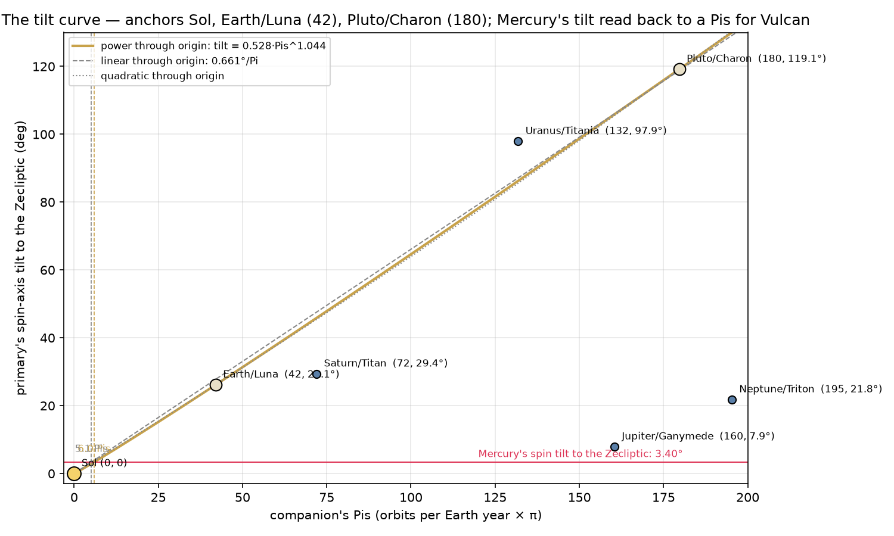
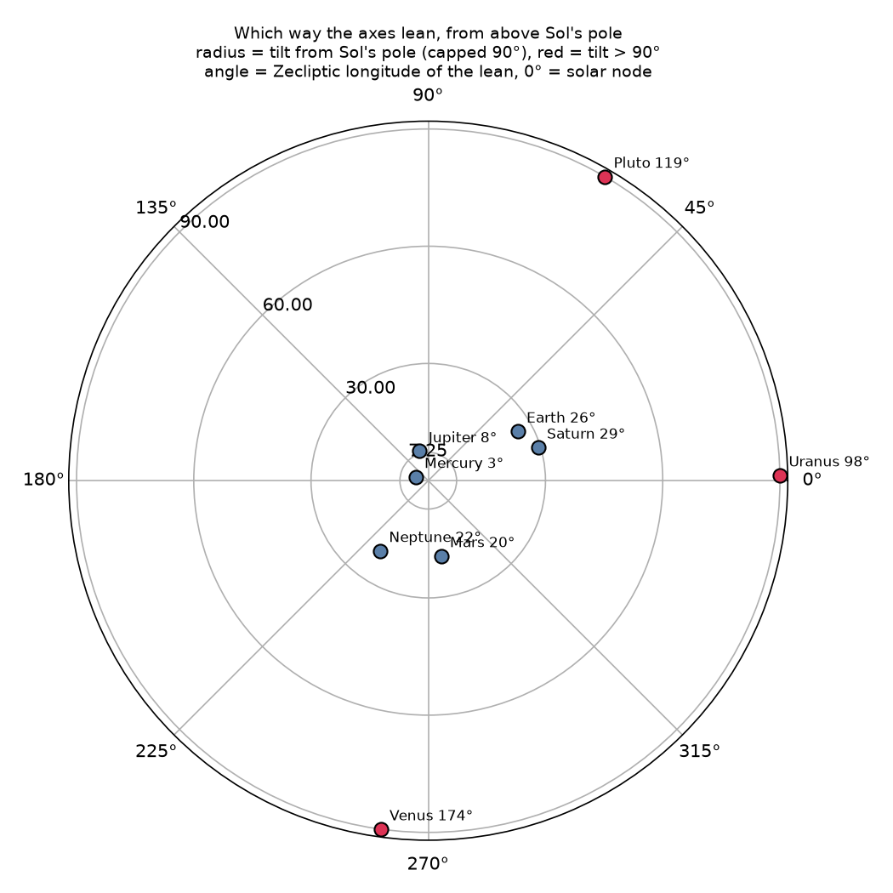

# The tilt curve — Sol 0, Earth/Luna 42, Pluto/Charon 180

**Date:** 2026-10-11 · **Numbers:** `data/bodies_metrics.json`, `data/pis.json`, `data/v4_annulus.json`, `data/vulcan_derivation.json` via `tools/vulcan/tilt_curve.py` → `data/tilt_curve.json`. Literals: the IAU 2015 pole table (Archinal et al. 2018), the invariable plane (Souami & Souchay 2012), J2000 obliquity, the classical AU in km.

Frame check: Sol's pole from (i 7.25°, Ω 75.76°) and from the IAU RA/Dec (286.13°, 63.87°) differ by 0.00°. Same pole, two sources.

## 1. Spin-axis tilts to the Zecliptic

The tilt that matters here is the angle between the body's spin pole and **Sol's** spin pole — not the familiar obliquity (which is measured to the body's own orbit) and not the tilt to the ecliptic (which is Earth's orbit). Poles are right-hand-rule (spin sense counts): the IAU table lists Venus's and Uranus's poles on the north side regardless of spin, so those two are flipped here; Pluto's IAU pole is already right-hand-rule.

| body | pole RA, Dec (J2000) | tilt to Zecliptic (Sol's pole) | obliquity to own orbit | tilt to ecliptic pole | tilt to invariable pole | lean azimuth (Zecliptic lon) | companion | companion Pis / Earth yr |
|---|---|---|---|---|---|---|---|---|
| Sol | 286.13°, +63.87° | **0.00°** | — | 7.25° | 5.97° | — | — | — |
| Mercury | 281.01°, +61.41° | **3.40°** | 0.034° | 7.04° | 6.38° | 163° | Vulcan (none on the board) | — |
| Venus | 272.76°, +67.16° | **173.58°** | 177.36° | 178.76° | 179.54° | 262° | — | — |
| Earth | 0.00°, +90.00° | **26.13°** | 23.44° | 23.44° | 23.01° | 29° | Luna | 42.0 |
| Mars | 317.68°, +52.89° | **19.54°** | 25.19° | 26.72° | 25.29° | 280° | Phobos | 3598.2 |
| Jupiter | 268.06°, +64.50° | **7.87°** | 3.13° | 2.22° | 3.45° | 106° | Ganymede | 160.4 |
| Saturn | 40.59°, +83.54° | **29.36°** | 26.73° | 28.05° | 27.34° | 17° | Titan | 72.0 |
| Uranus | 257.31°, -15.18° | **97.90°** | 97.77° | 97.72° | 96.93° | 1° | Titania | 131.8 |
| Neptune | 299.36°, +43.46° | **21.76°** | 28.32° | 28.03° | 27.23° | 236° | Triton | 195.3 |
| Pluto | 132.99°, -6.16° | **119.14°** | 122.53° | 112.82° | 113.59° | 60° | Charon | 179.7 |

The three the operator asked for: **Pluto/Charon 119.1°**, **Earth/Luna 26.1°** (23.44° to its own orbit, then the orbit's 7.25° to the Zecliptic, combined at the angle between the two lean directions — not a simple sum), **Mercury 3.40°** (its spin is locked to its orbit within 0.03°, so its tilt to the Zecliptic is its orbit's 3.38°).

## 2. The curve

Anchors: Sol (0, 0) — Sol's tilt to its own equator is zero by definition; Earth/Luna (42.0, 26.1°); Pluto/Charon (179.7, 119.1°).

| fit through the origin | form | Vulcan's Pis from Mercury's tilt | a (Earth-yr frame) | a / R_Hill | a (Mercury-yr frame) | a / R_Hill |
|---|---|---|---|---|---|---|
| power | 0.528·Pis^1.044 | **6.0** | 537,036 km | 3.06 | 207,886 km | 1.19 |
| linear | 0.661·Pis | **5.1** | 592,137 km | 3.38 | 229,215 km | 1.31 |
| quadratic | 0.6096·Pis + 2.98e-04·Pis² | **5.6** | 562,035 km | 3.21 | 217,563 km | 1.24 |

Reading Mercury's 3.40° back through the curve gives **5–6 Pis** — the operator's '5 or so, maybe 7' falls out of the two anchors he named. That is the content of the curve.

The pairs that were *not* used to draw it, against the power fit:

| pair | Pis | tilt | curve says | residual |
|---|---|---|---|---|
| Saturn/Titan | 72 | 29.4° | 45.8° | -16.5° |
| Uranus/Titania | 132 | 97.9° | 86.2° | +11.7° |
| Jupiter/Ganymede | 160 | 7.9° | 105.8° | -98.0° |
| Neptune/Triton | 195 | 21.8° | 130.0° | -108.2° |
| Mars/Phobos | 3598 | 19.5° | 2722.1° | -2702.6° |

Uranus/Titania and Saturn/Titan sit within 12–17° of a curve drawn without them; Jupiter (8° tilt at 160 Pis) and Neptune/Triton (Triton is a captured, backward-orbiting moon, so its Pis is not the same kind of number) are far off; Mars/Phobos (3,598 Pis, 19.5°) is off the right edge of the plot and off the curve. Four of seven pairs near one line through the origin is a trend worth keeping on the board; it is not a law, and it is on the board labelled as what it is: a relation drawn through the three bodies the operator chose, which two others happen to respect.

**Where 5–6 Pis puts the body.** Per Earth year: a ≈ 537,036 km = 3.1 Hill radii — outside Mercury's sphere; per Mercury year: 207,886 km = 1.19 Hill radii — still outside. The survival annulus (§19 of the report) is 13,254–81,473 km. So the curve's Vulcan and the integrator's Vulcan disagree, and the disagreement is the finding: either the Pis frame for Vulcan is not a year we have tried, or the curve's number is a clock (May–Dec 2028) rather than a place, or the body the curve points at is not bound to Mercury. All three are written down; none is chosen.

## 3. Distances re-measured with 1 AU := Sol's radius

Centre of Sol to the photosphere: R☉ = 695,700 km. One classical AU is **215.03 R☉**.

| body | a (R☉) | perihelion (R☉) | aphelion (R☉) | classical a (AU) |
|---|---|---|---|---|
| Mercury | 83.2 | 66.1 | 100.4 | 0.387098 |
| Venus | 155.5 | 154.5 | 156.6 | 0.723332 |
| Earth | 215.0 | 211.4 | 218.6 | 1.0 |
| Mars | 327.6 | 297.0 | 358.2 | 1.523679 |
| Ceres | 594.7 | 548.0 | 641.4 | 2.7658 |
| Jupiter | 1,118.8 | 1,064.7 | 1,172.9 | 5.20289 |
| Saturn | 2,050.7 | 1,940.2 | 2,161.1 | 9.53667 |
| Uranus | 4,126.3 | 3,931.3 | 4,321.3 | 19.18916 |
| Neptune | 6,466.0 | 6,410.5 | 6,521.5 | 30.06992 |
| Pluto | 8,489.9 | 6,377.6 | 10,602.2 | 39.482 |

Luna orbits Earth at 0.553 R☉; Charon orbits Pluto at 0.0282 R☉; Mercury's Hill radius at perihelion is 0.252 R☉. **Earth is 215 solar radii out; Pluto is 8,490 (6,380 at perihelion, 10,600 at aphelion).** Mercury at perihelion sits at 66 R☉ — the inner end of the barrier is 66 Sol-widths from the bubbling surface.

## 4. The birdie — which way do the axes lean?

A spin axis points at a fixed place on the sky; 'inward' or 'outward' toward Sol is a *season*, not a property — every planet's pole leans toward Sol at one solstice and away at the other. What *is* a property is the direction of the lean in the Zecliptic frame (the longitude toward which the pole tips), and whether those directions cluster.

| body | tilt | lean toward Zecliptic longitude |
|---|---|---|
| Mercury | 3.4° | 163° |
| Venus | 173.6° | 262° |
| Earth | 26.1° | 29° |
| Mars | 19.5° | 280° |
| Jupiter | 7.9° | 106° |
| Saturn | 29.4° | 17° |
| Uranus | 97.9° | 1° |
| Neptune | 21.8° | 236° |
| Pluto | 119.1° | 60° |

Mean resultant length of the nine lean directions: **0.17** (1 = all leaning the same way, 0 = uniform). The feathers of the birdie are not combed: the leans are spread around the dial, with Earth and Saturn leaning roughly together (their poles are 6.5° apart on the sky), the small-tilt planets (Mercury, Jupiter) sitting near the centre where azimuth barely means anything, and the three that have gone past 90° (Venus upside-down, Uranus on its side, Pluto/Charon on its side) tipped toward three unrelated longitudes. The honest answer to 'inward or outward' is: neither, as a set; the edges that turn hardest turn in different directions.

## 5. The Zecliptic's displacement from the solar system's normal

| plane pair | angle |
|---|---|
| Sol's equator (Zecliptic) to the ecliptic | 7.25° |
| invariable plane (total angular momentum) to the ecliptic | 1.58° |
| **Sol's equator to the invariable plane** | **5.97°** |

- Invariable plane: sum of the planets' orbital angular momenta (Jupiter ~61 %, Saturn ~25 %, Neptune ~8 %, Uranus ~5 %) from the ephemeris; its pole is fixed to ~0.01°.
- Solar equator: sunspot tracking (Carrington 1863, refined by Doppler and helioseismology) gives i = 7.25° to the ecliptic, node 75.76° (J2000).
- Angle between the two poles is the number above. It is ~6°, not ~1°. The ~1.6° figure is the ecliptic's tilt to the invariable plane — Earth's orbit, not Sol's spin.
- Sol carries ~0.5 % of the system's angular momentum in its spin; the planets' orbits carry the rest. So the 'normal' of the system is set by Jupiter and Saturn, and Sol is the body that is tipped.

So: not 1°. The 1.6° is Earth's orbit against the system's normal. Sol's spin is ~6° off that normal, and since Sol holds half a percent of the angular momentum, the system did not tip to Sol — Sol is tipped relative to the system. Why is an open question in the literature (an early stellar flyby, a lost companion, torque from a tilted primordial disc, an undiscovered outer planet have all been proposed); none is adopted here.

## Literals
- `iau_poles`: IAU WG 2015 report (Archinal et al. 2018), J2000 RA/Dec of north poles
- `invariable_plane`: i 1.5787°, node 107.5822° (Souami & Souchay 2012)
- `obliquity_j2000`: 23.439291
- `au_km`: 149597870.7
- `solar_node_deg`: 75.76
