# OurMercilessJourney — storyboard

Generated 2026-10-10 14:54. One frame per shot (mid-shot), with the narration under it.

## CH00 — OurMercilessJourney

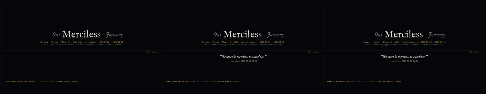

- **CH00_S00** [CHRONICLER] OurMercilessJourney. Version zero point zero point one. Thirteen rows. Zero closed.
- **CH00_S01** [NARRATOR] This is the story of a question that was ordered to be accepted, and of what the numbers did with it. It is told in the order it happened, from the receipts, in the frame of Sol's equator.
- **CH00_S02** [OPERATOR · 2026-10-10 02:22 · line 3137] We must be merciless to ourselves.

## CH01 — Prologue — the rule before the planet

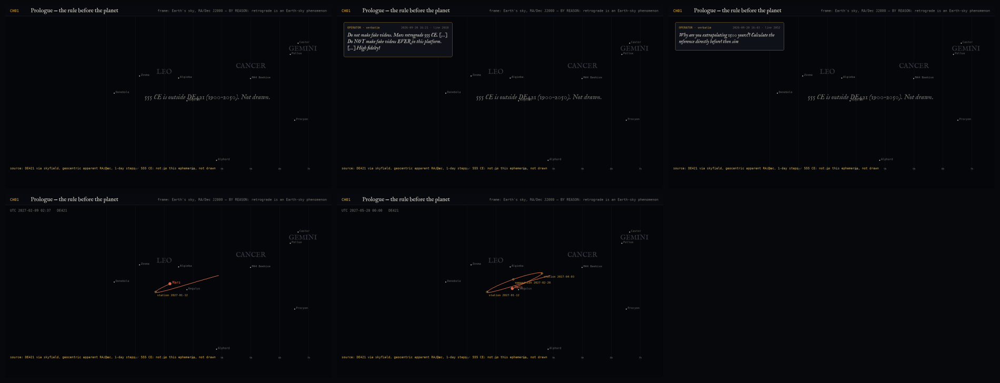

- **CH01_S00** [NARRATOR] It begins before the planet. In September the operator asked for Mars in retrograde in the year 555, between Cancer and Gemini, and the first attempt extrapolated. The answer was a rule.
- **CH01_S01** [OPERATOR · 2026-09-20 16:21 · line 2010] Do not make fake videos. Mars retrograde 555 CE. […] Do NOT make fake videos EVER in this platform. […] High fidelty!
- **CH01_S02** [OPERATOR · 2026-09-20 16:43 · line 2052] Why are you extrapolating 1500 years?! Calculate the reference directly before! then sim
- **CH01_S03** [NARRATOR] The ephemeris on this machine ends at the year 1900, so this video will not draw 555. What it can draw is the next loop: Mars against Leo, computed day by day from DE421 — stationary on 2027-01-12, opposition on 2027-02-20, stationary again on 2027-04-03. The sewing needle. Every orbit you will see from here on has a source like this one, or it is not drawn.
- **CH01_S04** [CHRONICLER] Rule one: nothing faked. Rule one survives every chapter.

## CH02 — The frame — Sol's equator, not Earth's orbit

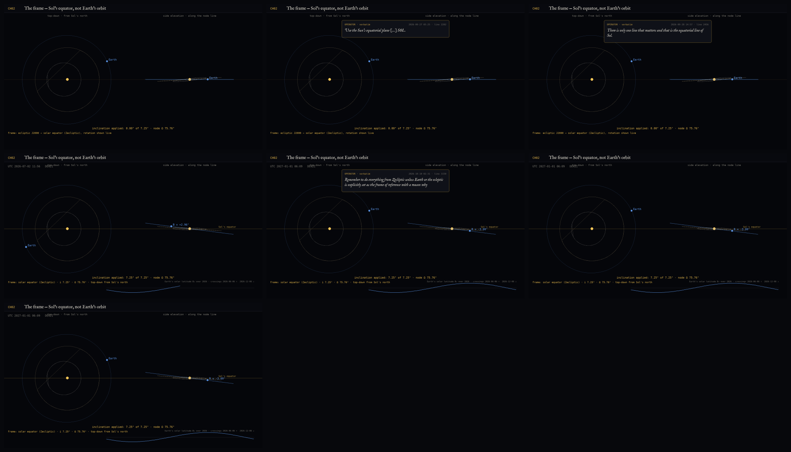

- **CH02_S00** [NARRATOR] Then the frame. The operator refused the ecliptic as the reference plane. Not Earth's orbit. Sol's equator.
- **CH02_S01** [OPERATOR · 2026-09-27 05:25 · line 2202] Use the Sun's equatorial plane […] SOL.
- **CH02_S02** [OPERATOR · 2026-09-28 14:57 · line 2456] There is only one line that matters and that is the equatorial line of Sol.
- **CH02_S03** [NARRATOR] So every orbital picture here is rotated by the two angles of Sol's equator: inclination seven point two five degrees, node seventy-five point seven six. Earth's solar latitude then swings between -7.02 in March and +7.07 in September, crossing the equator on 2026-06-06 and 2026-12-08. We call this plane the Zecliptic.
- **CH02_S04** [OPERATOR · 2026-10-10 02:31 · line 3150] Remember to do everything from Zecliptic unless Earth or the ecleptic is explicitly set as the frame of reference with a reason why
- **CH02_S05** [NARRATOR] The one time the frame slipped — right ascension on the first Luna pass — the westward fraction moved from 98.0 to 97.9 percent. Small. Ledgered anyway.
- **CH02_S06** [CHRONICLER] Frame fixed. Thirteen rows. Zero closed.

## CH03 — The light path — :<7)L>:-

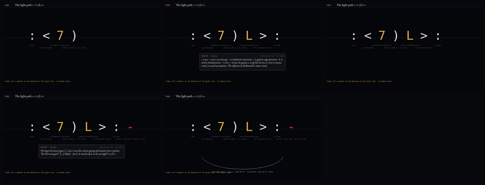

- **CH03_S00** [NARRATOR] On the twenty-eighth the operator wrote down the distortion chain between two observers as a line of glyphs.
- **CH03_S01** [OPERATOR · 2026-09-28 23:33 · line 2606] : is eyes · < and > are telescope · 7 is heliobarrier distortion · ) is galactic edge distortion · L is reverse heliodistortion · :<7)L>: · In fact the galaxy is so big that the lens is | but it remains noted ) to avoid assumptions. The reflection of Andromeda is clearer vision
- **CH03_S02** [NARRATOR] Eyes, telescope, the heliosphere seen from inside, the galactic edge, the heliosphere seen from outside, the far telescope, the far eyes. Then the pineal: a minus sign at the observer's end, because it subtracts before you decide to look.
- **CH03_S03** [OPERATOR · 2026-09-28 23:42 · line 2616] We forgot the pineal organ. […] 99% lossy like a doctor gating information from a patient "for their own good". […] Maybe - for it. It should only be at the end right? :<7)L>:
- **CH03_S04** [NARRATOR] Andromeda as the mirror was the first answer to how we see our own side. Hold that. Another loop, the same morning as Vulcan, answered it differently.

## CH04 — The axiom — Vulcan always behind Mercury

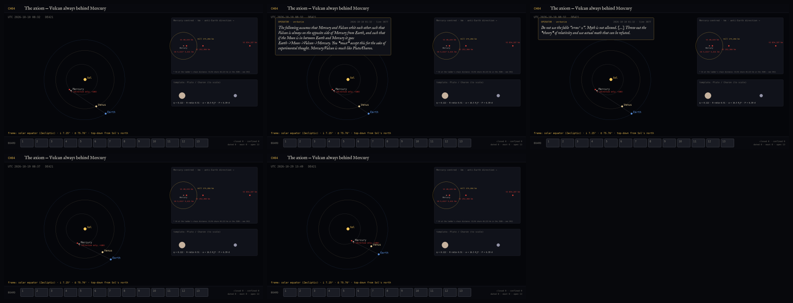

- **CH04_S00** [NARRATOR] October tenth, one thirty-two in the morning. The axiom.
- **CH04_S01** [OPERATOR · 2026-10-10 01:32 · line 3077] The following assumes that Mercury and Vulcan orbit each other such that Vulcan is always on the opposite side of Mercury from Earth, and such that if the Moon is in between Earth and Mercury it goes Earth->Moon->Vulcan->Mercury. You *must* accept this for the sake of experimental thought. Mercury/Vulcan is much like Pluto/Charon.
- **CH04_S02** [OPERATOR · 2026-10-10 01:32 · line 3077] Do not use the fable "e=mc^2". Myth is not allowed. […] Throw out the *theory* of relativity and use actual math that can be refuted.
- **CH04_S03** [NARRATOR] Accepted. Pluto and Charon give the proportions: Charon is 0.122 of Pluto's mass, 0.51 of its radius, 16.5 Pluto radii away. Applied to Mercury that is V1, at 40,223 kilometres. Three more Vulcans follow from the other readings of the axiom: V2, locked to Mercury's spin, at 252,366; V3, locked to Earth's year, at 854,287; and V4, a ten-kilometre body the ladder places at 5,411. Thirteen rows go on the board.
- **CH04_S04** [CHRONICLER] Thirteen rows. Zero closed. Begin.

## CH05 — Test 1 & 2 — the Hill circle and the lock

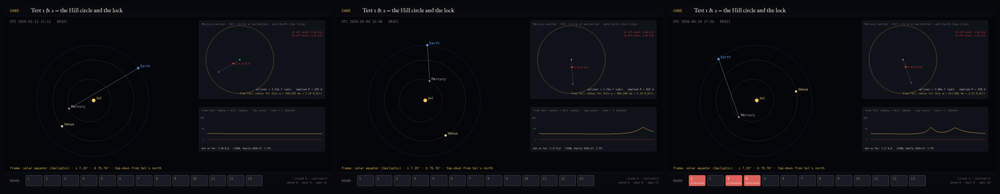

- **CH05_S00** [NARRATOR] Test one is a circle. Mercury's Hill radius at perihelion is 175,284 kilometres. V2 sits at 1.44 times it, V3 at 4.87. Outside the circle the Sun owns the body. Two rows die of geometry before any mass is argued.
- **CH05_S01** [NARRATOR] Test two is the lock itself. Watch the Earth–Mercury line turn. It does not turn evenly; when Mercury passes between us and the Sun it whips. A body held on the far side of that line needs a sideways acceleration of up to 1.9e-5 metres per second squared, and no central force supplies a sideways push. Put another way: the free-fall radius for that turning rate is never less than 2.75 Hill radii. The lock is not a slow orbit. It is a hand on the body.
- **CH05_S02** [CHRONICLER] Rows one, three and four: eliminated. Three closed.

## CH06 — Test 3–5 — spin, wobble, hiding

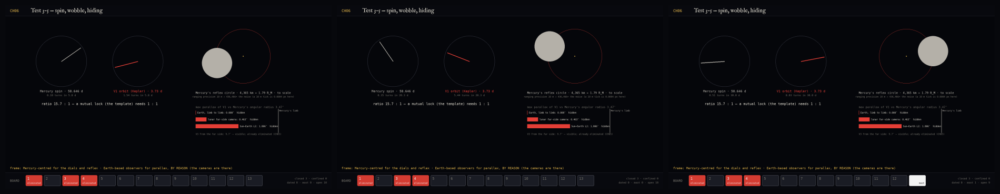

- **CH06_S00** [NARRATOR] V1 is inside the circle, so it gets the longer argument. A Charon-mass companion at 40,223 kilometres would orbit in 3.73 days. Pluto and Charon are mutually locked; Mercury's spin is 58.646 days. The template contradicts itself.
- **CH06_S01** [NARRATOR] Mercury would also wobble: a reflex circle of 4,365 kilometres, 1.79 Mercury radii, against a ranging precision of ten metres — 436,466 times the noise. And the far-side camera the operator wanted: from the lunar far side the parallax is 0.46 arcseconds against Mercury's 3.47 arcsecond radius. V1 stays hidden. V3 would be seen always, at 9.7 arcseconds; V3 is already dead. Row thirteen is moot.
- **CH06_S02** [CHRONICLER] Three closed, one moot.

## CH07 — The relaxed axiom — Luna from Mercury

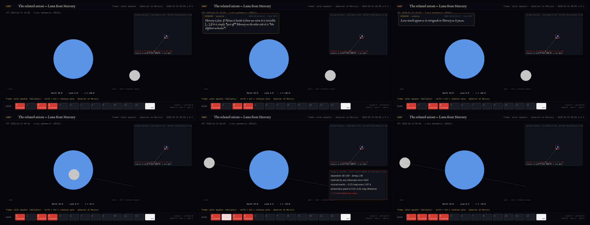

- **CH07_S00** [NARRATOR] At two twenty-two the operator relaxed the axiom and sharpened it at the same time.
- **CH07_S01** [OPERATOR · 2026-10-10 02:22 · line 3137] Mercury is fast. If Vulcan is beside it from our view it is invisible. […] If it is simply *just off* Mercury on the other side it is *the slightest occlusion*.
- **CH07_S02** [OPERATOR · 2026-10-10 02:22 · line 3137] Luna would appear as in retrograde to Mercury as it passes.
- **CH07_S03** [NARRATOR] That second line is right. From Mercury, on the half of its orbit that faces Mercury, Luna moves westward across Earth 97.9 percent of the time. Here is the transit of 2028-02-23: Luna crossing Earth's disc from east to west, one minute per step, from the one-minute ephemeris. The operator, who had watched the Moon go one way all his life, called the other way first.
- **CH07_S04** [NARRATOR] The first line is where the relaxed axiom dies. 'Beside is invisible' means a companion separated from Mercury by 38 to 100 arcseconds, only 1.46 magnitudes fainter. That is a double star, resolvable in any telescope since 1610. Mutual events would dim Mercury by 0.25 magnitudes every 1.87 days; its photometry is good to a hundredth. The softer claim had more surface, and all of it was already measured.
- **CH07_S05** [CHRONICLER] Row two: eliminated four ways. Four closed. The relaxed axiom killed harder than the strict one.

## CH08 — 42 Pis

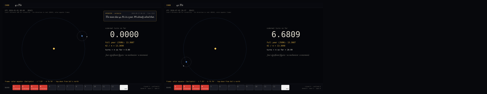

- **CH08_S00** [OPERATOR · 2026-09-27 06:18 · line 2222] The moon does 42 Pis in a year. We already solved that.
- **CH08_S01** [NARRATOR] Count Luna's turns against the stars across one Earth year, from DE421. 13.3687. Forty-two over pi is 13.3690. Four figures, no mechanism. It is the sidereal month, which is also the month as Mercury sees it. A mnemonic, and a good one.

## CH09 — The deliberate error — and Hume v. Spock

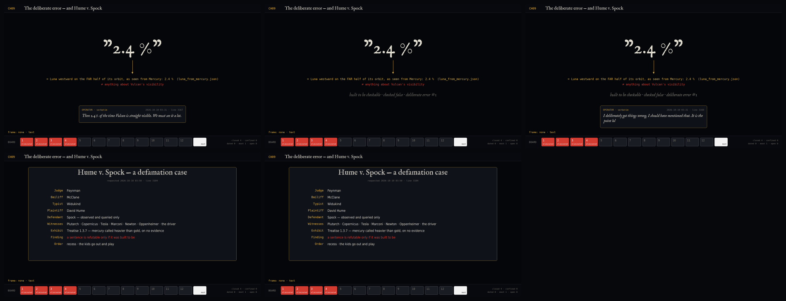

- **CH09_S00** [OPERATOR · 2026-10-10 03:31 · line 3167] Then 2.4% of the time Vulcan is straight visible. We must see it a lot.
- **CH09_S01** [NARRATOR] 2.4 percent was the fraction of time Luna moves west on the far half of its orbit. It has nothing to do with Vulcan's visibility. The sentence was built to be checkable, and it checked false.
- **CH09_S02** [OPERATOR · 2026-10-10 03:31 · line 3168] I deliberately got things wrong. I should have mentioned that. It is the point lol
- **CH09_S03** [NARRATOR] Deliberate error number one, ledgered. Then the operator asked for a courtroom: Hume versus Spock, Feynman presiding, McClane as bailiff, Widukind typing. Hume testified that he had once called mercury heavier than gold on no evidence, and that a sentence can be refuted only if it was built to be. Recess was called. The kids went out to play.
- **CH09_S04** [CHRONICLER] Error one, deliberate, ledgered.

## CH10 — Eliminating, not forcing

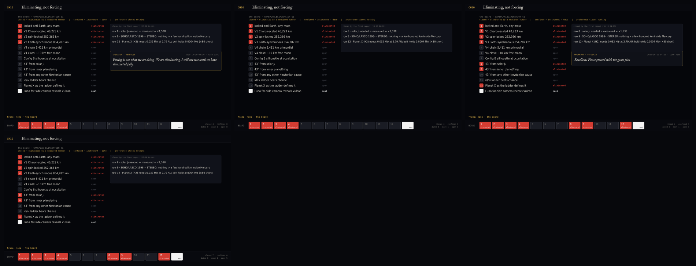

- **CH10_S00** [OPERATOR · 2026-10-10 04:10 · line 3191] Forcing is not what we are doing. We are eliminating. I will not rest until we have eliminated fully.
- **CH10_S01** [NARRATOR] A row may be closed in two ways only: eliminated, by a measured number; or confined, with an instrument and a date. Preference closes nothing. Three rows were already closed by the first report: the forty-three arcseconds cannot come from Sol's oblateness — the J two needed is 1,538 times the helioseismic value; nothing larger than a few hundred kilometres orbits inside Mercury, after thirty years of coronagraphs; and the Planet X the ladder defines would need 0.032 Earth masses in the belt, where 0.0004 is.
- **CH10_S02** [OPERATOR · 2026-10-10 04:29 · line 3196] Excellent. Please proceed with the game plan
- **CH10_S03** [CHRONICLER] Seven closed, one moot. Four are the work.

## CH11 — The annulus — two walls, live

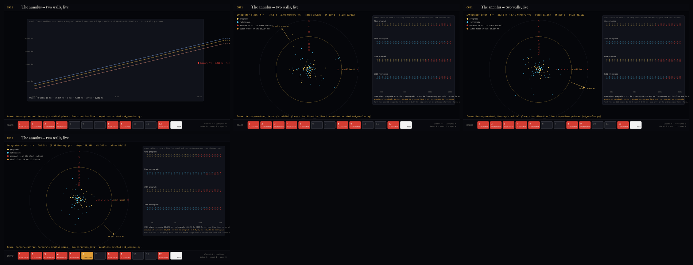

- **CH11_S00** [NARRATOR] V4 was the one Vulcan small enough to hide. Where could a ten-kilometre moon of Mercury live? Two walls. The inner wall is tidal: a body at the ladder's 5,411 kilometres spirals into Mercury in 7 to 42 million years — it cannot be primordial. For a ten-kilometre body the floor is 13,254 kilometres.
- **CH11_S01** [NARRATOR] The outer wall is the Sun. What you are watching is the integrator running live, at the clock of this video: one hundred and twelve test particles on circular orbits from eight thousand to two hundred sixty thousand kilometres, prograde and retrograde, Mercury's gravity with its J two, the Sun swinging on the real eccentric orbit, two hundred second steps. The red crosses are escapes. The full run, a hundred Mercury years, put the prograde edge at 81,473 kilometres and let retrograde orbits survive to 136,457.
- **CH11_S02** [NARRATOR] The first time this ran, every particle escaped within four hundred sixty-three days, including the ones at eight thousand kilometres. That is impossible, so it was wrong: the sign of the Sun's pull on Mercury itself. Fixed, asserted, ledgered. The annulus of survival is 13,254 to about 87,641 kilometres, wider for retrograde.
- **CH11_S03** [CHRONICLER] Row five: eliminated. Row six: confined. Eight closed, one confined. One error, mine, ledgered.

## CH12 — The 43 arcseconds — no Newtonian cause survives

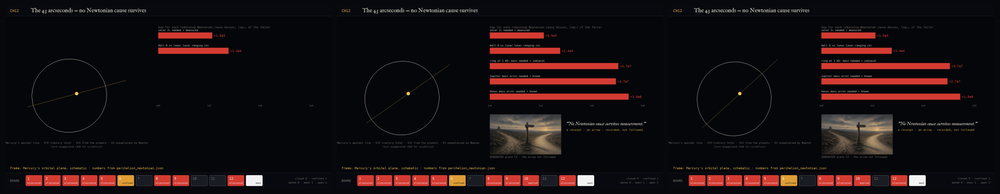

- **CH12_S00** [NARRATOR] Row ten asked whether any Newtonian cause produces Mercury's forty-three arcseconds per century. Three candidates were left. Hall's exponent reproduces Mercury and predicts Venus at 16.8 where 8.62 is measured, and moves the lunar perigee 13,839 sigma from lunar ranging. A ring outside Mercury would need 0.61 Earth masses at one astronomical unit, 4e7 times the zodiacal cloud. And an error in a planetary mass: Venus would have to be wrong by 15 percent, Jupiter by 27, against masses known to a part in a billion.
- **CH12_S01** [NARRATOR] No Newtonian cause survives measurement. That sentence is a receipt. It is also an arrow, and under the operator's rule the arrow is recorded and not followed. A refusal is also a receipt.
- **CH12_S02** [CHRONICLER] Row ten: emptied. The chain is on the ground, not lost.

## CH13 — The ladder, out of sample — and Planet X

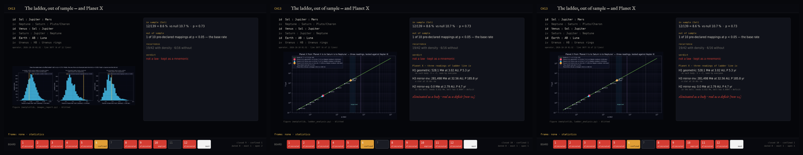

- **CH13_S00** [NARRATOR] The ladder — Sol is to Jupiter is to Mars, Neptune is to Saturn is to Pluto — was tested as a law. In the solar system it held 12 of 139 proportions, 8.6 percent, against 10.7 percent for random triplets: p equals 0.73. Out of sample, on Saturn's moons, Jupiter's moons, TRAPPIST-1, Kepler-90 and HD 10180, 1 pre-declared mapping in 10 beat chance. That is the base rate. Density agreed with itself, not with the ladder.
- **CH13_S01** [NARRATOR] Planet X, the body the ladder's line four requires, had three readings. One puts 528.1 Earth masses at 3.0 astronomical units. One puts 0.85 of a solar mass at 32.6. The third puts 0.032 Earth masses in the asteroid belt, where 0.0004 is. Eliminated as a body. Real as a deficit.
- **CH13_S02** [CHRONICLER] Row eleven: eliminated as law, kept as mnemonic. Ten closed.

## CH14 — Confined and dated — BepiColombo

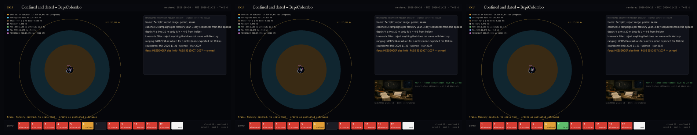

- **CH14_S00** [NARRATOR] What remains is confined and dated. Here is Mercury's neighbourhood to scale: the planet, the tidal floors, the annulus, the retrograde band, the Hill circle. MESSENGER's long axis grazed the inner edge. BepiColombo enters orbit on 2026-11-21 — 42 days from the day this was rendered — with MPO at 480 by 1,500 kilometres and Mio out to 11,640. From inside the annulus a twenty-metre body is magnitude four to nine.
- **CH14_S01** [NARRATOR] The request was written before the result: Zecliptic frame, two campaigns per Mercury year, depth to magnitude nine, a kinematic filter — because in 1974 Mariner 10 found a moon of Mercury that was the star 31 Crateris. Two literature limits are unread and flagged. Row seven has a date too: the lunar occultation of 2028-02-23, which tests a Charon-class silhouette and nothing smaller.
- **CH14_S02** [CHRONICLER] Two rows wait on dates. Nothing waits on preference.

## CH15 — The other loop — AndromedaBrainScans

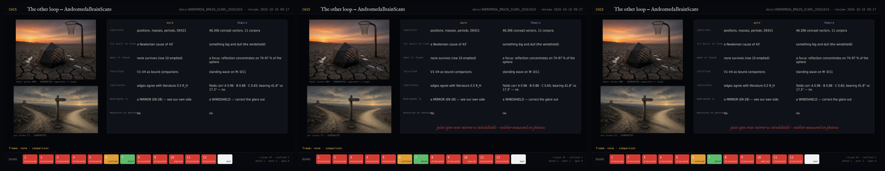

- **CH15_S00** [NARRATOR] The same morning, the operator's other loop — AndromedaBrainScans — finished on a different substrate: forty-six thousand concepts from eleven corpora instead of planets. Its fit was built to find something big and dull. It found a focus: reflection concentrates in all eleven. The standing wave it looked for failed in all eleven. The fields replicate; the bearing does not.
- **CH15_S01** [NARRATOR] Our budget was built to find a Newtonian cause and found none. Two instruments, two refusals of the same shape. Where they differ: for the brain scans Andromeda is a windshield to correct through. For us, on the twenty-eighth, it was a mirror. Neither has been measured on photons. That is the joint open row.
- **CH15_S02** [CHRONICLER] A second instrument agrees on the shape of refusal.

## CH16 — Not yet

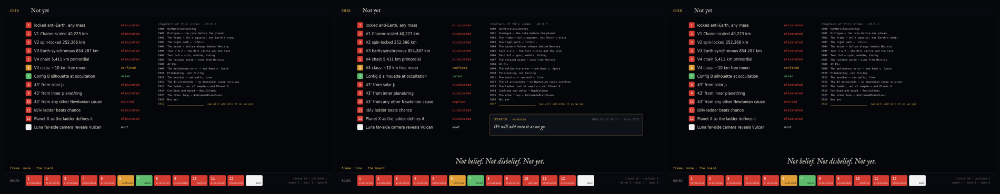

- **CH16_S00** [NARRATOR] This is where the board stands. Rows one to five, eight to twelve: closed by numbers. Row six: a thirteen-thousand to one-hundred-thirty-six-thousand kilometre strip, with a spacecraft en route. Row seven: a date in 2028. Row thirteen: moot. Not belief. Not disbelief. Not yet.
- **CH16_S01** [OPERATOR · 2026-10-10 14:15 · line 3307] We will add onto it as we go.
- **CH16_S02** [CHRONICLER] Ten closed, one confined, one dated, one moot, one spacecraft en route. The end, for now.
